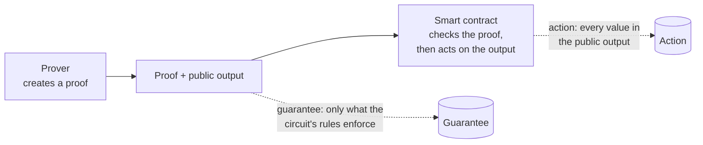
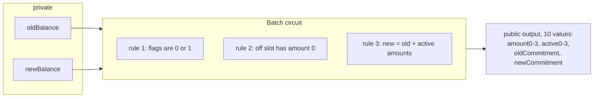
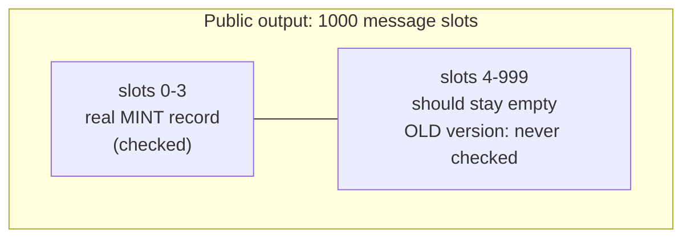
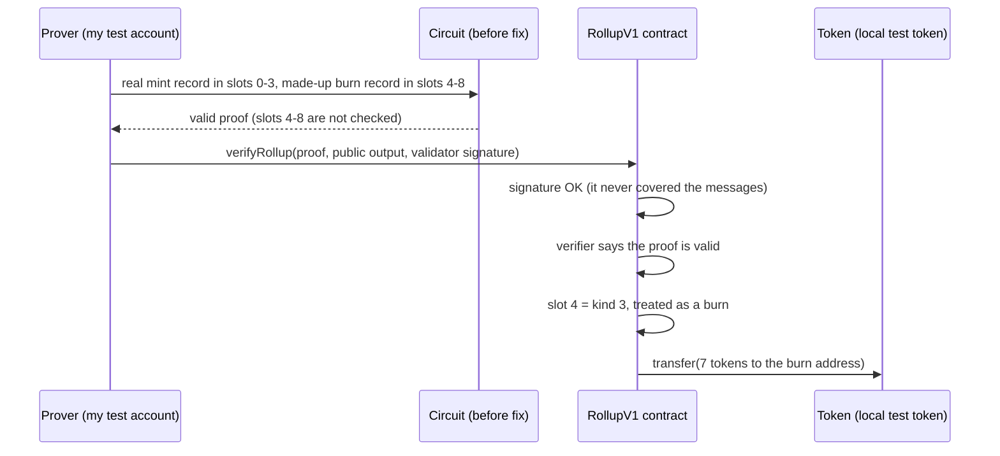

# BindCheck: weekly update

**In one paragraph.** A zero-knowledge proof lets someone show a computation was done correctly without revealing the details. A smart contract checks the proof, then moves money based on what the proof says. BindCheck asks one question: *does what the proof guarantees match what the contract does with it?* I built a small test system, reproduced a real, publicly disclosed vulnerability in the Payy project from circuit to token transfer, and confirmed that Payy's fix stops it.

**Key terms**
- **Circuit:** a list of rules (equations) that a valid computation must satisfy.
- **Proof:** evidence that someone knows inputs satisfying every rule of the circuit.
- **Public output:** the values a proof exposes. The contract reads these.
- **Verifier:** the code that checks a proof is valid.
- **Commit:** a saved snapshot of a project's code. A short code such as `c4d2c90` names one snapshot.

Contents: [1. Progress](#1-progress) · [2. Code walkthrough](#2-code-walkthrough) · [3. Next steps](#3-next-steps)

---

## 1. Progress

### 1.1 The problem



- A proof is only as strong as the circuit's rules.
- If the circuit never mentions some value in the public output, the prover can put anything there, and the proof is still valid.
- The contract reads the whole public output and acts on it: it moves tokens, records claims, and so on.
- The risk is the gap between the two: a value the circuit does not control but the contract trusts.

### 1.2 What was built

- **A small test system.** A Circom circuit for batches of deposits, two Solidity contracts that consume its proofs, and a first version of the checker.
- **A real case: Payy**
  - *Payy* is a private-payments system. It uses proofs to show a transfer is valid without revealing who paid whom or how much. Its circuits and contracts are public on GitHub, so I can study and run them.
  - *One of its circuits had a vulnerability of exactly the kind in 1.1.* Its merge circuit, `agg_agg`, exposes 1000 "message" slots. Only the first few were checked, but the contract read all of them.
  - *It was publicly disclosed* as [GHSA-fhxc-63vg-9gwr / CVE-2026-48100](https://github.com/polybase/payy/security/advisories/GHSA-fhxc-63vg-9gwr). 
  - I reproduced it on a local test chain.
  - I tested two versions of the code: `c4d2c90` (before the fix) and `dcd5d96` (after the fix). The fix adds one rule: every unused message slot must be zero. I ran the same attack on both. It worked on the first and was blocked on the second.
- **What this validates:** the whole pipeline works on real code, from circuit to contract to token balances, including the before-and-after comparison.

---

## 2. Code walkthrough

### 2.1 Circom programming

Circom is a language for writing circuits. A circuit declares **inputs** (public or private) and **constraints**: equations that must hold. This is the core of my test circuit, `circuits/batch_deposit.circom`, a batch of four deposit slots.

```js
active[i] * (active[i] - 1) === 0;                    // rule 1
(1 - active[i]) * amount[i] === 0;                    // rule 2
newBalance === oldBalance + sum;                      // rule 3 (sum of active[i] * amount[i])
```

- `===` means "this equation must hold, otherwise no valid proof exists".
- **Rule 1:** each `active` flag is 0 or 1. Those are the only numbers where `a * (a - 1) = 0`.
- **Rule 2:** if a slot is off (`active = 0`), its `amount` must be 0. This keeps unused slots empty.
- **Rule 3:** the new balance is the old balance plus the amounts of the active slots.
- **Public values** (what the contract sees): `amount[0..3]`, `active[0..3]`, `oldCommitment`, `newCommitment`, in that order. The balances stay private.



### 2.2 What a missing rule looks like

Delete rule 2 (a modified example, not the real file):

```circom
// (1 - active[i]) * amount[i] === 0;     <-- removed
```

| | Honest prover | Dishonest prover |
|---|---|---|
| Slot 2 `active` | 0 (off) | 0 (off) |
| Slot 2 `amount` | 0 | **500** |
| Balance update | ignores slot 2 | ignores slot 2 |
| Proof valid? | yes | **yes** |

- Rule 3 multiplies each amount by its flag, so an off slot adds nothing, whatever its amount.
- Nothing else forbids a non-zero amount there, so both proofs are valid.
- Whether that causes harm depends on whether the contract reads slot 2's amount. This is why the circuit and the contract must be checked together.

### 2.3 The contract that consumes the proof

`contracts/BatchConsumer.sol` is the simplest contract for this circuit. It stores one number, the current commitment, and moves it forward when given a valid proof.

```solidity
function submit(uint256[2] calldata pA, uint256[2][2] calldata pB, uint256[2] calldata pC,
                uint256[10] calldata pubSignals) external {
    uint256 stored = currentCommitment;
    if (pubSignals[OLD_COMMITMENT_INDEX] != stored) revert OldCommitmentMismatch(...);
    if (!verifier.verifyProof(pA, pB, pC, pubSignals)) revert InvalidProof();

    currentCommitment = pubSignals[NEW_COMMITMENT_INDEX];
}
```

- `pA, pB, pC` are the proof. `pubSignals` is the public output.
- **First check:** the proof must start from the commitment the contract already holds, so old proofs cannot be replayed.
- **Second check:** `verifier.verifyProof` is the cryptographic check, generated from the circuit.
- **Update:** the contract takes the new commitment from position 9 of the output.
- The contract finds values by **position**. If circuit and contract disagree about positions, the contract reads the wrong values.

`contracts/BackedBatchConsumer.sol` adds funding: each deposit slot must be paid for before a proof may use it.

```solidity
struct Escrow { uint256 amount; bool funded; bool consumed; }
mapping(bytes32 batchId => mapping(uint256 row => Escrow)) public escrows;
```

- Each deposit is identified by a batch ID and a row number. The contract tracks whether it was paid for and whether it was used.
- A proof that credits a slot nobody paid for should be rejected. Here an amount in a slot that should be empty is a real problem.
- The rules for this are written by hand in `bindcheck/spec/batch_backing.spec.json`: which values are amounts, which are flags, how a deposit is identified.

### 2.4 Payy: the circuit side

**What the circuit does**
- Payy groups private transactions into batches and produces one proof per batch.
- The circuit `agg_agg` takes two such proofs and merges them into one.
- Some transactions need the contract to act, so the proofs carry **messages**, which are instructions for the contract. Two kinds matter here:
  - **kind 2, a mint:** 4 words; registers a deposit.
  - **kind 3, a burn:** 5 words; pays tokens out to an address.

**The message array works like a form with 1000 lines**
- The merged proof's public output contains an array of 1000 message slots: the lines of the form.
- The circuit copies the inner proofs' messages onto the form, starting at line 0 and going down.
- A counter, `messages_index`, remembers the next line to write. After copying 4 words, it is 4.



**Before the fix** (`c4d2c90`, `noir/agg_agg/src/main.nr`):

```rust
if (has_ended) {
    assert(proof_message == 0, "messages cannot have gaps");
} else {
    assert(proof_message == messages[messages_index], "proof message must be exported");
    messages_index += 1;
}
```

- `assert` is a rule that must hold, otherwise no valid proof exists.
- `proof_message` is one word coming from an inner proof.
- **`else` branch (the inner proof still has messages):**
  - The rule says this word must equal line `messages_index` of the form.
  - Then the counter moves down one line.
- **`if (has_ended)` branch (the inner proof has no more messages):** the leftover words of that inner proof must be zero.
- This is the only place the circuit ever looks at the form. It checks lines 0, 1, 2, 3 as the counter passes them, then never looks again.

**The problem**
- Lines 4 to 999 are not mentioned in any rule.
- A value with no rule on it can be anything.
- So a dishonest prover can write whatever they like on those lines, and the proof is still valid.

**After the fix** (`dcd5d96`):

```rust
assert_message_tail_zero(messages, messages_index);   // called after both proofs are merged

fn assert_message_tail_zero(messages: [Field; 1000], messages_index: u32) {
    for i in 0..messages.len() {
        if i >= messages_index {
            assert(messages[i] == 0, "Message is not zero");
        }
    }
}
```

- Once all real messages are copied, the new function goes through all 1000 lines.
- Every line from the counter onward must be exactly `0`. In plain words: everything below the last real message must be blank.
- The sibling circuit `agg_utxo` already had this check, so the fix brings `agg_agg` in line with it.

**Why a tool finds this hard**
- The boundary between "real" lines and "blank" lines is the counter. Its final value is computed while the circuit runs.
- It is not a fixed position like "line 4". A tool has to work out where the counter ends up and check that the blank-line rule starts exactly there.

### 2.5 Payy: the contract side

Payy's contract is `RollupV1` in `payy-consumer/src/rollup3/RollupV1.sol`. `verifyRollup` accepts one batch of work.

```solidity
verifyValidatorSignatures(newRoot, height, otherHashFromBlockHash, signatures);
verifyAllMessages(3, publicInputs, zkVerifiers[verificationKeyHash].messages_length);
require(zkVerifiers[verificationKeyHash].verifier.verify(aggrProof, publicInputs), "...");
```

- A **validator** must sign each batch. The signature covers the new state, the block height and one extra hash. It does **not** cover the message slots.
- `verifyAllMessages` then walks **every** message slot, not only the ones the circuit filled.

```solidity
function verifyMessages(uint index, bytes32[] calldata publicInputs) internal returns (uint) {
    uint256 kind = uint256(publicInputs[index]);
    if (kind == 0)      return index + 1;                         // empty slot, skip
    else if (kind == 2) return verifyMint(index, publicInputs);   // register a deposit
    else if (kind == 3) return verifyBurn(index, publicInputs);   // pay tokens out
    else revert("RollupV1: Invalid message kind");
}
```

- A slot holding `0` is skipped. `2` is treated as a mint. `3` is treated as a burn.
- The contract cannot tell which slots the circuit really checked. It trusts whatever is in the output.

```solidity
function verifyBurn(uint i, bytes32[] calldata messages) internal returns (uint) {
    uint256 value     = uint256(messages[i + 2]);
    address burn_addr = bytes32ToAddress(messages[i + 4]);
    ...
    executeBurn(token, burn_addr, hash, value, false);   // sends `value` tokens to burn_addr
    return i + 5;
}
```

- A burn record is five slots: kind, token type, amount, a hash, and the **recipient address**.
- The contract sends `value` tokens to `burn_addr`, both taken from the record.
- Combined with the unchecked circuit slots, this is the whole problem: a record the circuit never vouched for is executed as genuine.

### 2.6 How the attack runs



- The made-up record is `[3, token type, 7, 424242, 0x…dEaD]`: a burn of 7 test tokens to a dead address. It is small and synthetic on purpose.
- Everything ran on Foundry's local chain with accounts I control.

The checking test is `payy-consumer/test/BurnPropagation.t.sol` (condensed: a few assertions merged, messages shortened):

```solidity
Result memory r = _submit(inst, candidateProof, candidatePis);   // submit proof with the extra record
assertTrue(r.ok, "settlement succeeded");
assertTrue(r.verifierCalled && r.verifierCallExact, "real verifier called with exactly this proof and output");
assertEq(post.balRollup, pre.balRollup - burnValue, "contract's token balance dropped by the burn value");
assertEq(post.balBurnAddr, burnValue, "burn address's token balance rose by the burn value");
```

- The test submits through the real contract and the real verifier.
- It reads the **token's own balances** before and after, not only emitted events, to confirm tokens really moved.
- Another test in the same file shows the validator's signature is **interchangeable** between an honest proof and the forged one, because it does not cover the messages.

| | Before the fix | After the fix |
|---|---|---|
| Can the extra record enter the output? | Yes, and a valid proof is produced | No. Building the proof fails with `Message is not zero` |
| Do tokens move to the extra address? | Yes (7 tokens) | No proof exists, so nothing is submitted |
| Does an honest batch still work? | Yes | Yes, and nothing goes to the extra address |

---

## 3. Next steps

- Build a checker that finds these gaps automatically, so it works on circuits written differently from Payy's.
- Extend it beyond the Payy bug to other kinds of proof-to-contract mismatch, such as amounts the contract trusts but the circuit does not bind.
- Test it on projects I did not use to design it.
- Compare its effort and results against a standard verification tool given the same written rules.
