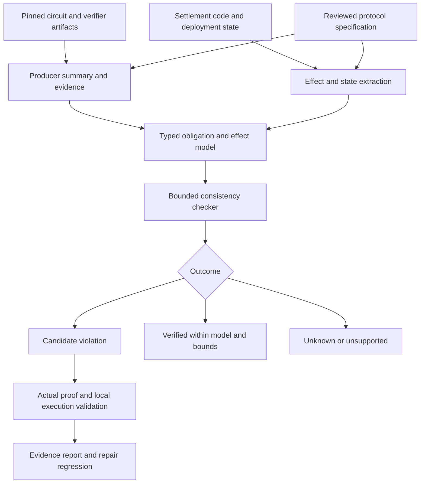

# BindCheck: A Research Guide to Proof-to-Execution Binding

**A beginner-friendly project plan, technical proposal, and paper-development guide**  
Prepared for Imran Pollob · Revised 13 October 2026 · Technical review incorporated; small-task coder workflow added

> **Historical planning document.** This guide records the plan and evidence assessment as of 13 October 2026. The authoritative current scope and evidence rules are in [`docs/research-contract.md`](docs/research-contract.md); current implementation status is in [`README.md`](README.md). Later T15–T21 work supersedes several status statements below, especially the Payy evidence and the absence of an accepted-proof execution violation.

## 1. The recommendation

**Keep the broad research goal, build a convincing first instance, and expand through evidence.** The goal is a systematic method for checking whether the security guarantees established by a ZK proof are preserved when an application interprets the proof and executes protected state changes. A narrow first implementation is a way to make progress, not the permanent boundary of the idea.

BindCheck will begin as a **specification-assisted checker for proof-to-settlement consistency**, using batched deposits and withdrawals with an EVM settlement layer as the first testbed. From that working instance, develop reusable methods for extracting proof guarantees, identifying execution requirements, and checking the connection between them. Automatic recovery of implementation facts and candidate interface correspondences is a priority research hypothesis; protocol policy remains explicit and reviewed. Extend the method to additional effects, valid transformations, and independent applications. Settlement is the first application of the broader proof-to-execution research program.

The strategy is **make it work → explain why it works → make the method reusable → broaden the evidence**. Novelty is a reason to pursue a promising idea; the architecture and experiments establish whether that idea becomes a useful research contribution. Technical difficulty should trigger a design experiment, not automatic removal from scope.

This is a proposed research contribution, not an established novel result. Acceptance cannot be assigned a reliable probability from a plan. What we can do is remove predictable rejection reasons: uncertain evidence, an overstated novelty claim, a vague algorithm, weak comparisons, circular ground truth, and results that do not generalize beyond the motivating incident.

**The central test:** Can BindCheck produce useful, independently validated findings on projects that did not shape its rules, while requiring less work or delivering better coverage than a generic verifier supplied with the same specifications?

### What this review did—and did not establish

This revision reads the supplied guide, checks incident reports and research sources, examines relevant published S&P approaches, and proposes a substantially revised methodology. It does **not** build BindCheck, run historical forks, reproduce vulnerabilities, prove the proposed theorem, establish ecosystem prevalence, or certify that no overlapping work exists. Those are research tasks with explicit acceptance criteria below.

Primary reports substantiate the Aztec Connect motivation. Some other claims need weaker labels. In particular, the Aztec 2.0 mechanism remains partly hypothetical in its own incident report. At the time of this review, the Payy advisory could not be retrieved in readable form. It was retrieved later and mapped to the local T15–T20 reproduction; use those later records rather than this document's provisional Payy assessment.

### How to use this guide

Read Sections 2–5 to understand the problem and the evidence. Use Sections 6–10 to design and build the research prototype. Sections 11–15 specify the experiments, schedule, paper, and reviewer checks. Section 16 is the source register and explains what was actually inspected. Section 18 is the detailed execution plan: follow its ordered steps, deliverables, completion gates, ten-day starting sequence, and solo-research schedule.

## 2. Understand the problem from zero

**Implementation entry point:** follow Section 19 for one small coder task at a time. Section 18 describes the overall project, not one assignment to execute in a single turn. Section 19 takes precedence over earlier larger example assignments for the day-to-day workflow.

### 2.1 What does a ZK application do?

Imagine a private payment system with a public bank account. The private system maintains users' balances. A proof tells the public smart contract that an update follows specified mathematical rules. The contract then accepts a new balance-state commitment and performs the corresponding public actions, such as consuming deposits or paying withdrawals.

There are several distinct pieces:

| Term | Plain meaning | Why it matters here |
|---|---|---|
| Circuit or constraint system | Mathematical conditions an accepted witness must satisfy | Its rules may differ from the application's intended rules |
| Witness | Values that satisfy those conditions, including private data | An adversary need not use the honest witness-generation program |
| Public inputs | The statement values against which the proof is checked | They may contain roots or hashes rather than explicit transaction details |
| Proof | Cryptographic evidence for the encoded relation | It authenticates the encoded statement, not every surrounding field |
| Verification key | Parameters used to verify proofs for a relation and proof-system configuration | Its correspondence with the analyzed circuit must be established |
| Verifier | Code checking the proof against the public inputs and key | Successful verification does not establish application-level security by itself |
| Settlement | Contract execution that applies the result | It can transfer tokens, consume a deposit, record a claim, or update a root |
| State root | A compact commitment to a larger state | Updating it can create financially significant claims without an immediate transfer |
| Nullifier or message ID | An identifier used to prevent repeated use | Identity and encoding mistakes can permit duplicate effects |

A verification key is not simply a source-code fingerprint. Compilers, configuration, setup, and proof-system details matter. Also, public inputs are not necessarily the only public information: calldata, events, and other application data can reveal additional information.

### 2.2 Why can a valid proof accompany an unsafe transaction?

Suppose a proof authenticates a withdrawal of 10 units to Alice. The settlement contract must not pay 100 units to Bob. That is the obvious direction of the problem: execution must respect authorization.

There is a second direction. Suppose a proof-backed state update creates a private balance based on a deposit. The application must actually consume the matching external deposit, or enforce a protocol rule that prevents unbacked value from becoming spendable. Accepting the balance update while skipping the required deposit action is unsafe even if no immediate withdrawal occurs.

This motivates two questions:

1. **Authorization:** Is each protected effect justified by the accepted statement and the application's other legitimate authorization rules?
2. **Coverage:** Are the external conditions required by the accepted state transition fulfilled, or preserved through a valid deferred mechanism?

“Every effect is justified by the proof” is too broad. Contracts can also execute authorized fees, administrative operations, and unrelated transfers. Define which effects belong to the proof-controlled operation and state the rules authorizing any exceptions.

### 2.3 What makes this hard?

The proof and the contract speak different languages. A circuit might expose a hash of a fixed-size batch; the contract may decode bytes and process a variable-length prefix. One side uses finite-field arithmetic, the other bounded integers and EVM execution. A payout might happen now, later, or as part of a combined transfer.

Consequently, equal array lengths are neither necessary nor sufficient for safety:

| Situation | Example | Expected judgment |
|---|---|---|
| Harmless padding | A 32-slot proof uses two active slots; all other slots are constrained to have no relevant effect | Accept |
| Dangerous omission | An active deposit row is excluded from settlement while the new root includes its credit | Flag |
| Correct aggregation | Two compatible withdrawals of 3 and 7 units are settled as one payment of 10 | Accept, if the protocol allows it |
| Wrong aggregation | The total is 10, but the payment goes to the wrong recipient | Flag |
| Correct deferral | An authorized withdrawal becomes a backed, uniquely redeemable claim | Accept within the stated safety model |
| Fake deferral | A queue entry exists, but its amount can change or it can be redeemed twice | Flag |
| Reversion | A transaction fails and all state changes revert | Do not count attempted transfers as committed effects |

These examples are explanatory designs, not newly discovered vulnerabilities.

## 3. What needs correction in the original plan?

| Original direction or claim | Revised assessment | Practical change |
|---|---|---|
| A real gap can exist between proof acceptance and settlement | Supported by primary incident evidence [1] | Keep as motivation |
| Aztec 2.0's exact root-mismatch mechanism is verified | Its primary report calls the mechanism a leading hypothesis [2] | Separate observed loss from the hypothesized mechanism |
| Payy advisory details are established | Unresolved during this 13 October review; later superseded by the advisory retrieval and T15–T20 evidence | Use T20 and the Payy case study for current evidence status |
| The integration bug class is new | Already discussed in prior work [3] | Claim an advance in method and evidence, if demonstrated |
| No formal work addresses proof/state agreement | Too broad: prior rollup modeling includes this agreement [10] | Compare concrete properties and assumptions |
| Every obligation only needs some matching effect | Allows duplicate use and incorrect aggregation | Track identities, multiplicity, quantity, and state transitions |
| Recognizing a queue proves safe deferral | Queue existence alone is inadequate | Check integrity, backing, redemption authorization, and consumption |
| Audited applications are benign controls | No finding in an audit does not establish absence | Validate each negative for the particular property |
| Every incident has a patched deployment to test | Deprecated immutable contracts may not | Distinguish vendor patches from research-authored repairs |
| A warning without a reproducing transaction is merely a lead | Some source-level defects can be established formally without a transaction | Report evidence grades instead of one binary label |
| New bugs are effectively mandatory at S&P | They are persuasive evidence, not a universal acceptance rule | Judge technical novelty and evaluation as a whole |
| A universal multi-language detector is feasible quickly | High implementation and specification risk | One automatic frontend first; disclose manual adapters |
| A corpus scan measures prevalence | A convenience sample measures findings in that sample | Report sampling limits and unknown cases |
| LLM comparison is cheap and always required | It can be useful but is neither universally required nor necessarily cheap | Include it if it answers a concrete comparison question |

The key conceptual correction is the distinction between **proof-system soundness** and **application correctness**. A sound proof system can prove a badly specified circuit. An underconstrained circuit is not automatically outside this project: it belongs when the missing relation directly explains an unsafe proof-to-settlement interaction. Breaking the cryptographic verifier itself is a separate scope.

## 4. Evidence: which cases can support the research?

### 4.1 Aztec Connect: the strongest starting point

Aztec Labs reports approximately $2.19M extracted on 14 June 2026, followed by approximately $88k on 15 June. The report distinguishes one transaction containing 14 crafted rollup calls from the later 14 separate transactions. Its technical explanation describes proof processing in groups of 32 rows while settlement uses `numRealTxs`; a deposit outside the processed prefix could affect internal state without the corresponding deposit collection. Later withdrawals extracted assets. [1]

Use this as the motivating **reported mechanism**. It is not a reproduction completed by this revision. The research must obtain the exact deployed code, historical state, proof/calldata, and execution trace, then demonstrate the missing prerequisite and subsequent effect locally. Do not mix totals, dates, transaction counts, or calls in one transaction.

### 4.2 Aztec 2.0: useful, but with a mechanism caveat

The primary report describes an approximately $2.2M incident on 17 June 2026 and identifies a circuit-level flaw. It explicitly says the exact mechanism is not provable from on-chain data alone; decoupled membership and settlement roots are its leading hypothesis. It also states that the verifier operated as intended. [2]

Treat this as a secondary case requiring circuit and key provenance work. A successful replay would confirm acceptance and effects; it would not, by itself, prove how the private witness was constructed. Do not count “stale VK,” a duplicate-root defect, and a header mismatch as three independent confirmed bugs without separate evidence.

### 4.3 Payy: historical assessment, superseded by T15–T20

The uploaded guide distinguishes a trailing-message aggregation flaw, identified as `CVE-2026-48100` / `GHSA-fhxc-63vg-9gwr`, from a reported September verifier incident. The primary advisory was unavailable during this review, but was retrieved later. T15–T20 now provide the current local reproduction, repair validation, and advisory mapping. The separate verifier incident remains outside the initial BindCheck scope. [12]

Before promotion into the dataset, retrieve the advisory, vulnerable and repaired commits, deployed or tested verifier configuration, and the actual caller/prover restrictions. Verify the affected versions and whether the issue was exploited. Do not assume the two descriptions represent either the same bug or two independent incidents. A media account can point to a case; it cannot establish the circuit semantics.

### 4.4 Additional case sources

The SNARK SoK documents integration failures, including a field-representation/nullifier example and proof-composition issues. These are leads for historical source-and-patch pairs. [3] Search its original audit and patch references rather than relabeling all its examples as settlement bugs.

The 2026 bridge-verification preprint supplies another source of leads, but its broad bridge dataset is not automatically a ZK dataset. Filter for a real proof relation, a consumer, a violated mapping, and recoverable versions. [9]

### 4.5 Use evidence grades consistently

| Grade | Required evidence | What you may say |
|---|---|---|
| Reported | Readable primary disclosure or audit | “The report describes…” |
| Source-confirmed | Exact versions and an independently checked violating path or relation | “This implementation permits…” |
| Model-confirmed | Satisfying counterexample in the declared abstract model | “The model admits…” |
| Locally reproduced | Actual verifier and relevant execution reproduce the violation | “We reproduced…” |
| Repair-validated | Attack is blocked and legitimate behavior remains functional | “The evaluated repair prevents this violation…” |
| Maintainer-confirmed | Recorded acknowledgment identifying the same defect | “The maintainer confirmed…” |

These labels describe different evidence dimensions; they are not always a strict ladder. A proof can establish a source property without a deployed exploit. Keep “reported impact,” “measured impact,” and “hypothesized impact” separate.

## 5. What published work teaches us

### 5.1 Relevant S&P approaches

The table distinguishes facts about prior work from **our methodological lessons**. These are examples of strong research construction, not a formula that guarantees acceptance.

| Work | What was checked and what it contributes | Lesson for BindCheck |
|---|---|---|
| **zkFuzz, S&P 2026** [4] | Full-text definition, design, evaluation, and ablation sections inspected. TCCT relates witness-generation traces to circuit constraints; the method searches for inconsistencies and evaluates detection, speed, findings, and component contributions | First show exactly why existing definitions or methods miss a meaningful case; then isolate the benefit of each new mechanism |
| **CCC-Check, S&P 2026** [5] | Author/publisher metadata and public implementation description inspected; PDF retrieval was blocked. Uses a Domain Consistency Model and IR-based abstract interpretation | A shared representation can be a contribution, but its semantic precision and annotation cost must be explicit |
| **Coda, S&P 2024** [6] | Official accepted-paper listing and authors' research summary inspected; full PDF was inaccessible. Uses refinement types and interactive proof support to establish circuit properties | Manual specification is legitimate; measure its cost and state exactly what the resulting proof guarantees |
| **CIVER, S&P 2024** [7] | Publisher abstract and author-group summary inspected. Uses modular transformation/deduction techniques for properties of finite-field constraints | Avoid solving an entire cryptographic circuit monolithically; evaluate modular summaries against a strong specification-driven baseline |

Do not describe all four as full-paper reviews. The access depth differs. Before the paper's final novelty statement, complete the inaccessible full-text comparisons, including their formal assumptions and artifacts.

### 5.2 The closest surrounding work

**SNARK vulnerabilities SoK, USENIX Security 2024.** It explicitly discusses integration-layer failures. BindCheck cannot claim to discover that layer. Its distinction must be a specific checked relation, extraction method, or evaluation result. [3]

**ZKAP, USENIX Security 2024.** It analyzes circuit security through program analysis. It is a relevant circuit-side comparison, particularly for defects also expressible as local constraint mistakes; claiming all such tools necessarily miss every BindCheck finding would be unfair. [8]

**Bridge verification study, October 2026 preprint.** This is substantial overlap: execution binding, unexpected inputs, replay, and trust management are already part of its taxonomy. Its full text distinguishes 1,482 classified findings from 830 source-mapped instances. Its conventional-tool comparison maps documented capabilities; that is different from running those tools on all cases. Its proposal for cross-component semantic analysis means BindCheck needs a working, differentiated technique. [9]

**Formal foundation for ZK rollups.** The inspected Alloy model includes agreement between proof, commitment, current state, and transition, alongside queue and upgrade properties. Calling it only “governance work” understates its relevance. BindCheck should explain how it checks concrete circuit/consumer implementations against such high-level requirements. [10]

**SmartAxe.** Its source/destination alignment and semantic-dependency analysis are methodological neighbors. Generic dataflow alignment alone is therefore not a sufficient novelty claim. The differentiator must involve constraint-backed meaning, required-effect coverage, and explicit value/identity conservation. [11]

**ZKP security-tools study, July 2026 preprint.** Its full text reports union detection of 32/70 isolated bugs and 11/56 buildable project-mode bugs, not 19.6% of the same 70. It does not measure false positives systematically. Use this as evidence about that benchmark's tooling limitations, not proof that current tools miss BindCheck's class. [13]

**Context-Binding Gaps in Stateful Zero-Knowledge Proximity Proofs, 2026 preprint.** This additional related work studies application context and proof reuse, including off-circuit alternatives. Thus “the first formal study of ZK application binding” is unsafe. Its proximity setting differs from settlement obligations, but the conceptual overlap must be acknowledged. [14]

### 5.3 A defensible candidate novelty statement

> We investigate specification-assisted checking of proof-to-settlement consistency in batched ZK applications. The proposed method relates constraint-backed obligations to concrete settlement effects, checks quantity and identity preservation, and distinguishes supported padding, aggregation, and deferred claims. We evaluate the additional detection and reduction in analysis effort against simpler cross-boundary checks and specification-driven verification.

This statement is deliberately conditional. Replace “proposed” only after implementation and experiments. Avoid “first,” “language-agnostic,” “fully automated,” and “end-to-end sound” unless separately justified.

### 5.4 Develop novelty through comparison

For every close paper, write one page answering: input artifacts; property; trusted assumptions; required annotations; analysis algorithm; supported cases; limitations; artifact availability. Then try to encode three representative BindCheck tasks in the strongest relevant existing method.

Use these comparisons to identify where to contribute. If an existing verifier can express the property, investigate whether BindCheck can derive the necessary obligations, reduce manual modeling, handle supported transformations, or locate a failure across components more effectively. Expressibility in a general verifier does not make a specialized method redundant. However, a new name alone does not establish an advance.

For each limitation, propose a mechanism and a discriminating experiment. If neither the mechanism nor its measured benefit survives comparison, revise it. Preserve the broad problem while improving the technical route; change the overall direction only when repeated, well-designed experiments undermine its central hypothesis.

## 6. Research questions and contributions

### Main research question

**Can we systematically connect the guarantees established by a ZK proof to the requirements of application execution, and detect when that connection fails?**

The initial operational question is: can a specification-assisted checker detect disagreement between accepted proofs and settlement effects in batched deposits and withdrawals, while accepting explicitly supported legitimate differences in batching and timing? This first question makes the broader goal testable without claiming universal support.

| Question | Experiment or argument that answers it | Result that would weaken the project |
|---|---|---|
| RQ1: What relationships must hold? | Derive a small obligation model from independently verified cases and valid designs | Each project requires unrelated, incident-specific rules |
| RQ2: Can we check them effectively? | Detect labeled violations and reject false alarms on held-out projects | Detection collapses outside the motivating families |
| RQ3: What does the method add? | Compare against simple rules, dataflow checks, and generic verification using equal specifications | A small baseline matches the full system |
| RQ4: What does it cost? | Measure onboarding, annotations, runtime, proof generation, and triage effort | Bespoke expert work dominates every project |
| RQ5: Does it matter in practice? | Scan a declared corpus and validate findings, repairs, and affected deployment conditions | Only synthetic changes are detected; practical relevance remains unclear |

Candidate contributions, contingent on results:

1. **A reusable model of proof guarantees and execution requirements.** Establish which relationships must survive across the boundary, including authorization, required-effect coverage, multiplicity, context, and supported pending obligations. Demonstrate exactly which applications the model captures.
2. **Methods for extracting, aligning, and checking those relationships.** Investigate source-linked summaries, a shared semantic representation, transformation rules, and counterexample-guided refinement. Measure the benefit and cost of the implemented mechanisms.
3. **Evidence of practical value and progressive generalization.** Begin with real source-version pairs and challenging controls; then test independent families, different mechanisms, and selected extensions. Publish reproducible results, limitations, and adaptation effort.

The taxonomy is supporting evidence. It need not be inflated into a standalone contribution.

### 6.1 Technical hypotheses to investigate

These are proposed contributions to develop, not discoveries already established by the literature review.

| Hypothesis | Candidate method | Experiment that tests it |
|---|---|---|
| Much of the boundary contract can be recovered from implementation artifacts | Slice backward from public inputs and protected effects; extract guards, encodings, dependencies, and candidate equalities | Compare against independently annotated interface facts; measure omissions, incorrect facts, and analyst correction time |
| Different failure mechanisms share useful structure | Represent proof guarantees and execution requirements as typed records connected by source-linked relations | Encode independent applications; measure reuse versus application-specific additions |
| Legitimate transformations can be modeled compositionally | Explicit rules for neutral padding, compatible aggregation, and pending-claim transitions | Paired safe/unsafe examples, unseen combinations, and rule-removal ablations |
| Checking the weakest connection can make analysis practical | Generate local verification conditions and refine only summaries implicated by candidate counterexamples | Compare with monolithic checking and fixed summaries using the same assumptions and budgets |
| Findings can explain what developers should repair | Report the missing relation with producer and consumer locations, then validate a candidate repair | Independent assessment of localization and repair tests preserving honest behavior |

Prioritize the shared representation and one effective extraction/checking mechanism. Add other methods when experiments show they solve an observed limitation. Do not build every proposed component simply to make the architecture larger.

## 7. Scope and threat model

### 7.1 Recommended first scope

Start with EVM applications that expose a recoverable proof interface and settle batched deposits or withdrawals. Implement **Circom plus Solidity** as the first automatic path if corpus reconnaissance confirms enough eligible applications. Circom is an engineering starting point, not a guarantee of sufficient target diversity. Use an explicit, manually reviewed summary for legacy C++/Barretenberg cases; do not count those as automatically analyzed circuits.

A feasibility gate should select the frontend based on actual buildable targets. If the useful corpus is predominantly Noir, switch the first frontend rather than building two incomplete ones. The architecture may support multiple adapters later; the first paper should report only demonstrated support.

### 7.1a Expansion roadmap

The research model, implemented support, and paper claims should be recorded separately. The model can anticipate broader applications; implementation support requires tests; paper claims require evaluation. An unimplemented extension remains on the roadmap rather than being silently discarded.

| Stage | Capability to establish | What should be reused | What must be added | Evidence for the next step |
|---|---|---|---|---|
| 1. Working instance | A proof-backed batch and its deposit/withdrawal effects agree | Initial typed obligations and checker | One producer adapter, one consumer path, reviewed specification | A real failure, repair, legitimate control, and meaningful baseline comparison |
| 2. Multiple mechanisms | Check amount, recipient, asset, root/context, and repeated consumption | The same relation representation and checking engine | New obligation types or predicates where necessary | Independent mechanisms detected without incident-specific hardcoding |
| 3. Realistic composition | Handle padding, aggregation, and safety-preserving deferral | Identities, quantities, source links, and condition generation | Explicit transformation rules and pending-state transitions | Hard negatives plus combinations held out during rule development |
| 4. Independent applications | Transfer beyond the development codebase | Core model, rules, report format, and engine | Application configuration and adapters | Measured onboarding effort and held-out family results |
| 5. Broader proof consumers | Test another language or a non-payment protected action | Guarantee/requirement abstraction and core checks | A language adapter or a new consumer-effect adapter | Concrete demonstration of what transfers, what changes, and where the model fails |

For Stage 5, candidate applications include a proof-authorized claim, identity-gated action, or proof-driven state update. These are target-selection ideas, not allegations of vulnerabilities or promises of support. Choose a target with recoverable artifacts and a clear shared relationship. Adding a second language tests portability; adding another effect type tests semantic generality. Neither alone establishes the other.

Select each extension based on three questions: does it expose a meaningful weakness in the current method, can a reusable mechanism address it, and can we validate the improvement? Prefer one extension answering those questions convincingly over several shallow adapters. The paper can be strong before the entire roadmap is complete if its central contribution and supported scope are established.

### 7.2 Attackers

| Capability | Included behavior | Required per-case check |
|---|---|---|
| Public submitter | Changes available calldata, submits proofs, repeats authorized operations | Is the entry point really permissionless at the evaluated block? |
| Malicious authorized prover/sequencer | Constructs any feasible witness satisfying the actual relation; selects ordering or batch contents | Does the protocol promise safety against this actor? |
| Replay adversary | Reuses proof material or semantically equivalent encodings | Which identifiers, state versions, and domains are checked? |

Do not assume control of private users' secrets, administrator keys, or validator quorums unless the specific experiment declares that capability. Authorization to submit a proof does not automatically imply authorization to steal funds. Equally, if a trusted operator is explicitly allowed to choose a policy value, its choice may not be a vulnerability.

### 7.3 Assumptions and exclusions

Assume sound cryptographic verification **for the actual deployed relation**, correct modeled EVM behavior, and stated cryptographic assumptions. Do not assume the circuit expresses the intended application policy; that is part of what must be checked or supplied as a trusted specification.

Initially exclude cryptographic proof-system breaks, trusted-setup compromise, general privacy leakage, arbitrary reentrancy, economic manipulation, and consensus/finality failures. Analyze their interaction only when it is necessary to establish a selected boundary violation. Require provenance for circuit, compiler, verification key, and consumer; unresolved provenance yields a conditional result, not a clean bill of health.

## 8. The technical idea, explained carefully

### 8.1 Replace vague “obligations” with typed records

An obligation is a protocol requirement, not merely a value that appears in calldata or an unconstrained circuit variable. Represent it using an identifier, kind, asset, quantity, beneficiary or owner, domain, state version, activation condition, and permitted discharge rule.

Examples:

| Kind | Meaning | Valid discharge |
|---|---|---|
| ConsumeDeposit | The accepted state credits value using an external pending deposit | Consume that exact authorized deposit once, or establish an equivalent protocol-defined resource transfer |
| PayWithdrawal | An authenticated burn or debit permits a payout | Pay the permitted recipient/asset/quantity, or create an authorized pending claim |
| AdvanceState | The application accepts a new committed state | Check the correct prior state and the relation governing the transition |
| ConsumeClaim | A queued claim is redeemed | Verify the claim and update consumption state atomically with the payment |

Do not expose private user details merely to fill this record. Some records will contain commitments or abstract identifiers. The analyst must state how those abstractions are related to the original semantics.

### 8.2 There are two distinct checks

**Producer check:** Do the circuit constraints actually establish the declared facts? For example, does the membership root used inside the circuit equal the public root checked by the consumer? Is an inactive slot forced to have no relevant effect?

**Consumer check:** Given only established facts and legitimate application rules, does the contract perform an allowed transition? For example, does it consume the deposit that backs the credited balance, use the same recipient and amount, and prevent repeated use?

If a manual summary asserts the missing equality, the checker will erase the bug. Every summary fact needs a provenance label: mechanically checked, independently justified, assumed, or unresolved. Count findings differently when their validity depends on unverified assumptions.

### 8.3 A formal target—not a completed theorem

Let `d` be calldata; `p(d)` the public inputs actually passed to the verifier; `w` a satisfying witness; and `R_v(p,w)` the actual relation associated with verification configuration `v`. Let `s` and `s'` be pre- and post-settlement states, and `τ` the committed execution trace. `σ` is the protocol specification. `q` tracks outstanding obligations; it can be ghost state maintained by the checker, related explicitly to concrete queues or balances.

Define:

- `Iσ(s,q)`: the resource and correspondence invariant initially holds.
- `Stepσ(s,q,d,w,τ,s',q')`: execution conforms to the authorized abstract transition.
- `T(s,d,τ,s')`: the concrete execution model admits this successful transition.

The target implication is:

```text
Iσ(s,q) ∧ AllowedContext(s,d,v) ∧ R_v(p(d),w) ∧ T(s,d,τ,s')
    ⇒ exists q': Stepσ(s,q,d,w,τ,s',q') ∧ Iσ(s',q')
```

Quantification is over the admitted pre-states, inputs, witnesses, and traces. The protocol specification must not vary after a failing example is observed. Witness dependence must be handled explicitly: two satisfying witnesses for the same public statement cannot justify incompatible externally visible effects unless the specification permits that ambiguity. Public commitments and their binding assumptions may be essential to this argument.

This implication is a research target. Defining `Stepσ` and proving a useful decomposition is substantive work. A paper cannot present the formula alone as a soundness theorem.

For fungible obligations, a useful bookkeeping rule is:

```text
outstanding_after = outstanding_before + created - discharged - validly_cancelled
```

Apply it per identity and relevant context, with no negative balances or duplicate discharge. Conservation of a global total alone is insufficient: it could hide a payment to the wrong person. Cancellation must be explicitly authorized. A deposit prerequisite cannot be “deferred” while its unbacked credit becomes freely spendable unless a sound protocol rule provides the missing backing.

### 8.4 Why the original existential matching fails

“For each effect, there exists an obligation” allows the same 10-unit authorization to justify two separate 10-unit payments. Both effects have a matching obligation, but 20 units were paid.

Require quantity-conserving, identity-preserving consumption. Many-to-one aggregation and one-to-many splitting are permitted only through specified rules. An obligation record is a consumable authorization or requirement, not an unlimited permission.

### 8.5 Padding, aggregation, and deferral

**Padding:** Neutrality is a semantic property. A zero-looking row can still alter a root, consume a nullifier, or trigger a fee. Conversely, a harmless encoding need not consist entirely of zeros. Prove the relevant projection has no protected effect under the row's activation condition.

**Aggregation:** Preserve asset, recipient, domain, identity accounting, and permitted fees. Netting is allowed only if the protocol explicitly allows it. Equal sums do not justify exchanging obligations between users.

**Deferral:** Preserve an obligation's identity, quantity, backing requirements, authorized redemption, and single-use lifecycle across transitions. A storage write or emitted event alone does not establish this. Start with a small modeled pending-claim pattern; return “unsupported” for more complex queues.

**Safety versus liveness:** Showing that a queued withdrawal cannot be stolen or duplicated is a safety claim. Showing it will eventually be paid is a liveness claim requiring assumptions about callers, schedulers, censorship, and available funds. The first version should claim safety-preserving deferral, not unconditional eventual settlement.

### 8.6 An important limitation: the specification problem

No general analyzer can infer all intended economic policy from code. BindCheck should extract mechanics automatically where possible and ask an analyst to specify selected protocol meanings. The research question is whether a small, reusable schema makes this substantially easier and more reliable than writing complete bespoke invariants.

Measure that effort. A tool with 30 minutes of reusable annotation per project is a different contribution from one that requires a week of expert modeling. Neither number is known yet.

### 8.7 Technical precision added after proposal review

**Coverage and neutrality are separate obligations.** For a simple prefix consumer with batch size `N` and limit `L`, prove `0 <= L <= N` and, for every omitted index, `i >= L => not Active(i)`, together with `not Active(i) => Neutral_sigma(i)`. The second implication alone permits an active skipped row and does not establish coverage. More general consumers may discharge a row elsewhere under an explicit protocol rule. Define neutrality over protected state-transition semantics, not an additive difference between hash roots.

**Separate obligations, permissions, and context.** Required prerequisites cannot be silently discarded. Consumable authorizations cannot justify repeated effects beyond their allowed quantity. Unused permissions may legitimately remain unused, and pending claims may persist. Root/domain compatibility is a separate typed relation. An accepted historical membership root need not equal the current root when the protocol explicitly permits historical membership. These distinctions support resource accounting without claiming that every protocol fact is a linear resource. A new calculus is a contribution only if its semantics and useful properties are established.

**Use operation-specific representation conditions.** For a direct encoding of a field element as a `k`-bit unsigned integer, require equality of canonical integer representatives and the relevant bounds, including `< p` and `< 2^k`. A truncating cast, modular reduction, byte-order change, or multi-limb encoding needs its own relation. Record overflow behavior and range constraints at intermediate operations. A generic modular-equivalence formula does not cover every conversion. The integration-layer range example in [3] motivates this work, but does not establish that every verifier accepts noncanonical inputs.

**State cryptographic abstraction assumptions precisely.** A compressing hash is not globally injective. If an analysis uses an idealized collision-free/binding summary, declare the domain and cryptographic assumption and check encoding/domain separation separately. Do not silently assert universal injectivity or discard nonlinear constraints that might control feasibility. A circuit checks a supplied preimage against a commitment; it does not unpack or invert a digest.

## 9. A buildable architecture

The architecture should have a stable core and replaceable adapters. Producer adapters expose established proof facts; consumer adapters expose protected effects and state transitions. The shared representation connects those facts to the requirements of each effect. Protocol specifications supply meanings that cannot be inferred reliably from code. Transformation rules explain legitimate changes in representation or timing. The checker and validation pipeline operate on that common representation.

Call the initial representation a **guarantee–requirement graph**: nodes are facts, obligations, effects, and relevant states; edges record relationships such as equality, commitment coverage, quantity preservation, authorization, or consumption. Every edge carries its source evidence and whether it is checked, assumed, or unresolved. The graph is a proposed engineering representation, not a novelty claim by itself. Its value must come from the extraction and checking methods it enables.

On a new application, first attempt to add an adapter and a protocol specification without changing the core. If that fails, examine whether the missing concept merits a reusable extension. Record core modifications and their reasons as part of the generalization experiment.



### Stage A: Artifact and provenance capture

Pin source commits, compiler versions, build flags, constraint artifacts, verifier bytecode/key information, proxy implementation, chain ID, historical block hash, and dependencies. Separate source-level and deployed-system results. Matching a contract name to a repository is not provenance.

**Output:** A machine-readable manifest and a record of unresolved correspondences.

### Stage B: Producer interface extraction

Recover public-input positions, encodings, activation conditions, batch boundaries, and relevant equality/range constraints. Track which bytes or rows a commitment covers. Do not try to reverse a cryptographic hash. Verify its input layout and use an explicit cryptographic summary with declared assumptions.

Begin with a narrow supported subset. Preserve finite-field semantics. A Solidity integer comparison cannot be moved into a field model without range and conversion conditions. Unsupported nonlinear reasoning or uncertain summaries must result in “unknown.”

**Output:** Producer facts with source locations, artifact provenance, and proof/assumption status.

### Stage C: Consumer extraction

**Bounded interface recovery experiment:** support explicit public fields first, then one commitment-to-batch encoding. Slice from actual verifier arguments and protected effects on the consumer side; use source mappings and compiled constraints on the producer side. Recover positions, widths, guards, order, lengths, commitment coverage, and conversion operations. Match slots through established encoding/equality relations, not identical variable names or array indices. Classify each correspondence as mechanically established, analyst-confirmed, assumed, or unresolved. Keep inferred implementation facts separate from intended protocol policy.

Evaluate recovered facts against an independently reviewed interface table on two independent implementations as an initial feasibility experiment. Measure incorrect facts, omissions, unresolved mappings, analyst correction time, and downstream detection changes. The second implementation is a transfer test, not evidence of ecosystem-wide generality. Do not promise a configuration-line limit; count template construction, comprehension, and correction effort too. Add a Noir/ACIR adapter only when corpus evidence justifies it; it does not automatically cover legacy C++/Barretenberg. Constrained and unconstrained computations must remain distinct [17].

Trace data passed into verifier calls and into protected effects. Track guards, loop bounds, decoding, internal calls, storage writes, external call results, and revert behavior. Slither IR is a candidate implementation basis, but its suitability must be tested on the chosen contracts, especially inline assembly and proxies.

Include root updates and deposit consumption, not only `transfer` calls. Token events alone are not authoritative balance changes. Initially support standard token behavior or provide an explicit asset model; fee-on-transfer and rebasing assets otherwise require additional semantics.

**Output:** A transition summary and a list of effects that could not be modeled.

### Stage D: Alignment and checking

Use the reviewed schema to align obligations with effects. Generate verification conditions for coverage, authorized parameters, consumption, and pending-state preservation. Use symbolic execution or SMT on the bounded, noncryptographic interface logic; use checked summaries for expensive cryptographic components.

A lightweight dependency graph helps locate candidates, but does not prove authorization. A value can depend on an authenticated input and still be changed incorrectly. Conversely, an authorized value may come from trusted storage rather than directly from public inputs.

**Output:** Either a violating model, bounded verification under listed assumptions, or an explicit unknown result. Never convert solver timeout into “safe.”

### Stage E: Counterexample validation

Check whether an abstract counterexample corresponds to a constructible proof and reachable local state. Abstract satisfiability is not enough if hash preimages, private secrets, or missing setup artifacts cannot be supplied.

Distinguish three validation modes:

1. Historical replay of public proof/calldata against an appropriate local historical state.
2. Newly generated valid proofs against a pinned vulnerable local build.
3. Model or reduced-example validation when actual proof generation is unavailable.

A mocked verifier is acceptable for checker development, but cannot support a claim of end-to-end exploitability. If the honest witness generator rejects an input, that does not prove the constraint system rejects it; adversarial witness construction may still be possible.

### What the first prototype should contain

**Refinement loop:** (1) extract supported facts and explicit summaries; (2) generate local verification conditions; (3) solve under recorded bounds/assumptions; (4) check a candidate against concrete circuit constraints and reachable execution; (5) diagnose any mismatch and refine the responsible abstraction. Record every refinement and its justification. Never add the desired invariant as an assumed fact merely to remove a counterexample. Missing secrets, infeasible preimages, unsupported constraints, unreachable states, and timeouts remain distinct outcomes. Failure to generate a proof does not itself establish safety. This loop is an algorithm to implement and evaluate, not an existing automatic witness-synthesis capability.

Implement typed records, one batch-coverage check, exact amount/recipient matching, and a duplicate-consumption check. Demonstrate valid padding and one safe aggregation pattern. Add a pending-claim state machine only after single-transition semantics work. Do not start with a general recursive-proof analyzer or a universal circuit decompiler.

### A research feedback loop

For each missed case or false alarm, identify whether the cause is missing evidence, extraction, alignment, an inadequate transformation rule, solver limitations, or an incorrect specification. Improve that component, test the change on development cases, and retain a separate frozen held-out set. Do not tune on the held-out results while still calling them independent validation. This loop turns early failures into method development without inflating the measured performance.

## 10. Research work packages

### WP1 — Establish the cases

Collect and pin primary evidence, then select two different failure mechanisms. Prefer cases from independent implementation families where feasible. For every case, write a one-page explanation of intended behavior, actual behavior, attacker capability, violated relation, and evidence gaps.

**Done when:** Another researcher can locate the exact evidence and distinguish what is observed from what is inferred. A case does not need a deployed exploit to qualify, but its ground-truth claim must be justified.

### WP2 — Reproduce and repair

Create local historical or source-build tests, record relevant pre/post states, and isolate the violated relation. Then test a minimal repair alongside honest operations. Research-authored repairs must be labeled as such and must not be described as official patches or deployed fixes.

**Done when:** The failure and repair behavior are explained causally, not merely shown as a failing/passing test. If code or keys are unavailable, retain an explicitly limited case rather than fabricating a complete reproduction.

### WP3 — Freeze the initial property

Write the obligation schema and valid-design rules before building the evaluation labels. Have a second qualified person challenge the assumptions. Test it against hand-worked examples of duplicate use, wrong recipient, active skipped rows, harmless padding, valid aggregation, and safe/unsafe deferral.

**Done when:** Each expected decision has a short independent explanation; no application-specific exception was inserted only to eliminate a false alarm.

### WP4 — Implement the minimum checker

Build extraction, reviewed summaries, conditions, and evidence reports. Integrate a generic symbolic checker early so the strongest baseline is not postponed until the end.

**Done when:** The tool analyzes the intended subset, exposes its assumptions, and fails explicitly outside that subset.

### WP5 — Evaluate generalization

Freeze code and configuration for the held-out experiment. Run real cases, negatives, mutations, and baselines under a predetermined budget. Investigate all false positives and missed cases, including those that favor competitors.

**Done when:** Every headline number can be regenerated from raw logs and independently adjudicated labels.

### WP6 — Find practical value and write the paper

Run the eligible project corpus, validate candidate findings locally, assess actual trust assumptions and deployment relevance, and prepare disclosure material. Only contact maintainers or send reports after the researcher authorizes that communication.

Write the introduction, threat model, and method while the work proceeds. Reserve the final stage for results, claim calibration, and artifact verification—not for beginning the manuscript.

### WP7 — Broaden the working method

After the first instance works, choose one extension from Section 7.1a. Before implementing it, state what should transfer unchanged, what new concept is needed, and how success will be measured. Implement the extension on development material, freeze it, then evaluate an independent family or withheld combination.

**Done when:** The extension works on independently evaluated material, its adaptation effort is recorded, and the paper explains whether it demonstrates portability, semantic generality, or both. If a new mechanism is required, describe and evaluate it; do not conceal it behind a claim that the original tool generalized automatically.

## 11. Dataset design that survives reviewer scrutiny

### 11.1 Use four separate datasets

| Dataset | Purpose | Ground truth and caveats |
|---|---|---|
| Historical real defects | Assess relevance and known-case detection | Pinned source, primary report, and independent semantic validation; evidence grade per case |
| Property-specific negative controls | Measure false alarms on legitimate designs | Manual or formal justification for the checked property; an audit alone is insufficient |
| Controlled mutations | Isolate failure modes and algorithm components | Compiles, is reachable, and has an independently established changed property |
| Held-out project corpus | Assess practical applicability and new findings | Initially unlabeled; no-warning projects remain unknown unless separately validated |

Planning targets, **not minimum S&P requirements or promised results**: seek roughly 6–10 verified real defects across several independent families, 12–20 justified negative scenarios, and 40–80 valid mutations. Begin a transparent search for 20–40 eligible project families; the final usable corpus may be much smaller. Report actual counts and exclusion reasons. If evidence is sparse, narrow the claim instead of multiplying cases artificially.

### 11.2 Define the unit of analysis

Distinguish a project, implementation family, deployment, source version, entry point, defect, and warning. Ten cloned contracts with one inherited defect are not ten independent discoveries. Vulnerable and repaired versions belong to the same family for data splitting.

The same underlying defect can violate multiple categories. Count unique root causes separately from category labels and affected deployments.

### 11.3 Sampling and exclusion rules

Declare the search cutoff and candidate sources before scanning: source-linked audit collections, known ZK application repositories, historical disclosures, and published datasets. Include applications with inspectable producer and consumer artifacts or explicitly classify them as summary-assisted cases.

Record every exclusion: missing source, unrecoverable version, absent setup/key material, unsupported language, build failure, duplicate family, or out-of-scope semantics. Do not choose only projects with easy proofs or only repositories already known to be vulnerable.

A public-source sample is biased toward accessible projects and disclosures. Report “confirmed findings among these analyzable projects,” not “the percentage of all ZK applications that are vulnerable.”

### 11.4 Prevent leakage and circular labels

Keep development and held-out splits at the **family level**. Freeze taxonomy definitions and matching rules before the held-out run. An independent reviewer should label or adjudicate cases without seeing BindCheck's output where practical. Record disagreements and uncertain cases.

For LLMs, public historical bugs may appear in training data. Mask incidental names where appropriate, include held-out variants, and report this limitation. Name removal cannot prove absence of contamination.

### 11.5 Mutation operators and valid controls

Candidate operators include shortening a processed prefix, changing a decoding offset, removing a binding equality, weakening an activation condition, altering a recipient/amount mapping, or omitting claim consumption. Apply only where the resulting program represents a meaningful scenario.

Reject mutants that do not compile, are unreachable, are semantically equivalent, require excluded attacker powers, or cannot produce an accepted proof under the claimed validation mode. Retain the rejection counts. Avoid hundreds of trivial descendants of one case dominating recall.

### 11.6 Example case-record template

```yaml
case_id: assigned_stable_identifier
family_id: shared_implementation_family
origin: historical_disclosure | audit | mutation | new_finding | negative_control
sources: []
source_commit: unresolved
compiler_and_flags: unresolved
circuit_artifact_hash: unresolved
verifier_and_key_provenance: unresolved
chain_and_block_hash: not_applicable_or_unresolved
attacker_capabilities: []
entrypoint: unresolved
expected_relation: plain_language_and_formal_reference
evidence_grade: reported
summary_facts_and_assumptions: []
reproduction_mode: none
repair_origin: none | vendor | research
label: unknown
label_rationale: required
reviewers_and_disagreements: []
tool_run_ids: []
disclosure_status: not_applicable
```

This template intentionally uses unresolved values. No addresses, commit IDs, or attack traces are invented by this guide.

## 12. Evaluation and baselines

### 12.1 The experiments that matter

| Experiment | What it establishes | Evidence to collect |
|---|---|---|
| Historical reproduction | The motivating mechanisms are real and correctly understood | Proof acceptance, local state changes, causal mapping, limitations |
| Vulnerable/repair comparison | The identified relation explains the failure | Violation removed; honest behavior retained |
| Held-out families | Generalization beyond development examples | Family-level results with frozen configuration |
| Legitimate complexity | Padding, aggregation, and supported deferral do not cause systematic alarms | Justified negatives and false-alarm explanations |
| Equal-specification comparison | Added value beyond a generic solver and hand-written invariant | Comparable evidence, budgets, onboarding effort |
| Ablation | Each major component contributes | Paired case outcomes and runtime changes |
| Corpus study | Practical usability and findings | Funnel from candidates to builds, analyses, warnings, confirmed issues |
| Controlled expansion | The method transfers beyond the initial scope | Fixed-core versus extended-core results, adapter effort, new annotations, and held-out mechanism/application results |

For controlled expansion, record a baseline before adding support and compare after the extension under the same budgets. Separate reuse of the model from reuse of implementation. Report any extra manual facts supplied. The objective is to show what made the broader capability possible, not simply count supported projects.

### 12.2 Use strong and simple baselines

**Baseline A: Boundary rules.** Check explicit count agreement, input use, and obvious inactive-tail conditions. This tests whether BindCheck is only a few heuristics in disguise.

**Baseline B: Cross-boundary dependency analysis.** Associate authenticated fields with protected effects using data/control flow. This isolates whether semantic matching adds value over ordinary dependency analysis.

**Baseline C: Generic verification with equal specifications.** Provide the same reviewed assumptions, invariant, bounds, and asset model to a suitable symbolic executor/model checker, such as a compatible Halmos-based harness or an alternative selected during the pilot. Include modeling time. Do not give BindCheck a detailed specification while giving the baseline only raw code.

Run two complementary comparisons: **normal workflow**, measuring each method's available automation and full analyst effort; and **equal-information checking**, supplying equivalent circuit summaries, specifications, bounds, and assumptions to isolate the checking method. In the latter, record the work required to translate summaries into the baseline's representation. Do not assume Halmos universally replaces verifier calls with `true`; inspect and record the selected version, harness, supported operations, and abstraction [16]. Extraction or effort advantages are valid outcomes even when another engine can check the same property. Never prescribe competitor misses or a BindCheck win before running the experiment.

**Baseline D: Circuit security tools.** Select compatible versions of ZKAP, Circomspect, Picus, CIVER, CCC-Check, or zkFuzz based on the actual targets. Use original project mode where possible; report isolated translations separately. Not every named tool needs to be run if it cannot answer the relevant question. Explain selection rather than adding a decorative list.

**Baseline E: Contract/bridge tooling.** Use Slither for generic contract findings and consider SmartAxe-style checks for the compatible subset. A generic tool not designed for the property is context, not the strongest competitive baseline.

**Optional baseline F: LLM-assisted review.** Give both circuit and consumer code, dependency context, the same protocol specification where applicable, a fixed output schema, and a fixed budget. Record model identifier, date, prompts, tools, sampling parameters, repetitions, tokens, and cost. Evaluate identifying the actual relation and location—not merely mentioning “binding.”

If a baseline cannot build, times out, or lacks support, record that outcome. Publish both performance on common supported cases and coverage over the full input set. Incompatibility is an applicability limitation, not a semantic false negative in the supported-subset comparison.

### 12.3 Metrics and denominators

| Metric | Definition or reporting rule |
|---|---|
| Confirmed precision | Independently validated true findings divided by adjudicated positive findings; also disclose every unresolved warning |
| Conservative precision bound | Confirmed true findings divided by all positive findings, treating unresolved items as unconfirmed |
| Recall | Detected labeled defects divided by labeled in-scope defects, reported separately for historical and mutation sets |
| Negative-control false-alarm rate | Validated-negative units receiving a false alarm divided by all evaluated validated-negative units |
| Applicability | Successfully modeled units divided by eligible attempted units, with failure reasons |
| Localization quality | Whether the report names the producer fact, consumer location, and missing relation |
| Effort | Initial annotation, debugging, adaptation, and triage time; distinguish expert from repeat-user time |
| Runtime | Extraction, solving, witness/proof generation, replay, and peak memory separately |
| Practical findings | Unique root causes, independent families, affected deployments, and confirmation/disclosure status |

Deduplicate multiple warnings for the same defect. Report case-level and family-level summaries. For small datasets show exact counts, not only percentages. Use confidence intervals where appropriate, but do not present mutation-heavy observations as independent evidence of ecosystem prevalence. If using bootstrap estimates, resample families rather than near-identical mutant files.

For randomized methods, use several independent seeds—five is a reasonable pilot starting point—and report variability and time-to-first-valid-finding. Predefine resource budgets and stopping rules.

### 12.4 Ablations

Remove one mechanism at a time: producer constraints, quantity/identity accounting, neutrality reasoning, stateful claim consumption, or counterexample validation. Keep all other inputs and budgets fixed.

Each ablation needs a relevant test set. Removing a deferral module from a dataset containing no deferred operations says nothing. If deferral is cut from the implementation, cut its claimed contribution and ablation too.

### 12.5 A result we must be willing to publish honestly

If a simple dependency check finds almost everything, inspect cases involving multiplicity, valid aggregation, stateful consumption, or producer/consumer interpretation differences to determine whether the initial dataset is too easy or the additional machinery is unnecessary. If annotation cost exceeds writing direct invariants, investigate reusable templates and fact extraction, then measure again on independent material. Let each result guide a concrete improvement rather than automatically abandoning the idea.

Also accept the result when a fair experiment continues to favor the simpler approach. Do not manufacture complex cases merely to make BindCheck win. If no previously unknown issue is found, do not relabel historical defects or research mutants as new vulnerabilities. The final paper must reflect the contribution actually demonstrated.

## 13. Timeline and decision gates

### 13.1 Quality-first schedule

Plan for approximately **10–14 weeks** for a well-supported project, adjusted after the first two weeks. This is a planning estimate, not a guarantee.

| Period | Main work | Decision or deliverable |
|---|---|---|
| Weeks 1–2 | Source verification, initial mechanism, build feasibility, closest-work comparison | Establish the first working case and identify the next technical challenge |
| Weeks 3–4 | Property, independent labels, shared representation, initial checker and baselines | Make the minimum method work and explain its contribution |
| Weeks 5–7 | Additional mechanisms, transformation rules, independent application onboarding | Develop one evidence-driven expansion; freeze the evaluation version |
| Weeks 8–10 | Held-out and controlled-expansion experiments, corpus analysis, validation and disclosure preparation | Establish generality, adaptation costs, and practical value |
| Weeks 11–14 | Remaining experiments, adversarial review, artifact and manuscript | Submit only claims fully supported by evidence |

Writing runs throughout. Maintain a results ledger, limitations list, and one-page paper argument from week one.

### 13.2 The S&P 2027 Cycle 2 decision

The official CFP lists abstract registration on **10 November 2026** and paper submission on **17 November 2026**, both at 23:59:59 AoE. From 12 October, that is roughly five weeks. The current guide alone is not evidence that this schedule is feasible. [15]

By **25 October**, require more than two reproduced cases: a differentiated method, a working pipeline, credible independent-family evaluation material, and a strong baseline already running. By **3 November**, require stable primary results and a near-complete manuscript. If these are absent, favor a later venue rather than force an under-evaluated submission.

These dates are project gates, not conference rules. Existing reproducible work can shorten the schedule, but only after its artifacts are inspected. This revision does not assume that previously mentioned replays are available or complete.

### 13.3 Research decisions: improve before discarding

| Finding | First research response | Evidence that would justify a larger change |
|---|---|---|
| Closest work expresses the same property | Investigate better extraction, transformation handling, composition, or analyst effort | No distinct useful capability or advantage remains after fair comparison |
| Only one family currently works | Separate reusable semantics from case-specific logic and build a second adapter | Independent applications repeatedly require unrelated bespoke analyses |
| Circuit/key artifacts are unavailable | Recover alternate versions or choose another buildable application; retain the original as contextual evidence | No realistic target supports the validation needed for the intended claim |
| Summaries require heavy expert effort | Add reusable templates, candidate fact extraction, and source-linked review | Measured effort remains excessive and no practical advantage is established |
| Current findings are local circuit defects | Use them to validate extraction, then investigate effects and prerequisites requiring consumer context | Cross-boundary analysis adds no meaningful capability on a justified corpus |
| Mutations dominate the benchmark | Acquire independently evidenced cases and difficult valid designs | The real-world relevance of the selected mechanism cannot be substantiated |
| Strong baselines match the tool | Diagnose the bottleneck; test targeted method improvements and effort benefits | Repeated controlled experiments show no substantive advantage |

Set a bounded experiment for each response, with a written hypothesis and outcome. Persistence means learning and improving, not endlessly changing the benchmark. Postponing a submission deadline is separate from abandoning the research goal. Ideas that are not yet implemented remain in the expansion backlog with their dependencies and evidence requirements.

## 14. How to turn the project into a convincing paper

### 14.1 Working title

**Research-program title:** BindCheck: Connecting ZK Proof Guarantees to Application Execution

**Initial paper title:** BindCheck: Checking Proof-to-Settlement Consistency in Batched ZK Applications

Use “Checking” while guarantees are bounded or conditional. “Verifying” can be appropriate if the proved scope and assumptions justify it. Avoid a title suggesting all ZK applications or all execution-binding failures are covered.

Broaden the paper title when the evaluated extensions support it. The research-program title expresses the ambition; the submitted title describes the demonstrated contribution. The manuscript should explain how its first working scope leads to reusable methods without presenting roadmap items as completed results.

### 14.2 The paper's argument

The introduction should establish five points in order: a concrete security failure; the exact missing relation; why the strongest existing approach leaves a practical gap; the new technique that addresses that gap; and measured evidence that it works beyond the motivating example.

Do not write “both components are correct” unless correctness is relative to explicitly different specifications. A clearer statement is: **proof acceptance and local contract checks can both succeed while the composed application violates its resource policy.**

### 14.3 Suggested manuscript structure

| Section | Job of the section | What reviewers need to see |
|---|---|---|
| Introduction | Establish problem, gap, and evidence-backed contributions | A specific failure and a precise advance |
| Background and motivating case | Explain proof interfaces and settlement | A trace linked to real artifacts |
| Scope and threat model | Define adversary, trusted components, and exclusions | No hidden malicious-operator assumptions |
| Consistency model | Define obligations, consumption, and pending state | Counterexamples to weak matching and explicit valid cases |
| Method and implementation | Explain extraction, summaries, checking, and validation | Algorithms, support boundaries, annotation burden |
| Evaluation | Answer the RQs | Fair baselines, held-out families, negatives, errors, costs |
| Findings and discussion | Establish significance and limitations | Evidence grades, deployment relevance, disclosure status |
| Related work and conclusion | State the demonstrated difference | No inflated “first” claims |

Keep the essential method and results in the main text. Put extended cases, proofs, raw tables, and configuration details in appendices/artifacts without making the central argument depend on them.

### 14.4 Figures and tables worth creating

1. A motivating trace linking proof-accepted rows, contract processing, and the missing resource action.
2. The architecture, with manual inputs and assumed summaries visually distinguished.
3. A lifecycle figure for creation, aggregation, pending state, and one-time discharge.
4. A prior-work matrix comparing actual inputs, properties, annotations, and guarantees.
5. A dataset funnel showing exclusions and build/analysis failures.
6. Paired results on vulnerable and repaired versions, plus hard negatives.

Avoid decorative diagrams. Each visual should answer a likely reviewer question.

### 14.5 The strongest objections and the necessary response

| Reviewer objection | Evidence needed before submission |
|---|---|
| “This is ordinary invariant checking with a new name.” | Equal-specification comparison plus a concrete extraction, automation, scalability, or usability advantage |
| “Your annotation contains the answer.” | Independent specification, documented provenance, held-out application onboarding |
| “The formal statement is a restatement of correctness.” | A useful decomposition, algorithm, and precisely scoped guarantee |
| “You detect circuit bugs already handled by existing tools.” | Compatible circuit-tool results and cases requiring consumer context |
| “All bugs come from one codebase.” | Independent-family evaluation or narrower claims |
| “Your verifier stub allows impossible attacks.” | Actual proof/verifier validation or explicit model-only classification |
| “Safe examples are just audited projects.” | Property-specific negative validation |
| “You call timeouts safe.” | Separate unknown outcomes and coverage accounting |
| “The queue check does not prove eventual payment.” | A safety-only claim or an explicit liveness proof with assumptions |
| “Your corpus is biased.” | Sampling protocol, exclusions, family deduplication, restricted interpretation |
| “The new result is already in recent work.” | Completed side-by-side novelty analysis, including 2026 preprints |
| “The fixes just reject everything.” | Honest-operation regression tests and preserved supported behavior |

### 14.6 Submission administration, kept separate from scientific quality

As checked on 12 October, the CFP permits 13 main-text pages and 18 total including references/appendices, uses anonymous `conference,compsoc` submissions, and requires ethics and generative-AI disclosures. It fixes registration information at the abstract deadline, requires a draft 24 hours before submission closes, and generally imposes a one-year S&P resubmission wait after rejection. Vulnerability disclosure is due by rebuttal unless an exception is granted. Artifacts should be anonymized and frozen at submission. Recheck the complete CFP before registration. [15]

These requirements do not substitute for novelty or evidence. There is no universal rule requiring one new vulnerability for acceptance.

## 15. Working with an AI coder and maintaining research integrity

### 15.1 Divide responsibility clearly

The AI coder can retrieve public source material, prepare pinned builds, write extraction code, implement tests, run experiments, and assemble reports. The human researcher owns scope, semantics, threat assumptions, ground-truth decisions, disclosure, and final claims. AI output is an implementation proposal or analysis lead until checked.

A second qualified human review is preferable for circuit facts and labels. If unavailable, disclose that limitation; running the same model twice is not independent expert validation.

### 15.2 Give tasks with observable completion criteria

Example first assignment:

> Work on the evidence and local reproduction of the selected historical case. Read the primary report, recover the exact source and deployed-artifact references, and create a manifest recording confirmed and unresolved facts. Build a local test that checks actual proof verification and the relevant state changes. Do not use a mocked verifier to claim exploitability. If source, historical state, or proof artifacts are unavailable, report the blocker and preserve partial evidence. Then propose a minimal research repair and test both the reported failure and legitimate behavior. Record commands, versions, logs, assumptions, and validation mode. Do not submit transactions to live networks or contact maintainers as part of this task.

Follow with separate tasks for the producer fact table, consumer effect table, small checker, baseline, and held-out experiment. Require each task to return changed files, commands run, measured outputs, and unresolved questions.

### 15.3 Maintain a claim ledger

| Field | Example content |
|---|---|
| Claim | “The checker detects a skipped required deposit.” |
| Evidence | Case ID, tool run, local trace, reviewed invariant |
| Assumptions | Pinned summary, token model, bounded trace length |
| Status | Proposed / source-supported / measured / independently reviewed |
| Paper location | Section and figure/table that will use it |
| Failure condition | What new evidence would invalidate the claim |

Never write results into the paper from memory. Generate tables from preserved logs. Keep annotations and repairs versioned. A failed experiment and an unsupported case are research outcomes, not cleanup to hide.

### 15.4 Ethical testing and disclosure

Use owned local builds or isolated historical forks for destructive tests. Record permission and threat assumptions. Prepare coordinated disclosure for previously unknown vulnerabilities; do not publish actionable details for unmitigated funded contracts simply to meet an artifact deadline. For immutable deployments, discuss residual risk and available protective actions with the relevant parties after communication is authorized.

Preserve an internal complete evidence package and a separate anonymized release package. Disclose substantive AI assistance accurately, including code, analysis, and experimental roles, rather than describing all use as proofreading.

### 15.5 Your first seven working days

| Day | Task | Tangible output |
|---|---|---|
| 1 | Read the motivating primary report; complete the claim ledger and case manifest | One precise case explanation with unresolved facts |
| 2 | Recover pinned source, verifier artifacts, and historical context | Build/replay feasibility assessment |
| 3 | Obtain a local trace or record the exact blocker | Evidence-graded reproduction package |
| 4 | Test a minimal repair and honest behavior | Causal explanation and regression results |
| 5 | Formalize typed obligations on the case and five valid/invalid toy scenarios | Initial specification with reviewer comments |
| 6 | Implement the simplest check and an equal-specification baseline | First comparative result, even if unfavorable |
| 7 | Attempt a second independent family; identify what transfers and what fails | Next design experiment and expansion backlog |

The goal of this first week is not a complete detector. It is evidence that a general method is both necessary and feasible.

## 16. Source register and verification limits

Links below are primary research, author, maintainer, or official venue sources unless explicitly marked as inaccessible leads. Access was checked on 12 October 2026. Published venue status is separated from preprint status. This was a targeted review, not a completed systematic literature review covering every 2022–2026 publication or audit.

1. **Aztec Labs. Aztec Connect Incident.** Primary report; technical mechanism and timeline read. [Report](https://aztec-labs.com/blog/aztec-connect-incident.html). Used for reported facts, not a claim of local reproduction.
2. **Aztec Labs. Aztec 2.0 Rollup Incident.** Primary report; read, including its explicit mechanism uncertainty. [Report](https://aztec-labs.com/blog/aztec-2-incident.html).
3. **Chaliasos et al. SoK: What Don't We Know? Understanding Security Vulnerabilities in SNARKs. USENIX Security 2024.** Full-text integration, defense, and example sections inspected. [Paper](https://arxiv.org/html/2402.15293v1).
4. **Takahashi et al. zkFuzz: Foundation and Framework for Effective Fuzzing of Zero-Knowledge Circuits. IEEE S&P 2026.** Full-text v3 inspected; avoid mixing statistics from earlier versions. [Paper](https://arxiv.org/html/2504.11961v3), [project](https://zkfuzz.xyz/), [official accepted papers](https://sp2026.ieee-security.org/accepted-papers.html).
5. **Kolozyan et al. Language-Agnostic Detection of Computation-Constraint Inconsistencies in ZKP Programs via Value Inference. IEEE S&P 2026.** Author abstract and implementation documentation inspected; full PDF retrieval blocked. [Paper record](https://eprint.iacr.org/2025/2120), [CCC-Check](https://github.com/ArmanKolozyan/CCC-Check).
6. **Liu et al. Certifying Zero-Knowledge Circuits with Refinement Types. IEEE S&P 2024.** Method summary and venue checked; full PDF inaccessible. The arXiv record was withdrawn for submission-location reasons, so use the publication/ePrint reference rather than treating that withdrawal as retraction of the published work. [ePrint](https://eprint.iacr.org/2023/547), [author publication page](https://junrui-liu.github.io/research/), [official accepted papers](https://sp2024.ieee-security.org/accepted-papers.html).
7. **Isabel, Rodríguez-Núñez, and Rubio. Scalable Verification of Zero-Knowledge Protocols. IEEE S&P 2024.** Publisher abstract and author-group summary checked; not a full algorithm reproduction. [Publisher](https://ieeexplore.ieee.org/document/10646792/), [author-group publications](https://costa.fdi.ucm.es/web/publications.php).
8. **Wen et al. Practical Security Analysis of Zero-Knowledge Proof Circuits. USENIX Security 2024.** Accessible paper; relevant circuit-analysis baseline. [PDF](https://www.usenix.org/system/files/usenixsecurity24-wen_1.pdf).
9. **Wang et al. Understanding Verification Vulnerabilities in Cross-chain Bridges: An Empirical Study. arXiv preprint, submitted 9 October 2026.** Full-text taxonomy, dataset, evaluation methodology, and discussion inspected. [Paper](https://arxiv.org/html/2610.13170v1). Treat as a preprint; independently validate any reused case.
10. **Towards a Formal Foundation for Blockchain ZK Rollups.** Full-text model and relevant consistency/queue passages inspected. [Version 3](https://arxiv.org/html/2406.16219v3). This guide uses the inspected version without relying on the uploaded guide's unverified venue label.
11. **SmartAxe: Detecting Cross-Chain Vulnerabilities in Bridge Smart Contracts via Fine-Grained Static Analysis.** Full-text alignment and semantic-checking approach inspected. [Paper](https://arxiv.org/html/2406.15999v1).
12. **Payy advisory.** [GHSA-fhxc-63vg-9gwr](https://github.com/polybase/payy/security/advisories/GHSA-fhxc-63vg-9gwr), [NVD lookup](https://nvd.nist.gov/vuln/detail/CVE-2026-48100). The advisory was not readable during the 13 October review, but was retrieved later and mapped in T20. Use T20 and `docs/payy-case-study.md` for current evidence. The separate verifier incident is not part of the initial BindCheck scope.
13. **Kolozyan, Sorger, Hicks, and Chaliasos. ZKP Security Tools and Verification: Coverage, Effectiveness, Adoption, and Challenges. July 2026 preprint.** Full-text methodology and results inspected. [Paper](https://arxiv.org/html/2607.23752v1), [artifact](https://github.com/t-sorger/zkp-security-tools).
14. **Ootani. Context-Binding Gaps in Stateful Zero-Knowledge Proximity Proofs: Taxonomy, Separation, and Mitigation. 2026 preprint.** Version 1 model and scope inspected; publication acceptance not established. [Paper](https://arxiv.org/html/2604.03900v1).
15. **IEEE S&P 2027 Call for Papers.** Official deadlines, submission, disclosure, and AI-use rules checked. [CFP](https://sp2027.ieee-security.org/cfpapers.html).

16. **Halmos project documentation.** [Repository](https://github.com/a16z/halmos), [external-call/error documentation](https://github.com/a16z/halmos/wiki/errors). Consulted in the 13 October proposal review; not a completed baseline execution. External-call handling and limitations depend on the actual harness/version, not a blanket always-true rule.
17. **Noir unconstrained functions documentation.** [Documentation](https://noir-lang.org/docs/language/unconstrained). Consulted in the 13 October proposal review for the distinction between unconstrained witness computation and constraints establishing correctness.

### Remaining verification before a submission-level novelty claim

**Corpus refinement:** treat [3] and [9] as leads, then follow original audits, vulnerable/repaired versions, and forward searches through 2025–2026. A 2024 review cannot cover later audit publications. Keep semantics-preserving transformations as valid robustness controls; security-changing mutations belong in the defect set only after independent validation. Numerical acquisition targets are planning aids, not established availability or acceptance thresholds. Measure case yield before committing to a second frontend.

Complete full-text and artifact inspection for Coda, CIVER, and CCC-Check; resolve Payy's primary evidence; verify deployment/circuit/key correspondence for selected cases; trace relevant original audits from the SoK and bridge dataset; and repeat forward/backward citation searches immediately before scope freeze and submission. Record search terms, dates, inclusions, and exclusions. A search returning no exact match for “proof-to-settlement” does not establish novelty: related work may use refinement, correspondence, resource conservation, semantic consistency, or application binding.

## 17. The standard for deciding that the project is ready

The project is ready for a strong submission when it has an important, accurately evidenced problem; a clearly differentiated method; explicit assumptions; independent-family results; serious negative controls; fair strong baselines; and reproducible conclusions. Previously unknown, confirmed vulnerabilities would strengthen that package, but they do not compensate for a weak method or invalid evaluation.

The earlier comparative milestone was completed in stages through T15–T21, but remains in-sample. **The current milestone is T22: evaluate the ACIR/SMT method under its preregistered expectations, record specification burden and failures, and then begin independent-case feasibility work.** The broader objective remains connecting proof guarantees to execution requirements across applications.

## 18. Detailed execution plan: from local experiment to submitted paper

**Added 13 October 2026; retained as historical planning context.** Later tasks completed part of this plan. Use the research contract and README for current decisions and status; use this section for rationale and unfinished work only.

Your starting environment is your own contracts deployed on your own local Hardhat or Anvil network. Use it to build, debug, and demonstrate the method. A local deployment gives control over experiments; it does not by itself establish that a finding applies to an independently developed or deployed application. Preserve that distinction in every case record.

### 18.1 The finished project you are trying to produce

The deliverable is an **auditor-facing research prototype with a defensible scientific evaluation**, accompanied by a reproducible paper. It should take pinned producer and consumer artifacts plus a reviewed protocol specification, identify supported proof-to-execution inconsistencies, explain the missing relation, and package the evidence needed to validate each result.

The auditor workflow should be: import project → inspect recovered interface → confirm protocol meanings and assumptions → run checks → inspect a source-linked finding → reproduce locally → evaluate a repair → export evidence. The tool must also show unsupported code and uncertain summaries. Measure this workflow, not just the solver's speed.

| Final deliverable | Minimum substantive contents | Evidence that it is finished |
|---|---|---|
| Problem and specification | Scope, attacker capabilities, protected effects, assumptions, invariants, transformation rules | Every benchmark label is traceable to a written rule |
| BindCheck prototype | One usable producer adapter, one consumer adapter, common representation, checks, reports, validation interface | Fresh installation analyzes supported cases without hand-editing the engine |
| Benchmark | Real independently sourced material, vulnerable/repair pairs where available, hard valid cases, separately labeled synthetic mutants | Versioned manifests, family assignments, ground-truth evidence, exclusions |
| Evaluation | Strong baseline, support and error analysis, ablations, adaptation effort, controlled expansion | Tables regenerate from raw runs and answer the stated research questions |
| Paper | Precise contribution, model, method, evidence, related work, limitations | Every empirical claim has a preserved run or reviewed case behind it |
| Reproduction artifact | Source, pinned dependencies, configurations, sample inputs, scripts, expected outputs, licenses | A clean-environment rehearsal reproduces the central results |

These are scientific completion criteria, not a guarantee of acceptance. A new idea must become a useful technique and survive comparison.

### 18.2 Work order and decision gates

Proceed in this order. Literature review, case acquisition, and writing continue alongside implementation; do not wait until the tool is finished to start them.

| Step | Main output | Proceed when… |
|---|---|---|
| 1. Freeze an initial research contract | One-page scope and claim ledger | The initial property and attacker are explicit |
| 2. Establish the research environment | Reproducible local build and deployment | A clean reset produces the same honest outcome |
| 3. Build one authentic proof-to-execution example | Vulnerable/repair pair with a real proof | Verification succeeds, the violation is measured, and the repair preserves honest use |
| 4. Collect independent evidence and review closest methods | Evidence ledger and comparison matrix | The proposed technical gap is specific and testable |
| 5. Define the semantics and independent oracle | Protocol specification and manual labels | Both invalid and difficult valid behaviors have precise judgments |
| 6. Design the common representation | Typed schema and worked examples | It expresses the first case without case-name-specific rules |
| 7. Implement the minimum complete checker | Producer → consumer → condition → report pipeline | It distinguishes the first invalid and valid cases and exposes unknowns |
| 8. Validate counterexamples and repairs | Automated local evidence packages | Model findings are separated from feasible execution findings |
| 9. Add one mechanism at a time | Padding, aggregation, and claim-lifecycle support as justified | Each addition improves a defined case and passes its valid controls |
| 10. Freeze the benchmark and baselines | Locked splits, configurations, budgets | Evaluation decisions are written before held-out results are seen |
| 11. Run the principal experiments | Reproducible results and failure analysis | RQs have complete denominators and defensible answers |
| 12. Broaden through a controlled experiment | Independent-family/consumer adaptation | Reuse, changes, effort, and remaining limitations are measured |
| 13. Build the auditor workflow and artifact | Usable reports and reproducibility package | Another installation can follow the documented workflow |
| 14. Finish and challenge the manuscript | Evidence-backed submission draft | The strongest predictable reviewer objections are answered |
| 15. Submit and maintain the record | Frozen paper/artifact and claim map | Current venue requirements and reproducibility checks pass |

### 18.3 Step 1 — Write the initial research contract

**Purpose:** prevent the project from becoming an unbounded collection of ZK or smart-contract bugs.

1. Write the broad goal in one sentence: connect what an accepted proof establishes to what an application is permitted and required to do.
2. Choose the initial instance: a fixed-batch ZK deposit/withdrawal application with an EVM settlement contract. Prefer an available application with buildable artifacts; use your demonstrator to unblock development while independent cases are acquired.
3. State the attacker separately for each case: public submitter, malicious authorized batch producer, or replay adversary. State what each can choose. Owning the local deployment does not justify granting the modeled attacker administrator privileges.
4. Identify protected effects: consumption of a pending deposit, acceptance of a new root, payment, creation of a claim, and consumption of a claim. Start with deposit consumption and root acceptance if that produces the fastest complete experiment.
5. Write three initial research questions: Can the method find the inconsistency? Can it accept legitimate transformations without excess false alarms? What does it add over direct invariant checking given the same specification?
6. Write the initial contribution hypothesis as a hypothesis: reusable boundary summaries and resource accounting might reduce modeling effort or improve analysis over generic verification. Record what evidence would refute it.
7. Create an expansion backlog with candidate mechanisms, required semantics, validation needs, and expected reuse. Keep ideas here rather than silently deleting them.

**Outputs:** `research/scope.md`, `research/claims.csv`, `research/expansion.md`.

**Completion check:** you can explain the first unsafe transition, the legitimate contrasting transition, and the strongest baseline in five minutes without saying “the proof and contract do not match” as the entire property.

### 18.4 Step 2 — Establish a reproducible local environment

Choose one primary execution environment for the first experiment. Keep your existing Hardhat project if it already works; use Anvil if it fits your deployment and trace workflow better. Supporting both immediately is unnecessary. Hardhat's official documentation covers local development networks and testing; Anvil is a local Ethereum node. [18-A, 18-B]

1. Pin the Solidity compiler, EVM target, optimizer settings, contract dependencies, circuit compiler, proof-system tooling, solver, and operating-system/container image. Record executable versions and lockfiles rather than “latest.”
2. Separate circuit source, compiled constraints, witness generation, proving artifacts, verification key, generated verifier, and deployed consumer. Record a digest for each and the build commands connecting them. For your own experimental setup, document key generation and its assumptions.
3. Deploy a standard test token, the actual verifier, and the settlement contracts locally. Use deterministic deployment/setup scripts and labeled accounts for depositor, recipient, batch producer, and adversary.
4. Save the chain configuration, initial balances, pending deposits, initial root, timestamps if relevant, and constructor parameters. Reset to this state before independent cases.
5. Make an honest deposit-to-settlement test pass. Check the proof against the expected public inputs, the contract's verifier call, the accepted root, deposit consumption, and actual balances.
6. Save transaction receipts, pre/post storage and balance observations, and traces. Do not infer successful settlement from events alone.
7. Define a run identifier containing source revision, case ID, configuration, and seed. Store machine details and elapsed time with each run.

**Suggested repository organization:**

| Directory | Contents |
|---|---|
| `research/` | Scope, literature matrix, claims, research decisions |
| `cases/CASE_ID/` | Manifest, specification, labels, proof fixtures, local deployment/replay tests |
| `bindcheck/` | Producer/consumer adapters, representation, check generation, reporting |
| `baselines/` | Baseline configurations and equivalent specifications |
| `experiments/` | Frozen run plans, orchestration, aggregation scripts |
| `results/raw/` | Immutable per-run records and logs |
| `results/derived/` | Regenerable tables and plots |
| `paper/` | Manuscript, bibliography, figures, claim-to-result map |
| `artifact/` | Installation, quick start, expected outputs, environment information |

**Completion check:** reset, build, deploy, prove, verify, and settle an honest case from a fresh environment using documented commands. Node-specific APIs should be taken from the pinned version's documentation rather than assumed interchangeable.

### 18.5 Step 3 — Build the first complete demonstration

Use a small fixed-size batch first, for example four slots; this is an engineering choice, not an attempt to reproduce a historical system's exact parameters. The demonstrator should use an actual circuit and generated verifier.

**First defect to model:** an active deposit affects the proof-backed state transition but settlement processes only a shorter prefix and fails to consume its external backing.

1. Implement a small private-state transition with deposit identifiers, amounts, activation flags, an old root/state commitment, and a new root/state commitment. Define exactly how the public batch commitment binds the rows.
2. Implement the honest settlement behavior: match the verified public inputs to the supplied batch, check the current root, consume each active deposit once, and accept the new root atomically.
3. Introduce one explicit research mutation: allow the consumer's processing limit to exclude an active row without enforcing neutrality outside the processed region. Preserve other checks so the experiment isolates this relation.
4. Construct a satisfying witness for the actual mutated composition's circuit. Generate a proof and pass it through the actual verifier called by the local consumer. Save the public inputs and the exact execution inputs.
5. Measure the failed prerequisite: the accepted state includes a deposit credit while the corresponding external deposit remains unconsumed, or lacks the backing required by the specification. State precisely which condition fails; do not conflate a missing token transfer with consumption of an already escrowed deposit.
6. If the demonstrator supports it, execute a later withdrawal to show the economic consequence. An unbacked-state invariant violation is already meaningful evidence; a later loss demonstration is a separate stronger observation.
7. Implement a repair: either process every active obligation, or enforce that every excluded row is neutral for the protected semantics. Select the rule consistent with the protocol.
8. Run the original failing case against the repair. Then run honest empty/padded batches, active deposits, multiple deposits, and legitimate withdrawals. A repair that rejects all operations has not succeeded.

**Required controls:** an invalid proof is rejected; altered authenticated input is rejected; a valid neutral suffix is accepted; an omitted active row is rejected by the repair; a duplicate deposit cannot be consumed twice; a reverting settlement leaves the protected state unchanged.

**Outputs:** executable vulnerable and repaired designs, proof fixtures, local tests, and a one-page explanation linking circuit row → verified statement → contract path → violated invariant.

**Completion check:** verification success and application failure are established in the same experiment. A verifier stub is allowed for early unit tests but cannot support this completion claim. Label the case “research-authored demonstrator,” not “new real-world vulnerability.”

### 18.6 Step 4 — Acquire independent cases and make novelty testable

Start this during Steps 2–3. Your own examples tell you whether the design is coherent; independently sourced cases test whether it is useful outside your design choices.

1. Use Section 16's primary reports and papers as leads. Preserve their existing confidence labels until source and execution evidence improve them.
2. For every candidate, record repository/commit, license, circuit language, proof system, consumer language, build status, available proving artifacts, reported root cause, patched version if any, and attacker requirements.
3. Attempt a time-boxed build and provenance check. A useful initial budget is two working days per difficult candidate, followed by a documented decision to continue, use source-only evidence, or move to another case. This is a planning choice, not a universal research rule.
4. Classify candidates by independent code lineage. Forks, repaired versions, and mutants of one project belong to the same family for splitting and generalization claims.
5. Read the closest methods at the level needed to compare inputs, properties, assumptions, algorithms, manual work, and artifact support. Complete the access gaps already recorded in Section 16.
6. Build a prior-work matrix with a source/page/section for each substantive entry. Distinguish “not evaluated,” “not supported,” and “fundamentally cannot express.”
7. Convert the novelty question into an experiment: can a generic bounded verifier with the same economic invariant achieve similar correctness, coverage, effort, and runtime? If yes, determine whether BindCheck's extraction, decomposition, transformation handling, or auditor workflow provides a measurable improvement.

**Initial acquisition target:** one independently evidenced development case, one difficult valid design, and at least one independent family reserved for later analysis. Expand the candidate list beyond that target. One reserved family is an early feasibility check, not enough by itself for broad population claims. If realistic proof artifacts remain unavailable, strengthen source-level analysis but keep model-only and execution-confirmed results distinct.

**Outputs:** `research/literature.csv`, `cases/index.csv`, build logs, provenance gaps, family assignments.

**Completion check:** the proposed difference from closest work is a concrete capability or cost reduction, not a new name for integration bugs.

### 18.7 Step 5 — Define semantics and an oracle independent of the tool

An **oracle** is the rule and evidence used to decide whether the tool's answer is correct. It must not merely repeat BindCheck's generated output.

1. Write protocol invariants before using detector output to assign labels. For the demonstrator, these come from your explicit design. For independent applications, derive them from protocol documents, source, disclosures, and justified interpretation.
2. Define identity: which deposit, withdrawal, claim, asset, beneficiary, chain/domain, and state epoch are relevant? Specify canonical encodings and permitted equivalences.
3. Define amounts as integers with declared ranges. Specify where finite-field values become EVM values and what prevents wraparound or noncanonical representations from changing meaning.
4. Define activation and neutrality. An inactive row is neutral only if its relevant state/effect projection is neutral, not simply because one marker is zero.
5. Define valid aggregation, fees, splitting if supported, cancellation, and deferral. Identify which rules are proof-authenticated and which are legitimate application policy.
6. Define reachable initial states. Arbitrary storage values are useful for model stress tests but cannot establish a reachable vulnerability without further evidence.
7. Express each property twice where practical: a human explanation and an independently written assertion/model. Check the assertions against concrete local state changes.
8. Obtain a second qualified review of labels and critical summaries where available. If you are the only researcher, record your own time-separated review and disclose the lack of independent adjudication; do not call it independent human validation.

| Property | Independent observation/assertion |
|---|---|
| Deposit backing | Every newly spendable deposit credit satisfies its exact backing/consumption rule |
| Withdrawal authorization | Recipient, asset, value, domain, and identity conform to an available authorization |
| Conservation | Per-context created resources equal discharged plus valid outstanding/cancelled resources, with no negative availability |
| One-time use | Repeating a deposit or claim does not produce another unauthorized committed effect |
| Root agreement | The old state expected by the proof agrees with the state required by the consumer |
| Padding neutrality | Excluded slots cannot alter the protected semantics under the declared conditions |
| Atomicity | Reverted effects do not survive; caught external-call failures are modeled according to the remaining committed transition |

**Completion check:** you can judge a trace without running BindCheck. Labels name a property and evidence, and uncertain labels remain unresolved.

### 18.8 Step 6 — Design the common representation and transformation rules

Create a small typed schema before building a broad extractor. Instantiate it by hand for the first case to expose missing concepts.

Each **producer fact** records its expression, activation condition, value domain, origin, artifact digest, and status: checked, justified manually, assumed, or unresolved. Each **obligation** records kind, identity, amount, asset, beneficiary, domain, state version, source fact, and allowed discharge rule. Each **consumer effect** records the same relevant semantic fields, path guard, pre/post state, source location, and commit/revert condition.

1. Use distinct types for field elements, bounded integers, byte strings, addresses, and commitments. Conversions carry explicit obligations.
2. Represent the commitment's covered data layout and linking checks. Do not solve for hash preimages. Use a justified binding summary and record the assumption; a weakened hash abstraction may produce infeasible counterexamples.
3. Specify a direct-payment rule, a deposit-consumption rule, and a state-advance rule first.
4. Add an aggregation rule only when compatible identities/contexts and quantity conservation can be established. Preserve which authorizations have been consumed even when one transfer discharges several.
5. Add deferral as a state transition that creates an integrity-protected, backed claim with authorized single-use redemption. “An event was emitted” is not a discharge rule.
6. Keep protocol intent separate from extracted guarantees. A desired equality belongs in the property to check; it must not be silently added as an assumed circuit fact.

**Algorithmic detail that matters:** when several valid matchings exist, do not report a violation merely because one chosen matching fails. Safety requires an allowed resource allocation/refinement for the observed transition. The checker must search for a valid allocation or use a justified deterministic matching procedure. Detecting the absence of all valid allocations may require a specialized flow/constraint procedure or quantified reasoning. Work this out on small examples before claiming general aggregation support.

**Completion check:** the representation handles a valid padded batch and the omitted-active-row defect using the same general rules, and explains the difference in source-linked terms.

### 18.9 Step 7 — Implement the minimum complete checker

Build a vertical slice before optimizing any component.

1. **Producer adapter:** recover public-input order, types, relevant constraints, active-slot conditions, and commitment coverage. Begin with the available frontend from the development case. Tag manual facts; never present them as automatic extraction.
2. **Consumer adapter:** recover verifier arguments, decoding, loop bounds, guards, external-call outcomes, root/storage writes, and protected effects. Use a small documented subset first. Unsupported paths affecting the property must remain visible.
3. **Alignment:** connect actual verifier inputs to producer facts and consumer values using source-linked equalities and encodings. A data-dependency edge alone is insufficient.
4. **Condition generator:** encode authorization, required-effect coverage, identity/quantity preservation, and state transitions for the supported rules.
5. **Reasoning engine:** select a bounded symbolic/SMT implementation after a small comparison on the first cases. Pin transaction depth, loop bounds, arithmetic semantics, timeout, and memory limits.
6. **Report generator:** show the property, producer location, consumer location, path condition, assumptions, counterexample or proof scope, and suggested validation action.
7. **Outcome handling:** keep analysis and validation as separate fields. Analysis can be counterexample, verified within bounds/assumptions, unknown, unsupported, or error. Validation can be not attempted, replay failed, source-confirmed, or actual-proof/local-execution confirmed.

The counterexample search should admit a real circuit witness or clearly state its summary abstraction. It should look for an allowed pre-state and successful execution for which the specification cannot justify the resulting transition. A satisfying solver assignment under assumed facts is not automatically an exploitable execution.

**Essential engineering checks:** correct public-input order; field/integer conversions; neutral versus active suffix; amount-preserving but wrong-recipient payment; duplicate discharge; reverted versus committed effect; invalid or unsupported summary handling. These checks address semantic risks in the implementation, not only code coverage.

**Completion check:** the tool finds the first defect, accepts its valid contrasting design within the stated analysis scope, and reports an intentionally unsupported construct without calling it safe.

### 18.10 Step 8 — Turn model findings into local evidence and test repairs

Implement a validation adapter that converts a supported counterexample into inputs for the existing local harness.

1. Restore the recorded initial state through the setup script or pinned snapshot.
2. Check witness feasibility against the real constraints. The honest witness generator may reject inputs even when another satisfying witness exists; record whether this blocks proof construction or whether a separately validated witness can be built.
3. Generate/reuse a proof only for its matching relation and public inputs. Confirm acceptance by the exact verifier used in the test deployment.
4. Execute the entire transaction sequence under the declared attacker role. Do not use storage-editing or privileged impersonation to manufacture a purported reachable attack state; if such setup is necessary, label and justify it.
5. Compare pre/post balances, roots, consumed IDs, and pending claims against the independent oracle. Handle failed subcalls, transaction reverts, and subsequent redemption correctly.
6. Minimize the input/sequence while preserving proof feasibility and the same root cause. Save the minimized reproduction and the original run.
7. Apply a minimal repair and repeat the failing and valid tests. Distinguish a vendor repair from your research-authored repair.
8. If replay fails, classify the reason: abstraction artifact, impossible witness, unreachable state, mismatch in artifacts, unsupported token behavior, or implementation error. Refine the model where justified and preserve the failed validation record.

**Evidence package:** manifest, specification, proof/public inputs or reproducible generation recipe, transaction sequence, receipts, state observations, violated assertion, repair diff, honest-operation regression output, and assumptions.

**Completion check:** a reader can distinguish “the solver found a possible mismatch” from “a real accepted proof on this local deployment caused the asserted violation.” Findings on owned demonstrations remain demonstrations unless independently sourced material supports a broader claim.

### 18.11 Step 9 — Strengthen the method through successive mechanisms

Add one mechanism at a time, keeping the earlier cases as regressions. The table is a development suite, not a real-world prevalence dataset.

| Increment | Invalid case to expose | Difficult valid control | Expected new method component |
|---|---|---|---|
| Active-row coverage | Credited active deposit omitted from consumer processing | Forced-neutral suffix is skipped | Activation and neutrality reasoning |
| Parameter binding | Correct total paid to wrong recipient or asset | Same value passed through a permitted encoding | Typed identity/context alignment |
| Aggregation | An obligation is reused, or incompatible obligations are pooled | Compatible 3 + 7 obligations paid as 10 | Resource allocation and consumption |
| Field/encoding boundary | Two representations bypass identity/range policy | Canonical conversion with adequate checks | Range and representation obligations |
| Deferred settlement | Claim amount changes or the same claim pays twice | Backed immutable claim redeemed once | Cross-transaction lifecycle invariant |
| State context | A proof applies to an incompatible current root or domain | Correctly bound state/domain transition | State/context correspondence |
| Failure behavior | State commits despite an unhandled required action failure | Entire failed transaction rolls back | Committed-effect semantics |

For every increment write: the hypothesis, the reusable rule, the invalid example, the valid example, what the baseline does, and the added cost. Test combinations such as aggregation with padding rather than only isolated mechanisms. Reserve some combinations for evaluation instead of tuning all of them during development.

**Completion check:** each mechanism has both positive evidence and an over-rejection control. If a feature fails, run a bounded improvement experiment and retain it in the backlog if unresolved. The broad goal remains; the paper claims only implemented and evaluated capabilities.

### 18.12 Step 10 — Freeze the benchmark, labels, and baselines

Use three separately reported datasets: independently evidenced historical/source cases; independently developed applications analyzed for findings and hard valid behavior; and research-authored/mutation cases for controlled mechanism tests. Do not combine their counts into one headline “real bugs found.”

1. Set inclusion rules: relevant proof-consumer relation, identifiable source version, enough semantics for labeling, and documented artifact availability. Record excluded and failed-build candidates in the dataset funnel.
2. Split at family level before tuning the final method. Keep vulnerable/repair pairs, forks, and derivatives together. Familiar disclosed cases are development/known-case evidence, not blind discovery.
3. Reserve held-out families. Write down what adaptation is permitted: specifications and adapters may be added according to a fixed procedure; changing core rules is measured as adaptation, not silently treated as zero-shot reuse.
4. Freeze labels with supporting evidence. Do not label an entire application safe; validate specific properties over a stated model or set of executions.
5. Deduplicate mutants that are invalid, unreachable, equivalent, or copies of the same root cause. Report mutation operators and source families.
6. Implement the strongest baseline early: direct property checking with the same specification, initial states, bounds, cryptographic summaries, and resource budget. Record how much manual code/modeling it needs.
7. Add simple count/boundary rules and a dependency-based method to reveal when the new machinery is necessary. Run compatible circuit/contract analyzers where they answer a relevant comparison; do not mistake incompatible inputs for semantic misses.
8. Predeclare configurations, timeout, memory, seeds, warning deduplication, matching of findings to labels, and stopping rules. Set runtime limits from development pilots, then lock them.
9. Separate development effort from onboarding effort. When one researcher configures all methods, alternate or counterbalance order where feasible and disclose learning bias. Without a user study, claim measured researcher effort rather than general auditor productivity.

**Outputs:** frozen corpus manifest, split file, label file, baseline configuration, experiment protocol, and release tag/digest.

**Completion check:** you cannot change a denominator, drop a difficult family, or retune the method after viewing held-out results without a recorded protocol revision. If a fix uses held-out information, report the original and revised result separately and seek fresh material for further generalization testing.

### 18.13 Step 11 — Run the experiments that answer the paper's questions

Run small pilots to verify scripts, then the frozen experiment. Keep failures and timeouts in the raw records. A resumed run must preserve completed records and record why any run was replaced.

| Experiment | What to vary/control | Required measurements | Paper question answered |
|---|---|---|---|
| E1: Detection and false alarms | Same corpus, labels, and specifications across methods | Unique confirmed findings, misses, unresolved warnings, validated-negative alarms, support failures | Does the method identify the relevant defects accurately? |
| E2: Strong baseline comparison | Equal semantics/bounds/budgets; measured annotations | Detection, analysis coverage, end-to-end effort, solve time, memory | What does BindCheck add beyond ordinary invariant checking? |
| E3: Ablations | Remove one implemented mechanism at a time | Lost detections, added false alarms, runtime and support changes | Which design elements cause the improvement? |
| E4: Scale and bounds | Batch sizes, relevant branches, transaction depth | Extraction/solve/proof/replay time separately; memory; timeout boundary | Where does the implementation stop being practical? |
| E5: Held-out onboarding | Frozen core plus documented adaptation | Reused rules, adapter/spec work, core changes, findings, unknowns | Does the method transfer beyond its development family? |
| E6: Auditor report usefulness | Same case package and review task | Source localization, reproducibility, triage steps/time; structured feedback if available | Can a reviewer act on the result? |
| E7: Repairs and valid behavior | Vulnerable and repaired pair plus honest workload | Attack blocked, intended operations preserved, behavior/gas impact where relevant | Is the finding causal and the repair meaningful? |

For E4, use geometric workload sizes supported by the actual design. Record when a larger batch requires a new circuit and verification key. Separate compilation/setup, proof generation, analysis, and execution; changing circuits is not merely increasing a loop parameter. For deferred claims, state transaction bounds; bounded absence of a violation is not an unbounded lifecycle proof.

For randomized methods, five independent seeds is a pilot minimum to estimate variability, not a magic confidence threshold. Increase repetitions if variability could change the conclusion. This planning choice is consistent with evaluating component effects and variability, as illustrated by zkFuzz's ablation methodology [4]; it does not import that paper's results into BindCheck.

**Report denominators explicitly:** TP/FP/FN for adjudicated in-scope defects; unresolved warning counts; eligible, attempted, buildable, and supported units; historical and synthetic results separately. Show both common-supported comparisons and overall applicability. Use exact counts for small samples. If uncertainty intervals are useful, respect family dependence; do not treat dozens of near-identical mutants as dozens of independent projects.

**Failure-analysis procedure:** for every miss, false alarm, timeout, and replay failure, classify its root cause. Distinguish missing specification, incorrect extraction, unsupported semantics, solver limits, ambiguous ground truth, and actual checker defects. Suggest an improvement, but do not erase the original evaluation result.

**Completion check:** each RQ has a table/figure, an answer supported by it, a limitation, and a path to the underlying raw records. Unfavorable findings remain visible.

### 18.14 Step 12 — Broaden with a controlled expansion experiment

Broaden in two stages: first another independent implementation of the same economic relation, then a new protected effect or producer language. These test different forms of generality.

1. Select a target for a stated reason, such as a proof-authorized claim whose lifecycle stresses the existing model, or another frontend whose constraints can supply the same producer facts.
2. Before opening its results, predict what should transfer: identity/value rules, commitment links, transition invariants, report structure, and validation procedure.
3. Attempt onboarding with the frozen core and new specification/adapter only. Keep a log of every manual assumption and time spent understanding, annotating, debugging, and validating.
4. If it fails, identify the smallest missing semantic concept. Decide whether it is a reusable extension or application-specific policy. Implement the extension on development material and report that the original zero-core-change attempt failed.
5. Re-run prior controls to check that the extension has not relaxed the property or introduced false alarms.
6. Evaluate the extension on additional independent material if available. Report the original method and the extended method separately.

**Expansion result table:** target family, new effect/language, reused core components, adapter size, specification size, expert time, core changes, assumptions, detected/validated outcomes, unsupported paths.

**Completion check:** broader claims name the dimension actually tested. A second language supports a portability claim; another semantic action supports an effect-generality claim. Neither establishes coverage of all ZK applications. A well-evidenced narrow result is a first paper, while the roadmap remains a larger research program.

### 18.15 Step 13 — Make the result useful to auditors and reproducible

Prioritize a clear command-line workflow and report before a graphical interface. The following is a **proposed command contract to implement**, not commands available today:

```text
bindcheck inspect CASE_MANIFEST
bindcheck check CASE_MANIFEST --spec PROTOCOL_SPEC --config ANALYSIS_CONFIG
bindcheck validate FINDING --profile LOCAL_PROFILE
bindcheck report RUN_DIRECTORY
```

The inspection output should expose recovered public inputs, protected effects, unresolved mappings, and summary trust status. A finding should include a plain-language explanation, affected source locations, exact violated rule, analysis bounds, prerequisites, validation status, and evidence paths. A no-finding report must list support coverage and assumptions.

1. Document a small reproducible demonstration and the full evaluation separately. Provide expected outputs and approximate resource requirements measured from actual runs.
2. Package pinned sources or legally redistributable fixtures; otherwise provide exact retrieval/build instructions and explain access dependencies.
3. Make result aggregation deterministic. Generate paper tables from data and keep an immutable raw-results archive.
4. Add environment diagnostics, useful errors, and a schema/version check so incompatible artifacts do not silently mix.
5. Rehearse from a clean environment with no hidden local caches. Record any manual intervention. If only you perform the rehearsal, describe it as an author reproduction rather than independent artifact validation.
6. If another auditor tests the workflow, give them a written task and collect feedback separately from benchmark ground truth. A small convenience sample supports qualitative feedback, not broad productivity claims.

**Completion check:** the package lets a reader reproduce the central example and regenerate central tables, and accurately describes which full experiments require substantial time or unavailable artifacts.

### 18.16 Step 14 — Write the paper alongside the work, then challenge it

Do not wait for the final experiment to create the manuscript. Start with a skeleton and placeholders explicitly marked as unmeasured.

| Research milestone | Writing to finish at that point |
|---|---|
| Scope and first local case | Problem statement, threat model, motivating trace |
| Semantics and schema | Definitions, valid/invalid examples, assumptions |
| Minimum checker | Algorithm/pseudocode, architecture, supported constructs |
| Frozen evaluation protocol | RQs, datasets, baselines, metrics and budgets |
| Results and expansion | Result tables, error analysis, measured generality |
| Artifact rehearsal | Reproducibility statement and known limitations |
| Final review | Introduction, contributions, abstract, title and conclusion aligned with evidence |

**Formal work:** decide whether the paper claims a bounded checking procedure or a proved decomposition. If claiming soundness, state and justify producer-summary validity, consumer-model fidelity, type/encoding preservation, allocation correctness, and state-invariant initialization/preservation. Explain which claims concern the mathematical model and which concern the implemented extractor. A solver returning unsatisfiable under bounds is not a proof of the entire deployed application. Do not add a theorem solely for appearance; a precise useful bounded method can be described honestly.

**Suggested main-text space budget:** approximately 1.5 pages introduction, 1.5 background/motivation, 1 scope/threat model, 2 model, 2.5 method/implementation, 3 evaluation, and 1.5 related work/discussion/conclusion, totaling 13 pages. This is an editorial starting point, not a venue-mandated allocation. The currently checked S&P CFP allows up to 13 main-text pages and 18 total; reserve required ethics/disclosure content within the permitted format and recheck the CFP before submission. [15]

**Minimum evidence visuals:** one real or explicitly labeled demonstrator trace; architecture showing manual/assumed inputs; obligation/claim lifecycle; dataset funnel; paired baseline results; one expansion/effort table. Educational Figures 2.1–2.3 support the guide, but the paper also needs figures grounded in its actual implementation and results.

**Reviewer-style challenge rounds:**

1. **Novelty:** remove the name BindCheck. What technical capability remains that a strong existing method does not provide at comparable effort? Cite the actual closest method.
2. **Correctness:** can a summary assume away the bug, an invalid witness create a false exploit, or a convenient state initialization break the threat model?
3. **Evaluation:** do family leakage, weak negatives, unequal baseline specifications, or excluded failures change the conclusion?
4. **Generality:** is success driven by the motivating example, or do independently developed targets use the same rules?
5. **Usefulness:** can an auditor understand, reproduce, and repair a finding? Is annotation effort measured honestly?
6. **Claims:** does every headline number regenerate? Do the title, abstract, and conclusion stay within the demonstrated scope?

For each objection, write the missing evidence or the narrower defensible wording. If the missing evidence threatens the central contribution, run the necessary experiment before polishing prose. Seek external expert feedback when possible; self-review is useful but not independent review.

**Completion check:** the paper can be read without this guide, with essential algorithms and evidence in the main text. It does not promise future features as contributions or report proposed results as measured results.

### 18.17 Step 15 — Submission, response preparation, and release

1. Recheck the venue's current dates, anonymity, formatting, authorship, artifact, disclosure, and AI-use requirements. Keep a short compliance checklist separate from the scientific checklist.
2. Freeze the submission's code revision, data, annotations, configurations, paper PDF, and claim map together. Do not let a later code update silently change what the paper evaluated.
3. Inspect the final PDF: readable figures at print size, correct citations, consistent counts, accessible legends, no missing symbols, and no author-identifying artifact metadata where anonymous review is required.
4. Re-run the small reproduction and regenerate central tables from saved results. Full reruns are needed only if changes affect the measured claim or the protocol requires them.
5. Prepare concise answers to expected questions about summaries, specification effort, held-out tuning, baseline fairness, arithmetic, deferral, and artifact provenance.
6. If results reveal an unknown issue in independently developed software, prepare the evidence/disclosure record according to Section 15.4. Testing a copy locally does not establish that all external versions or deployments share the issue.
7. After review, map each comment to evidence, clarification, or a new experiment. Preserve original results and identify changes in any revised submission.

**Completion check:** the manuscript and artifact tell the same story, every contribution is supported, and the submission requirements are satisfied. Review outcomes remain uncertain even for careful work.

### 18.18 A practical schedule for a solo researcher

The 10–14-week estimate in Section 13 is an optimistic path with buildable artifacts and substantial uninterrupted research time. For a solo researcher starting from a plan, reserve **14–20 weeks including build, evaluation, and revision contingency**, then revise the estimate after the first two weeks. These are planning estimates, not measured project durations. Part-time availability should extend calendar time; a nearby deadline should not compress the evidence gates.

| Period | Primary work | Tangible exit output |
|---|---|---|
| Week 1 | Scope, environment, honest proof/settlement path, literature/case triage | Reproducible honest local build and precise first invariant |
| Week 2 | Complete demonstrator and repair; independent-case feasibility | Actual-proof failing/passing pair and prioritized candidate corpus |
| Weeks 3–4 | Semantics, oracle, representation, minimum checker, strong baseline | First honest comparative experiment |
| Weeks 5–7 | Producer/consumer extraction, validation, mechanism increments | Documented support matrix and stable development suite |
| Weeks 8–9 | Independent onboarding, ground-truth review, baseline completion | Frozen corpus, splits and evaluation protocol |
| Weeks 10–12 | Main evaluation, failure analysis and controlled expansion | Complete raw results and RQ answers |
| Weeks 13–14 | Artifact rehearsal, full draft, reviewer challenge | Submission-quality candidate if central gaps are closed |
| Weeks 15–20, if needed | Missing independent cases, expensive experiments, expert review and revisions | Evidence gaps resolved or claims narrowed with reasons |

The official S&P 2027 Cycle 2 dates remain abstract registration on 10 November 2026 and paper submission on 17 November 2026, checked again on 13 October. [15] Starting from a plan today leaves about five weeks, so this execution plan does not assume that cycle is feasible. Use the existing readiness gates; choose a later target if substantive experiments are still missing.

### 18.19 Your next ten working days

> Historical starting sequence from 13 October. It is not the current task queue.

This replaces Section 15.5's aggressive seven-day sequence as the default when beginning from a plan without an existing runnable artifact. Historical reconstruction proceeds in parallel where feasible, but does not block an owned demonstrator.

| Day | Work | Stop condition for the day |
|---|---|---|
| 1 | Write scope, threat model, first invariant; inventory existing code/artifacts | One-page research contract and explicit missing dependencies |
| 2 | Pin environment; deploy token/verifier/consumer; define reproducible setup | Clean local deployment with recorded state |
| 3 | Build/prove the honest circuit path and connect actual verifier inputs | Honest proof accepted and intended state changes observed |
| 4 | Add the omitted-active-row demonstrator and independent assertion | Accepted proof plus measured invariant violation, or exact blocker recorded |
| 5 | Repair; run padding, replay, and rollback controls | Attack blocked while legitimate behavior still works |
| 6 | Review closest work and attempt independent-source build/provenance | Evidence matrix and viable next case; unresolved claims labeled |
| 7 | Define typed producer facts, obligations, effects and manual labels | Worked representation for invalid and valid examples |
| 8 | Implement minimum extraction/alignment/check/report slice | Source-linked finding with explicit assumptions |
| 9 | Implement the same invariant in a strong generic baseline | Fair first comparison including manual effort |
| 10 | Review outcomes; draft motivation/method; select next reusable mechanism | Two-week decision note and updated schedule |

If a day overruns, finish its dependency before pretending the later step is done. If proof generation or historical artifact recovery is the blocker, keep model-level engineering moving, but retain the missing actual-proof milestone in the plan.

### 18.20 Weekly review and final definition of done

At the end of each week, update one page with: completed evidence, failed experiments, new assumptions, time spent, unresolved reviewer objection, and the next experiment. Choose the next experiment by the uncertainty it removes, not by the easiest feature to implement.

The final readiness review should answer **yes, with evidence** to all of the following:

- The implemented method has a concrete technical advantage or a clearly measured useful tradeoff against a strong baseline.
- At least the central proof-to-execution example uses the actual proof relation and verifier, with honest behavior and a meaningful repair validated locally.
- Independent-source evidence supports practical relevance; authored examples and mutants are labeled separately.
- Valid padding/aggregation/deferral cases are accepted only where those capabilities are claimed and justified.
- Producer assumptions, unsupported paths, arithmetic semantics, bounds, and unknowns are visible.
- Dataset labels, family splits, denominators, effort measures, and baseline specifications are auditable.
- Broader claims match measured reuse and controlled expansion, with unsuccessful adaptation attempts retained.
- Tables and central examples reproduce from the preserved artifact.
- The paper's claims match completed work, and predictable S&P reviewer objections have evidence-based answers.

**First milestone to pursue now:** one owned local application with an actual valid proof, one measurable boundary failure, one repair that preserves legitimate behavior, and one equal-specification baseline. That gives you a foundation to improve and broaden, rather than a large architecture whose value is still untested.

### Execution-plan source notes

The steps, estimates, gate definitions, proposed command interface, and project organization above are recommendations for this project, not claims copied from prior papers. Section 16 remains the research source register; its stated access limits remain in force. On 13 October, the official Hardhat documentation, Anvil documentation/search result, S&P CFP, and zkFuzz v3 ablation section were checked for the limited implementation and evaluation context used here.

- **[18-A] Hardhat official documentation:** [Getting started](https://hardhat.org/docs/getting-started). Use the documentation corresponding to the pinned version for test, node, and trace commands.
- **[18-B] Foundry official documentation:** [Anvil](https://www.getfoundry.sh/anvil). Local-node selection is an environment choice; it is not evidence of analyzer correctness.
- **[4] zkFuzz v3, Section VI-D:** [Paper](https://arxiv.org/html/2504.11961v3). Supports the methodological example of component ablations and repeated randomized measurements.
- **[15] IEEE S&P 2027 CFP:** [Official requirements](https://sp2027.ieee-security.org/cfpapers.html). Dates and page limits rechecked; recheck the full requirements before submission.

## 19. Small-task AI coder workflow

**Operating rule:** issue one task, obtain evidence, review it, and choose the next task. The guide is context; it is not authorization to implement the entire roadmap in one iteration. This workflow replaces the larger bundled coder assignments in earlier sections. The milestones in Section 18 remain the destination.

### 19.1 Responsibilities and task size

The researcher selects goals and approves semantic judgments. The coder implements one bounded task and reports actual execution. The research reviewer inspects the report and relevant code, identifies weaknesses, and writes the next task. A summary alone cannot establish implementation correctness. Mark reported results separately from results independently inspected or rerun.

Each task should have one main deliverable, explicit completion criteria, and a natural stopping point. Prefer one runnable improvement over a large collection of untested files. Resolve routine dependency and implementation choices autonomously. Preserve existing artifacts and avoid rewrites unless evidence justifies them. If starting in a new directory, record that there is no prior implementation; do not mistake another coder's uninspected report for reusable code.

### 19.2 Initial queue, issued one task at a time

| Task | Single main objective | Evidence required to proceed |
|---|---|---|
| T01 | Build a minimal honest batch circuit and generate/verify one ordinary proof off-chain | Pinned build, actual proof verification, public-input map, witness relation and logs |
| T02 | Export its real verifier and accept the same honest statement in a minimal local consumer | Local EVM test, verifier arguments and state assertions |
| T03 | Add explicit deposit identity/backing semantics and an independent oracle | Honest consumption path and a reviewed invariant |
| T04 | Introduce one labeled local consumer mutation and measure the invariant violation | Accepted proof plus observed state mismatch, correct attacker assumptions |
| T05 | Repair the defect and add legitimate contrasting cases | Failing case blocked; honest/padding behavior preserved |
| T06 | Implement a trace-based coverage checker | Verdicts compared with the independent oracle on real execution traces |
| T07 | Implement the same property in a strong baseline | Equal-information comparison and measured modeling effort |
| T08 | Onboard an independently sourced case and assess automatic interface recovery | Provenance, extracted versus reviewed facts, adaptation costs and limitations |

This queue is provisional. Review can insert a correctness repair, merge an already completed step, or change the next experiment. Do not discard ideas merely because a first attempt is difficult. Keep a backlog containing the unresolved concept, proposed improvement, and smallest experiment that could resolve it. Do not expand the architecture to compensate for absent evidence.

T01 may use a deliberately reduced one-balance model: four public deposit amounts and Boolean activation flags, private old/new balances, and public Poseidon commitments to those balances. Enforce `new = old + sum(active[i] * amount[i])`, suitable bounded integer ranges, and zero amount for inactive rows. Use explicit constraints for flags and arithmetic. This is an engineering fixture, not a private payment protocol: an unsalted low-entropy balance commitment offers no claimed confidentiality. Identities, backing, domains and one-time consumption are added and reviewed before vulnerability claims. Record the exact public-input order instead of assuming compiler ordering. The same statement must later be used by the real verifier.

### 19.3 Standard handoff

Every task ends with `reports/Txx.md`, a changed-file list or diff, and raw logs. Include:

1. Objective and status: completed, partial, or blocked.
2. Starting revision/state and files changed.
3. Exact commands, versions, exit statuses and evidence paths.
4. Expected versus observed results; mark unexecuted work “not run.”
5. Assumptions, manual inputs, mocks, unsupported cases and setup limitations.
6. Unexpected observations and failed approaches.
7. One recommended next task and its completion criterion.

Use a small machine-readable result file when the task produces multiple test outcomes. Do not require a dashboard or a general reporting framework at this stage. Preserve earlier reports when subsequent work corrects a result.

The reviewer returns: accepted evidence, remaining uncertainty, material correctness issues, and one next task. Accept a milestone when its concrete criteria are met; do not repeatedly broaden tests without a specific reason. A new research direction is recorded as a hypothesis until literature comparison and evidence support it.

### 19.4 Local defensive research scope and continuity

The authorized environment is the researcher's workspace and owned local Foundry/Hardhat/Anvil execution with test accounts and synthetic assets. Work includes ordinary proof generation, self-authored vulnerable/repaired demonstrations, property checks, and local validation for defensive research. Public sources may be retrieved for evidence and dependencies. No live transaction broadcasting or third-party communications are part of a coder task unless separately requested and scoped.

Describe the actual experiment and authorization clearly. Do not infer wrongdoing merely from the presence of vulnerability tests. Locality bounds the experiment; it does not justify ignoring concrete platform restrictions or claiming all possible risks vanish. If a specific operation is blocked, identify it, preserve partial work, complete independent permitted tasks, and return a report rather than abandoning documentation. Distinguish a tool/policy restriction from a missing dependency or an unsolved technical problem. Never conceal a restricted action or fabricate completion.

For proof setup, record security assumptions and avoid presenting public/recomputable setup secrets as sound production parameters. A proof generated normally from a checked satisfying witness in an insecure toy setup remains a demonstration with explicit limitations, not evidence of adversarial soundness. Proof bytes may vary between runs; successful semantic reproduction does not require identical randomized outputs.

### 19.5 Evidence status at this revision

At this guide's 13 October revision, no inspected artifact established an accepted-proof application violation. Later T15–T19 work superseded that status by producing a local real-proof Payy reproduction, committed token-balance effects, repair rejection, and an honest control; T20 records the claim mapping. T21 remains explicitly in-sample. Consult those reports rather than treating this historical paragraph as current evidence.

### 19.6 How the bar rises

First establish an actual honest proof and consumer path. Then establish a causal defect/repair pair and an independent oracle. Then compare a minimal checker with a serious baseline. Next automate interface recovery, acquire independently sourced cases, and measure generalization and effort. Finally freeze the evaluation and write only supported claims. The broader research goal remains intact throughout; novelty is investigated continuously, while each implemented increment is judged by evidence.
