# BindCheck: Project Update

**Date:** 30 October 2026  

## 1. Progress on the previous feedback

### 1. Check a specific blockchain

We narrowed the implementation to applications that use:

- Noir zero-knowledge circuits; and
- Solidity smart contracts on Ethereum-compatible blockchains.

The main case studies are Payy, a rollup application with a publicly disclosed flaw, and WarpToad, a privacy bridge used for controlled experiments. This gives us concrete blockchain actions such as token minting, token transfers, nullifier recording, and state-root admission.

### 2. The recipient and amount can be part of the proof

The amount and recipient do not need to be fixed constants. They can be dynamic proof values.

The important question is whether the proof and the smart contract agree on their meaning. BindCheck follows these values across the boundary and checks whether the contract's payment corresponds to what the proof authorized.

For example, the circuit can bind a dynamic amount and recipient to an authorized note:

```text
Circuit (simplified)

public amount
public recipient
public note_commitment
private secret

assert hash(secret, amount, recipient) == note_commitment
```

The contract should use the same public values after verifying the proof:

```solidity
verify(proof, [noteCommitment, amount, recipient]);
token.transfer(recipient, amount);       // matches the proof
```

A relationship mismatch occurs if the contract verifies one recipient but pays another:

```solidity
verify(proof, [noteCommitment, amount, recipient]);
token.transfer(msg.sender, amount);      // warning: different recipient
```

The values remain dynamic, but they are secure only when the circuit constraint, verifier inputs, and contract effect all describe the same transaction.

### 3. Bound and unbound variables

We now use a relationship-based definition:

> A value is bound when changing the value or its meaning would invalidate the required proof-to-contract relationship.

> A value is unbound when an attacker can change the value or how it is used while the proof and contract still accept the transaction.

Therefore, merely finding a variable somewhere in a constraint is not enough.

**Bound example:** the circuit checks that the public withdrawal amount is the amount stored in the private note. The contract then transfers that same public amount.

```text
Circuit
assert public_amount == private_note.amount

Contract
verify(proof, [public_amount]);
token.transfer(recipient, public_amount);
```

Changing `public_amount` would make the circuit check fail, so the transferred amount is bound to the note proven by the user.

**Unbound example:** the amount is passed to the verifier, but the circuit never constrains it. The contract still uses it for the transfer.

```text
Circuit
public_amount is declared, but no constraint uses it

Contract
verify(proof, [public_amount]);
token.transfer(recipient, public_amount);
```

The prover may choose a different `public_amount` without violating the circuit. Because the contract trusts that value, the unbound amount can directly change the blockchain effect.

### 4. Bound by a specific constraint, all constraints, or any constraint

Our early approach asked only whether a value appeared in any real circuit constraint. We learned that this was too weak.

The current analysis asks three questions:

1. **Is the value constrained at all?**
2. **Is it constrained on every path where the contract uses it?**
3. **Do the circuit and contract use it for the same purpose?**

The historical Payy flaw explains the second question. The circuit constrained only the active beginning of a message list, but the contract processed the entire list. The remaining messages could therefore influence blockchain actions without being properly constrained.

The WarpToad experiments explain the third question. A value may be constrained as one type of state root but used by the contract as another type of root. Both programs use the value, but the meanings do not match.

### 5. Categorize the mismatches to generalize them

We group proof-to-execution mismatches into **eight main classes**. Together, these classes form our taxonomy. An “Other” fallback covers a mismatch that does not fit any existing class.

| Mismatch class | High-level meaning |
| --- | --- |
| Relation gap | A relationship needed by the application is missing from the proof constraints |
| Field mapping | The circuit, verifier, and contract disagree about field identity, order, or position |
| Representation | The two sides interpret a value with different ranges, widths, signs, or encodings |
| Activation extent | The two sides disagree about which elements, paths, tags, or list positions are active |
| Context identity | The proof is not bound to the correct chain, application, actor, asset, state, or version |
| Verification configuration | The proof or key establishes a different relation from the one the application expects |
| Occurrence accounting | Identity, multiplicity, replay protection, or single-use accounting is lost |
| Discharge transformation | Aggregation, splitting, cancellation, selection, or pending handling changes the authorized meaning |

For each mismatch, we can additionally record its **consequence** and the required **attacker role**. These are supporting dimensions rather than additional mismatch types.

The first human labeling round has classified the **cause** of 17 relevant findings:

| Cause category | Meaning | Human-labeled findings |
| --- | --- | ---: |
| Representation failure | A value has the wrong range, encoding, or interpretation | 10 |
| Relation gap | A required relationship or constraint is missing | 6 |
| Field mapping failure | Proof fields and application fields are connected incorrectly | 1 |

The annotator used 3 of the 8 specific mismatch categories: representation failure, relation gap, and field mapping failure.

Three sets should be kept separate:

- **Taxonomy corpus:** used to develop the vocabulary of mismatch classes. It does not directly train the tool.
- **Tool-development set:** known applications and injected cases used to build and improve BindCheck. This is like the **training set**.
- **Held-out tool-evaluation set:** unseen reserved projects analyzed only after the tool is frozen. This is like the **testing set**.

The three sets serve different purposes. The **taxonomy corpus** currently has 27 findings screened, with 17 included from 13 families. The **tool-development set** contains the known applications and injected cases used to build BindCheck. The planned **held-out evaluation set** comes from about 30 candidate projects, with about 10 families privately reserved. Expanding the taxonomy to 50–100 real findings and the evaluation to 50–100 real projects remains future work. The current paper should claim an initial descriptive taxonomy and a bounded transfer evaluation.

## 2. Completed tasks

### Real case and controlled cases

- We reproduced the historical Payy mechanism with real proofs and a local blockchain effect.
- We created a controlled WarpToad case where a proof was not tied to the correct application domain.
- We created another controlled case where the contract failed to check the correct state root.
- For these mechanisms, the faulty version permits the action while the original or repaired version blocks the same attack.

### BindCheck prototype

The prototype now:

- reads the compiled circuit;
- identifies the public values provided to the verifier;
- follows how the smart contract checks and uses those values;
- connects values to guards, state updates, and token effects; and
- reports the suspicious relationship, its location, and a suggested repair.
- 11 of 30 injected cases detected;
- 19 cases clearly reported as outside the current supported scope; and
- no unsupported case represented as safe.

### Stronger relationship analysis

Two recent improvements address the central research idea:

1. **Conditional coverage:** the tool can identify when the proof constrains only part of the data that the contract uses. This captures the Payy message-tail relationship.
2. **Role correspondence:** the tool can identify when the circuit and contract use the same value for different roles, such as different roots, domains, amounts, fees, or beneficiaries.

For example, both sides may use and check a public root, while assigning it different meanings:

```mermaid
flowchart LR
    publicRoot["Same public value: public root"]
    circuitMeaning["Circuit meaning: root of the origin tree"]
    proofAccepted["Proof accepts membership under the origin tree"]
    contractMeaning["Contract meaning: root of the destination tree"]
    contractCheck["Contract finds the value in destination-root history"]
    localView["Each side appears correct when checked separately"]
    joinedView["BindCheck compares the meanings across the boundary"]
    warning["Warning: origin-root proof is being used as destination-root authorization"]

    publicRoot --> circuitMeaning
    circuitMeaning --> proofAccepted
    proofAccepted --> contractMeaning
    contractMeaning --> contractCheck
    contractCheck --> localView
    localView --> joinedView
    joinedView --> warning
```



A circuit-only analyzer sees a constrained root, and a contract-only analyzer sees a checked root. BindCheck compares their meanings and identifies the mismatch.

In a small preliminary experiment, separate circuit-only and contract-only analyses together detected 5 of 7 supported examples. The joined analysis detected all 7. This is the current evidence that analyzing the relationship provides information that the two separate analyses do not.

### Relationship to existing tools

Circuit analyzers, smart-contract analyzers, and testing frameworks solve useful parts of the problem. BindCheck can use them within a multi-step workflow. For example, Foundry can execute a contract test or validate a warning after BindCheck identifies the cross-boundary relationship to investigate.

In our bounded review, we found no existing automated tool that starts from both the circuit and its consuming contract, connects proof constraints to blockchain effects, and reports a proof-to-execution relationship mismatch. The claim is therefore not that BindCheck replaces Foundry or other analyzers. Its contribution is the cross-boundary analysis that connects their separate views.

## 3. Current status

```mermaid
flowchart LR
    completed["Completed: real case reproduction, controlled cases, benchmark, baselines, and validation"]
    corrected["Completed: correctness audit and removal of unsupported detections"]
    improved["Completed in development: conditional coverage and role correspondence"]
    integrating["In progress: combine the improvements into one final tool version"]
    freezing["Next: freeze the tool so evaluation cannot influence its rules"]
    evaluating["Next: evaluate on independently selected projects"]
    writing["Final step: update the paper and release a reproducible artifact"]

    completed --> corrected
    corrected --> improved
    improved --> integrating
    integrating --> freezing
    freezing --> evaluating
    evaluating --> writing
```



### What is established

- The security problem is real and demonstrated in a historical application.
- The same class of problem appears in several controlled mechanisms.
- Selected warnings have been validated with real proofs and blockchain effects.
- The new joined analysis detects relationship mismatches that separate analyses miss.
- The tool explains the affected value, its use, and a possible repair.

### What is not established yet

- We have not yet shown that the final tool works on independently developed applications.
- The current implementation supports only part of the Noir and Solidity ecosystems.
- The evaluation cases used to develop the tool cannot demonstrate unbiased discovery.
- The taxonomy has only one human annotator and one initial source.
- The tool produces warnings; it does not prove that every warning is exploitable or that silence means safety.

## 4. Work in progress

1. Final tool version
2. Independent evaluation
3. Paper update


## 5. Proposed research contribution

The proposed central contribution is:

> BindCheck analyzes the relationship between a zero-knowledge circuit and the smart contract consuming its proof. It connects circuit constraints to contract guards, state, and blockchain effects, and reports when the two sides disagree about what a proof authorizes.

The novelty is not simply finding an unused variable. The intended advance is identifying **typed and path-dependent mismatches across the circuit–consumer boundary** and explaining the blockchain action that may be affected.


## 6. Path to completing the paper

1. Combine and test the final tool.
2. Freeze the tool and evaluation procedure.
3. Build compatibility using only non-reserved projects.
4. Run the frozen tool on reserved projects.
5. Review and, where possible, validate the warnings.
6. Update the paper with the final evidence and limitations.
7. Package the tool, benchmark, and evidence for reproduction.

### Further dataset experiment for the current submission

This experiment may be necessary to support the paper's generalization claims:

- expand the taxonomy corpus to 50–100 real-world vulnerability findings from independent project families;
- expand the tool-applicability corpus toward 50–100 real-world Noir/EVM projects; and
- use a second independent annotator to measure agreement for mismatch type, consequence, and attacker role.


**Overall status:** The project has strong evidence on known and controlled cases, a clearer cross-boundary novelty result, and a concrete plan for testing independent transfer. The remaining priority is to freeze the final tool and complete the independent evaluation.
