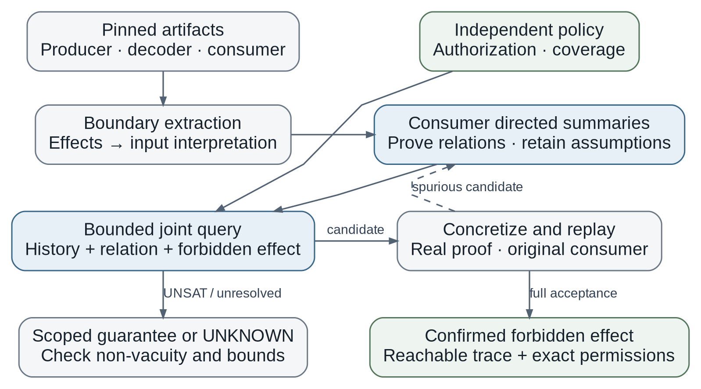

# D1: consumer-directed proof-to-effect analysis

Date: 23 October 2026. Research status: **INVESTIGATE FURTHER**. D1-00 is repository preparation, not a feasibility result. The [research contract](../research-contract.md) is authoritative; the [roadmap](roadmap.md) gives task gates.

## Problem and question

An accepted proof can establish facts about one set of values while the application executes effects with a different meaning. For example, a batch circuit may authenticate an active prefix while a consumer also executes a nonzero padded entry. This is a relation between producer constraints, actual decoding, state, caller permissions, and committed effects. Checking only a circuit or only a Solidity trace can miss that relationship.

D1 asks whether starting from the consumer's protected effects helps recover and solve the relevant joint obligations more effectively than equally informed direct and modular analysis. Authorization asks whether each effect has a compatible permission. Coverage asks whether each required obligation is discharged or explicitly handled by protocol policy. Neither property requires every optional permission to be exercised.

## Proposed solution and research questions

Extract supported producer constraints and consumer behavior into a joint representation. Work backward from protected effects to select observations. Derive summaries from the actual constraints, discharge their preconditions, solve the resulting obligations, and concretize candidates. Refine a summary when a candidate is spurious. Preserve field, byte, and integer semantics, reachability assumptions, occurrence identity, and artifact provenance throughout.

1. Can the extraction preserve the relevant producer/decoder/consumer behavior?
2. Does observation-directed summary selection/refinement improve solved obligations, precision, or total cost over monolithic and generic modular analysis?
3. Does a frozen method transfer to an independently developed application without defect-specific rules?
4. Does it produce useful verified obligations or confirmed effects beyond direct tests with equivalent policy and proof seeds?

## Scope and evidence boundary

Begin with one bounded arithmetic/array producer, exact decoding, and one supported non-reentrant settlement path with replayable initialization. Freeze numeric bounds and admitted states in the first experiment protocol. Single-state results are explicitly narrower than exploration of reachable histories. Start with occurrence-level discharge; aggregation, splitting, deferral, unsupported operations, and unproved correspondence remain explicit assumptions or UNKNOWN until supported.

Keep three verdicts: VIOLATION, VERIFIED_WITHIN_SCOPE, UNKNOWN. An abstract SAT candidate is unresolved until concretized. A concrete-model violation is weaker than a real-proof replay with reachable committed effects. A scoped guarantee requires non-vacuity and justified extraction/abstraction, not merely UNSAT on a reduced query. Policy may state what should be authorized; it must not assume the implementation binding being tested.

## Possible contribution and strongest challenge

The novelty hypothesis is a consumer-directed extraction/refinement mechanism with a demonstrated advantage. Integration mistakes, rich specifications, modular summaries, and selective unfolding already have close prior work. The [reference proposal](reference-proposal.md) provides the reviewed comparisons and primary-source bibliography, including CIVER, Coda, CCC-Check, and the SNARK SoK. D1-00 does not refresh the literature search or establish novelty.

Compare direct Foundry tests, monolithic joint solving, and an honestly labeled CIVER-style modular adaptation under equivalent facts, policies, bounds, and cost accounting. Compare common bug-finding tasks separately from verification guarantees. Preserve legitimate controls and every UNKNOWN. Payy variants are development data; early independent-target screening is not a held-out transfer result.

The work could support a top security venue only if it establishes a defensible method, a justified preservation argument, concrete security utility, and convincing independent comparative evidence. A new frontend, a known-case reproduction, solver tuning, or manually asserted correspondence alone is insufficient. Stop or narrow if clean controls fail, a routine modular adaptation ties at similar total cost, most bindings are supplied manually, or independent proving paths are infeasible.

## Current foundation and next step

Existing proof/replay harnesses and T22 regressions are reusable. The trace checker is not a static verifier, and the compact tail encoding is not a proved general summary. Historical T22 results remain UNKNOWN where previously unresolved. See [D1-00](../../reports/D1-00.md) for preservation evidence and [workspace.md](workspace.md) for how to work safely.

Next: D1-01 closes the existing six-slot T22 evidence record; D1-02 screens independent targets without waiting for favorable solver outcomes. The initial ten-researcher-day budget is a decision budget, not a promise of a completed paper or prototype.
