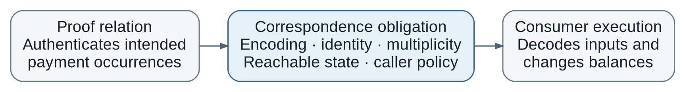

# Consumer Directed Proof to Effect Analysis

**BindCheck research proposal D1 | 22 October 2026**

**Decision: INVESTIGATE FURTHER.** First priority for a short feasibility study. This document proposes a method; it does not report a completed implementation, a new vulnerability, or established novelty.

## 1 Problem and proposed solution

A valid zero-knowledge proof certifies a particular mathematical statement. A blockchain application then interprets public inputs, selects a verifier, reads state, and changes balances or records. Security requires a correspondence between the authenticated statement and those effects. Correct cryptography alone does not establish that correspondence. Integration failures and the need for joint analysis are already recognized [1, §§6, 8].

**Illustrative example.** A batch circuit authenticates two payment occurrences. A contract decodes a three-slot array and executes all three entries. If the third slot is not constrained to represent an authorized payment or harmless padding, proof acceptance may coexist with an unauthorized transfer. Conversely, an ignored padding slot is legitimate. This example explains the property; it is not a new finding or a claim about an unexamined deployment.

**Proposed solution.** Start from security-relevant application effects and work backward to the producer constraints that justify them. Construct a bounded joint model of proof production, input decoding, reachable state, and execution. Replace expensive producer components with proved summaries, and refine those summaries when they admit an unrealizable counterexample.

**Candidate scientific contribution.** The research question is whether consumer-directed extraction and refinement can recover useful cross-language obligations automatically and check them more effectively than an adapted modular verifier with the same information. Semantic specifications, modular summaries, and selective unfolding are established techniques [2–4]. A new frontend alone would not justify this project as a top-tier contribution.

<!-- pagebreak -->

## 2 Research questions and security model

**RQ1 — Semantic fidelity.** Can the analysis recover a faithful relationship between the compiled producer statement, its actual public-input encoding, and the effects of a supported consumer path?

**RQ2 — Analysis effectiveness.** Does choosing and refining summaries from consumer observations improve solved obligations, precision, or total analysis cost over equally informed monolithic and modular baselines?

**RQ3 — Transfer.** Does the extraction and refinement mechanism work on an independently developed, previously unseen application without adding a defect-specific matching rule?

**RQ4 — Security usefulness.** Which confirmed authorization or obligation-accounting failures, or useful bounded guarantees, does the method obtain beyond direct contract tests supplied valid proofs?

### Property to check

The checker asks whether there exists a bounded reachable history, a producer witness satisfying the pinned compiled relation, and a consumer execution that violates an independently specified authorization policy. The model includes the exact decoder and execution context. Proof-system soundness and the correspondence between compiled constraints and the deployed verifier remain explicit assumptions, with program and key identities pinned.

There are two obligations. **Authorization** requires each executed effect to be permitted by authenticated intent and applicable state. **Coverage** requires each required obligation to be executed, cancelled, or legitimately pending at the observed transition. Coverage here is a safety/accounting property, not a claim that pending work eventually executes.

Use occurrence-level multisets: two identical payment requests are still two obligations. The policy may permit splitting, aggregation, cancellation, and deferral. Matching totals cannot detect a wrong beneficiary; one-to-one matching cannot represent every legitimate aggregation. Asset, recipient, domain, and occurrence identity must survive the correspondence.

### Adversary, scope, and trusted inputs

The adversary can choose allowed transaction arguments and, where the target threat model permits, malicious prover witnesses. Ordinary user and operator-controlled attacks are reported separately. Administrative changes enter histories only through legitimate actors; the model must not silently grant an attacker administrator powers.

The initial fragment is a bounded arithmetic/array producer and a non-reentrant EVM settlement path with explicit external-call summaries. Unsupported instructions, uncertain decoder semantics, and unresolved policies produce an unresolved result. The independently reviewed policy may specify intended obligations and legitimate caller assumptions. It must not assume that the implementation already preserves the correspondence being tested.

<!-- pagebreak -->

## 3 Architecture

**A. Artifact and identity intake.** Pin circuit/compiler artifacts, program identity, verification key, consumer code, ABI, initialization, and policy version. Preserve source-to-constraint mappings where available. A mismatched key or artifact invalidates the analysis setup.

**B. Boundary extraction.** Follow actual public-input construction and decoding into storage writes, token effects, and security-relevant branches. Recover dependencies backward from those observations into the producer. Dependency identifies a candidate relation; it does not establish semantic equality [5, §4.3].

**C. Checked abstraction.** Recover component structure, prove summaries from retained constraints, and build a conservative joint model. Record facts as extracted, proved, or assumed. Component recovery from flattened constraints is a real cost, already discussed by CIVER [2, §3.5].

**D. Query and refinement engine.** Check authorization and coverage separately. If a candidate depends on an imprecise summary, expose the responsible constraints and recheck. Refine according to the consumer observation that distinguishes the suspected effect.

**E. Evidence validator.** Reconstruct the witness, generate the actual proof when feasible, and replay the original consumer from a reachable state. Store the model, bounds, assumptions, proof bytes, transaction history, and final effect. Model-level evidence and executable security evidence remain separate outputs.

<!-- pagebreak -->

## 4 Technical method and proposed guarantees

**Step 1 — Freeze a supported semantic fragment.** Define the field, compiler version, EVM semantics, maximum batch/history lengths, call behavior, and resource budget before evaluation. Build honest and repaired controls first. A fragment should be chosen for meaningful security properties, not merely because its constraints are easy.

**Step 2 — Compute the observation slice.** Select policy-relevant effects, trace their data and control dependencies through decoding and proof verification, and retain producer constraints influencing those values. Include verifier selection, domain checks, lengths, and state guards. An effect-independent-looking constraint can still restrict feasible witnesses; dropping it requires a conservative abstraction argument.

**Step 3 — Construct observation-specific summaries.** Reuse verified component summaries where sufficient. Otherwise ask for relations needed to justify the selected effect, such as a bound on the active-message count or preservation of a recipient field. The analyst supplies policy roles; the tool must establish the corresponding implementation facts. Quantify manual annotations and failed hierarchy recovery.

**Step 4 — Solve and refine.** Search for a policy-violating execution in the abstract joint model. Test a candidate against the concrete retained producer and consumer relation. If infeasible, use the failed relation to select a component for unfolding or summary strengthening. Stop at the declared resource limit; a timeout remains UNKNOWN. Termination of refinement within a useful budget is an empirical question.

**Step 5 — Validate the representation boundary.** Preserve modular field arithmetic, integer ranges, canonical encodings, signedness, byte order, ABI lengths, hashing preimages, and domain separation. Treat hash abstractions under stated cryptographic assumptions. Do not replace field equality with integer equality without proving the necessary range conditions.

**Step 6 — Produce graded evidence.** An abstract SAT result is a candidate. A satisfying concrete semantic model is a conditional violation. A generated proof accepted by the unchanged consumer with a forbidden effect in a reachable state is confirmed executable evidence. UNSAT supports a bounded guarantee only if the abstraction is conservative, extraction is faithful within scope, and an accepted honest execution establishes non-vacuity.

### Formal contribution to attempt

Prove an abstraction-preservation result for the supported relation: every concrete execution has an abstract representative preserving the relevant observations. Then abstract unreachability of a forbidden observation implies its concrete unreachability within the bounds. Prove that refinement preserves this direction. This is a proposed theorem obligation, not an existing theorem. It does not establish compiler correctness, unrestricted liveness, or security beyond the modeled history bound.

<!-- pagebreak -->

## 5 Contributions and novelty boundaries

| Proposed contribution | Closest existing capability | Evidence needed to distinguish D1 |
|---|---|---|
| Recover obligations from actual producer and consumer artifacts | SNARK integration taxonomy [1]; cross-component dependencies in SmartAxe [5] | Semantic relations with exact encodings and measured extraction effort, beyond a taint map |
| Refine producer summaries using consumer observations | CIVER proves summaries and selectively unfolds components [2] | A defined selection/refinement mechanism that improves over adapting CIVER with the same extracted facts |
| Check authorization and occurrence-level coverage jointly with history | Coda and CCC-Check support intended semantics [3, 4]; rollup models address histories and ordering [6, 7] | Faithful connection to concrete producer/decoder/effect semantics, with explicit transformations and caller assumptions |
| Publish a reproducible boundary-analysis benchmark | Existing analyses supply useful components and cases | Independent code families, accepted honest/fixed controls, known and held-out defects, and provenance for every claim |

**What is already known.** A proof can be valid while integration is insecure [1]. Rich specifications, deterministic-but-wrong circuit behavior, and modular verification are prior art [2–4]. Cross-component semantic dependencies are also established [5]. The proposal therefore cannot claim novelty from “checking proof binding,” adding tags, or moving an existing verifier to Noir/ACIR.

**What is still a hypothesis.** Consumer observations may offer an effective way to choose cross-boundary relations and constrain refinement, avoiding much of a monolithic producer query without erasing relevant behavior. That hypothesis requires both a precise algorithm and comparative evidence. A combination of existing components is not automatically a research contribution.

**Decisive counterfactual.** Give a conventional relational/modular checker the same extracted constraints, policy, caller facts, and solver portfolio. If a straightforward adapter achieves equivalent results at comparable total effort, D1's claimed analysis contribution is not supported. Native lack of an ACIR frontend must not be scored as an algorithmic failure.

**Expected outputs if successful.** A scoped semantic model, a justified extraction/refinement algorithm, an implementation with an explicit unresolved-result interface, and a benchmark showing where the method adds value. These are planned deliverables. No new theorem, vulnerability, speedup, or universal safety guarantee is asserted by this proposal.

<!-- pagebreak -->

## 6 Evaluation plan

### Corpus and controls

Recruit at least three independent application/code families; withhold one family during method design. Record every screened target, unsupported feature, failed build, and reason for exclusion. Shared libraries and multiple variants do not create independent applications. Use exact historical vulnerable/fixed pairs where available; label seeded defects separately. Split by project and root cause, not randomly across similar mutants.

Controls must include honest and repaired executions, harmless witness freedom, ignored padding, duplicate obligations, legitimate splitting/aggregation, deferred obligations, caller-enforced guards, and alternate domains/encodings. A policy reviewer should check controls before results are unblinded. Failed non-vacuity or a wrong caller assumption invalidates a claimed guarantee.

| RQ | Experiment | Primary measurements |
|---|---|---|
| RQ1 | Compare extracted semantics with independent traces and reviewed encodings | Agreement, unsupported coverage, manual facts, extraction defects |
| RQ2 | Run joint, modular, and consumer-directed analyses under equal bounds and limits | Solved obligations, UNKNOWN, false candidates, wall time, memory, analyst hours |
| RQ3 | Freeze the mechanism and apply it to a held-out family | Adapter effort, new special rules, control accuracy, detection/verification retained |
| RQ4 | Replay concrete findings and compare with direct property tests | Distinct confirmed root causes, reachable forbidden effects, guarantees unavailable to the baseline |

### Baselines and causal tests

Use direct Foundry property tests with the same valid-proof seeds and policy; a monolithic joint query; a CIVER-style checked-summary adaptation over the same extracted relation; and a documented solver portfolio. Charge specification, adapter, proof-generation, and preprocessing costs. Report native and adapted scope separately.

Ablate consumer slicing, observation-directed refinement, occurrence identity, and reachable-state constraints individually. Loss of state constraints can create false attacks; removing identity can miss duplicated obligations. Explain these semantic changes rather than treating every ablation as a timing comparison.

Freeze bounds and time/memory caps before runs. Report per-instance results, distributions for nondeterministic configurations, and censoring; never replace timeouts with successful reduced queries. Keep raw solver output and independent replay scripts. Any security-impact claim includes the actor's permissions and the exact forbidden effect. No arbitrary number of bugs substitutes for a demonstrated method advantage.

<!-- pagebreak -->

## 7 Feasibility and top venue case

### Short gate before committing to a paper

**Proposed budget: ten researcher-days, not a completion forecast.** Days 1–3: close the existing bounded-checker control report under its frozen limits and identify an independent executable target. Days 4–7: compare one useful boundary property against the monolithic and adapted modular baselines. Days 8–10: freeze the method, transfer it, and review all assumptions and unresolved cases.

Pass only with a positively established legitimate repaired control within scope, a concretizable faulty control, transfer without a new defect-specific rule, and either a reproducible precision/detection advantage or materially lower total analysis effort. If the initial controls remain unresolved, narrow the claim or stop this direction. These are screening criteria, not statistical evidence of generalization.

The supplied BindCheck progress reports useful real-proof infrastructure and a known message-tail reproduction. It also reports unresolved full queries and earlier ties with direct contract testing. These are supplied reports, not independently rerun results. They may reduce setup cost; they do not support novelty or predict that summary refinement will scale.

### Why this could fit IEEE S&P or a comparable venue

The strongest paper would explain a general compositional failure mode and contribute a technically justified analysis that exposes it across independent implementations. IEEE S&P solicits security advances in analysis and verification and explicitly includes blockchain security [8]. Fit follows from a meaningful authorization property and a transferable analysis mechanism, rather than the presence of zero knowledge alone.

A credible submission needs the algorithm and scoped preservation argument, faithful implementation evidence, strong equal-information baselines, held-out transfer, honest negative results, and independently replayable security consequences or valuable bounded guarantees. The evaluation must show why a specialist cannot obtain the same result with a routine modular adapter. S&P artifact evaluation covers availability, functionality, and reproducibility [9]; package models, raw results, policies, proof fixtures, patches, and one-command replay accordingly.

**Strongest rejection case.** “This is a hand-written Payy policy plus standard assume-guarantee reasoning.” That objection is decisive if extraction is mostly manual, only one layout works, or the adapted baseline ties. Known-defect reproduction is useful validation, but not a new research finding. Run security experiments locally and coordinate disclosure of any new affected implementation before public release.

**Investment decision.** D1 remains the first experiment to try, not a selected paper contribution. Stop if controls cannot pass, caller/reachability corrections remove the findings, or no held-out advantage survives. Publication suitability is a conditional research judgment, not a forecast of acceptance.

<!-- pagebreak -->

## 8 References and evidence status

References identify the reviewed papers and the specific sections supporting comparisons. Publication details and review depth are recorded in the repository catalog. Author-reported results were not reproduced for this proposal. All architecture, algorithm, and evaluation descriptions above are proposed work.

<!-- references -->

[1] Stefanos Chaliasos, Jens Ernstberger, David Theodore, David Wong, Mohammad Jahanara, Benjamin Livshits. **SoK: What Don’t We Know? Understanding Security Vulnerabilities in SNARKs**. USENIX Security 2024. Relevant: Sections 6 and 8. [Publication or manuscript](https://www.usenix.org/conference/usenixsecurity24/presentation/chaliasos). Repository ID: BC-L001.

[2] Miguel Isabel, Clara Rodríguez-Núñez, Albert Rubio. **Scalable Verification of Zero-Knowledge Protocols**. IEEE S&P 2024, pp. 1794–1812. Relevant: Sections 2.3, 3.3, 3.5 and 5; physical PDF pages 5–6, 9–10 and 15. [Publication or manuscript](https://doi.org/10.1109/SP54263.2024.00133). Repository ID: BC-F005.

[3] Arman Kolozyan, Bram Vandenbogaerde, Janwillem Swalens, Lode Hoste, Stefanos Chaliasos, Coen De Roover. **Language-Agnostic Detection of Computation-Constraint Inconsistencies in ZKP Programs via Value Inference**. IEEE S&P 2026. Relevant: Sections 3–5 and Appendix A. [Publication or manuscript](https://sp2026.ieee-security.org/accepted-papers.html). Repository ID: BC-F001.

[4] Junrui Liu, Ian Kretz, Hanzhi Liu, Bryan Tan, Jonathan Wang, Yi Sun, Luke Pearson, Anders Miltner, Işıl Dillig, Yu Feng. **Certifying Zero-Knowledge Circuits with Refinement Types**. IEEE S&P 2024. Relevant: Sections 3–4. [Publication or manuscript](https://doi.org/10.1109/SP54263.2024.00078). Repository ID: BC-L006.

[5] Zeqin Liao, Yuhong Nan, Henglong Liang, Sicheng Hao, Juan Zhai, Jiajing Wu, Zibin Zheng. **SmartAxe: Detecting Cross-Chain Vulnerabilities in Bridge Smart Contracts via Fine-Grained Static Analysis**. PACMSE / FSE 2024. Relevant: Section 4.3. [Publication or manuscript](https://doi.org/10.1145/3643738). Repository ID: BC-L017.

[6] Stefanos Chaliasos, Denis Firsov, Benjamin Livshits. **Towards a Formal Foundation for Blockchain ZK Rollups**. CCS 2025. Relevant: Sections 3–6. [Publication or manuscript](https://doi.org/10.1145/3719027.3765115). Repository ID: BC-L002.

[7] Ioannis Kaklamanis, Fan Zhang. **CRATE: Cross-Rollup Atomic Transaction Execution**. arXiv 2025 (preprint). Relevant: Sections 3–7. [Publication or manuscript](https://arxiv.org/abs/2502.04659). Repository ID: BC-L035.

[8] IEEE Symposium on Security and Privacy 2027 Call for Papers. Opening scope and topic list. [Official source](https://sp2027.ieee-security.org/cfpapers.html). Accessed 2026-10-22.

[9] IEEE Symposium on Security and Privacy 2027 Call for Artifacts. Artifact Evaluation Information and Artifact Badges. [Official source](https://www.sp2027.ieee-security.org/cfartifacts.html). Accessed 2026-10-22.
