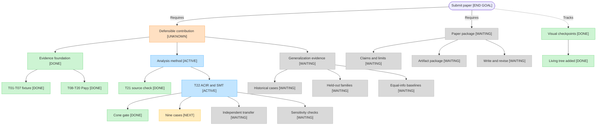

# BindCheck project checkpoints

This is the living visual index from the current research state to a paper
submission. It is a navigation aid, not an evidence source. The
[research contract](research-contract.md), [README](../README.md), and linked
task reports remain authoritative.

Status labels mean:

- `[DONE]` — the bounded task is complete at its stated evidence level;
- `[ACTIVE]` — work is underway;
- `[NEXT]` — the immediate gate;
- `[WAITING]` — depends on earlier work; and
- `[UNKNOWN]` — the research verdict is not established.

## Immediate path

1. Run the frozen nine-case T22 evaluation now that the single-case gate passes.
2. Run the independent transfer case without tuning on its result.
3. Complete sensitivity checks and equal-information baselines.
4. Decide whether the evidence supports a defensible contribution.
5. If it does, assemble the manuscript and artifact package for submission.

The end goal does not imply that submission is currently justified. The
research contract's two principal properties remain unchanged, and T22 has no
completed verdict yet.

## Checkpoint log

| Date | Checkpoint | Status | Evidence and meaning |
| --- | --- | --- | --- |
| 2026-10-20 | T22-v2 single-case feasibility gate | `[DONE]` | [T22](../reports/T22.md): the known vulnerable Payy case produced a counterexample in 4.1 seconds after exact specialization reduced the probe from 587 opcodes and 523 witnesses to 0 opcodes and 1 witness. This is not the nine-case result. |
| 2026-10-20 | Living project checkpoint tree | `[DONE]` | This page and the corresponding `AGENTS.md` update establish the visual checkpoint routine. No research verdict changed. |

## Update rule

For every bounded task that changes project state, update the relevant node and
append one row above. Link to the report or evidence that supports the status.
Never remove an old row; corrections should be new rows that identify what
changed. Pure discussion or status checks do not create project checkpoints.
