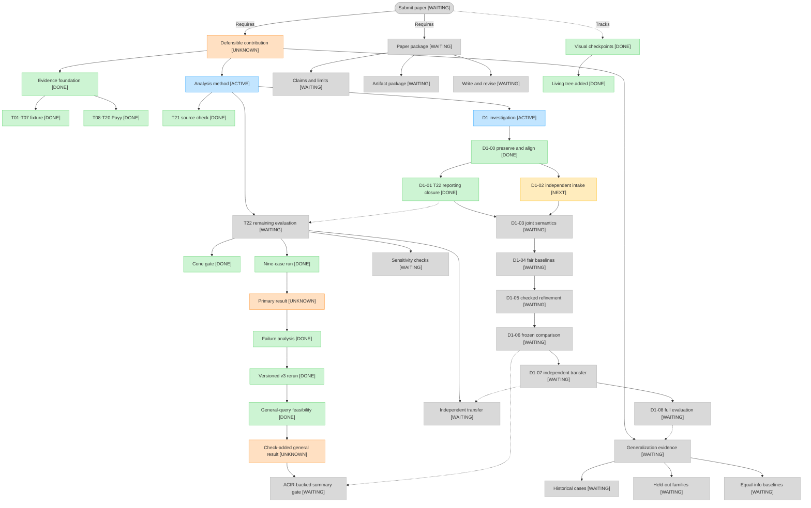

# BindCheck project checkpoints

This is the living visual index from the current research state to a paper
submission. It is a navigation aid, not an evidence source. The
[research contract](research-contract.md), [README](../README.md), and linked
task reports remain authoritative.

Status labels mean:

- `[DONE]` — the bounded task is complete at its stated evidence level;
- `[ACTIVE]` — work is underway;
- `[NEXT]` — the immediate gate;
- `[WAITING]` — depends on earlier work; and
- `[UNKNOWN]` — the research verdict is not established.

## Immediate path

1. Done: the running-flag false positive and both `UNKNOWN` classes are explained in [T22 Section 3.2](../reports/T22.md).
2. Done: the [T22-v3 rerun and audit](../reports/T22-v3.md), frozen before output, returns 4 `VIOLATION` and 5 `UNKNOWN` (4/9 expected outcomes matched). Seven synthetic regressions and four SAT replays pass; the running-flag probe false positive is fixed, but its full case remains unresolved. Prior evidence and compiled inputs are unchanged.
3. Done: [T22-v4](../reports/T22-v4.md) preserves a 22.5 KB, one-assertion non-vacuity goal that times out at 300 seconds with 93,696 KiB peak RSS. A fixed-stream ACIR branch returns conditional SAT in 79.9 seconds, while non-vacuity, prefix and tail in the full Boolean-rank query remain `UNKNOWN` after three 300-second timeouts. The check-added case has no verified verdict.
4. Done: [D1-00](../reports/D1-00.md) creates the isolated worktree, preserves staged work and historical evidence, and aligns the contract and [roadmap](d1/roadmap.md).
5. Done: [D1-01](../reports/D1-01.md) accounts for all six T22-v5 slots: three validated historical check-added timeouts and three new running-flag timeouts at 300 seconds/4 GiB. Reporting closure is complete, all six results remain UNKNOWN, and the original successful-solver milestone is unmet. No extended campaign or whole-system guarantee follows.
6. Next, independently: D1-02 screens two non-Payy families for a plausible proving/consumer path. Availability screening is not a held-out result and does not wait for favorable T22 results.
7. Then: faithful joint semantics, equal-information baselines, checked consumer-directed refinement, frozen comparison, and independent transfer. Full evaluation and submission remain conditional on the feasibility decision.

The end goal does not imply that submission is currently justified. The
research contract's two principal properties remain unchanged, and unresolved T22 results remain UNKNOWN. D1 preparation and reporting closure are complete; three missing historical query slots were executed. No new D1 analyzer or method-evaluation result has been completed.

## Checkpoint log

| Date | Checkpoint | Status | Evidence and meaning |
| --- | --- | --- | --- |
| 2026-10-20 | T22-v2 single-case feasibility gate | `[DONE]` | [T22](../reports/T22.md): the known vulnerable Payy case produced a counterexample in 4.1 seconds after exact specialization reduced the probe from 587 opcodes and 523 witnesses to 0 opcodes and 1 witness. This is not the nine-case result. |
| 2026-10-20 | Living project checkpoint tree | `[DONE]` | This page and the corresponding `AGENTS.md` update establish the visual checkpoint routine. No research verdict changed. |
| 2026-10-20 | T22-v2 frozen nine-case primary run | `[DONE]` | [T22](../reports/T22.md): 2/9 outcomes matched, 6 were `UNKNOWN`, and the running-flag negative control returned a likely spurious `VIOLATION`. The evaluation task completed, but the T22 result remains `[UNKNOWN]`. |
| 2026-10-20 | T22-v2 failure diagnosis | `[DONE]` | [T22 Section 3.2](../reports/T22.md); raw evidence in ignored `results/raw/T22/32_v2_diagnosis/`. The running-flag `VIOLATION` is a confirmed analyzer false positive: the specialization drops the implied goal constraint, and original-ACIR subset certificates are UNSAT for all eight slots. Timeouts trace to the cvc5 `gb` mode, missing re-componentization and slot scheduling; the general queries remain unresolved. The `agg_utxo` contradiction is genuine but was handled as unsupported. No verdict changed; the primary result stays `[UNKNOWN]`. |
| 2026-10-20 | T22-v2 diagnosis correction and reproduction addendum | `[DONE]` | [T22 Section 3.2](../reports/T22.md), post-review corrections. Correction to the previous row: the `agg_utxo` contradiction rules out only the all-streams-inactive premise; it does not show that an empty prefix is impossible. The R3 wording was narrowed to match. An exact-command addendum (`11_commands_addendum.txt`) and three reproduction scripts were added; the original raw records are unchanged. No verdict or tree node changed; the v3 rerun remains `[NEXT]`. |
| 2026-10-20 | T22-v3 versioned encoding, primary rerun and audit | `[DONE]` | [T22-v3](../reports/T22-v3.md): frozen R1–R6 rerun completes with 4 `VIOLATION`, 5 `UNKNOWN`, 0 `VERIFIED_WITHIN_SCOPE` (4/9 matches). All seven regressions and four SAT replays pass; all nine source/compiled cases and 129 prior raw evidence files match v2/the diagnosis. The running-flag probe false positive is fixed, but general queries produce six timeouts and nine allocation failures. Overall T22 remains `[ACTIVE]`, its research result `[UNKNOWN]`, and independent transfer deferred. |
| 2026-10-20 | T22-v4 check-added general-query feasibility | `[DONE]` | [T22-v4](../reports/T22-v4.md): a one-assertion, 18-variable reduction of the original non-vacuity goal still times out at 300 seconds (93,696 KiB peak RSS). Exact fixed-stream specialization yields conditional non-vacuity SAT in 79.9 seconds; the three full Boolean-rank queries each time out at 300 seconds. The bounded feasibility task is complete with a preserved blocker, while the check-added verdict and overall T22 remain `[UNKNOWN]`/`[ACTIVE]`; independent transfer stays deferred. |
| 2026-10-23 | D1-00 isolated worktree and research alignment | `[DONE]` | [D1-00](../reports/D1-00.md), [baseline](../metadata/d1/baseline.json), and [validation](../metadata/d1/d1-00-validation.json): preserve source index/staged patch, original files, historical reports, and an independent raw-evidence copy. Revise the prospective contract and roadmap; old verdicts remain unchanged. D1-01 reporting closure and D1-02 intake are next; old transfer deferral is replaced by early availability screening, not a transfer claim. |
| 2026-10-23 | D1-01 T22-v5 reporting closure | `[DONE]` | [D1-01](../reports/D1-01.md), [six-slot matrix](../metadata/d1/d1-01-query-matrix.json), and [execution manifest](../metadata/d1/d1-01-execution-manifest.json): validate three preserved check-added timeouts and execute three missing running-flag queries once at 300 seconds/4 GiB. All six remain UNKNOWN; non-vacuity and the original successful-solver milestone are unresolved. Specification/reduction audits do not establish encoding soundness. Prior evidence and original/source indexes are preserved. D1-02 intake is next and has not started. |

## Update rule

For every bounded task that changes project state, update the relevant node and
append one row above. Link to the report or evidence that supports the status.
Never remove an old row; corrections should be new rows that identify what
changed. Pure discussion or status checks do not create project checkpoints.
