# BindCheck project checkpoints

This is the living visual index from the current research state to a paper
submission. It is a navigation aid, not an evidence source. The
[research contract](research-contract.md), [README](../README.md), and linked
task reports remain authoritative.

**Current work sequence (2026-11-13):** follow the
[research roadmap](research-roadmap-2026-11-13.md). The author has removed the
November submission target. R00 (contract and evidence alignment) is next;
technical novelty and independent capability remain UNKNOWN. The older branches
and task narratives below preserve checkpoint-era status, including obsolete
"EVAL unopened" and next-task labels; they are not current scheduling instructions.
R00 will reconcile the prospective contract without relabeling historical runs.

Status labels mean:

- `[DONE]` — the bounded task is complete at its stated evidence level;
- `[ACTIVE]` — work is underway;
- `[NEXT]` — the immediate gate;
- `[WAITING]` — depends on earlier work; and
- `[UNKNOWN]` — the research verdict is not established.

Result and disposition qualifiers such as `INCONCLUSIVE`, `NOT_EVALUATED`,
`NOT_REACHED`, `NOT_EXECUTED`, and `NOT_SUBMISSION_READY` refine those progress
labels; they are not synonyms for failure, safety, or a negative result.

```mermaid
flowchart TD
    submit(["Submit paper [WAITING]"])
    contribution["Defensible contribution [UNKNOWN]"]
    submit -->|"Requires"| contribution
    submit -->|"Requires"| manuscript["Paper package [WAITING]"]
    submit -.->|"Tracks"| tracking["Visual checkpoints [DONE]"]

    contribution --> researchPlan["2026-11-13 research roadmap [DONE]"]
    contribution --> buildSpec["2026-11-20 build spec: binding class + agent tool [ACTIVE]"]
    buildSpec --> auditSweep["Audit-report sweep, acquisition, triage [DONE]"]
    auditSweep --> auditLabel["Human labeling of audit candidates [NEXT]"]
    auditLabel --> auditRepro["Study-set E4 reproduction [WAITING]"]
    researchPlan --> r00["R00 contract + evidence alignment [NEXT]"]
    r00 --> r01["R01 gap + natural feasibility [WAITING]"]
    r01 --> r02["R02 formal property + vertical slice [WAITING]"]
    r02 --> r03["R03 reliability + benchmark [WAITING]"]
    r03 --> r04["R04 independent evaluation freeze [WAITING]"]
    r04 --> r05["R05 comparison + real-proof validation [WAITING]"]
    r05 --> r06["R06 paper + independent reproduction [WAITING]"]

    contribution --> foundation["Evidence foundation [DONE]"]
    contribution --> analysis["Analysis method [ACTIVE]"]
    contribution --> evaluation["Generalization evidence [WAITING]"]

    foundation --> fixture["T01-T07 fixture [DONE]"]
    foundation --> payy["T08-T20 Payy [DONE]"]

    analysis --> sourceCheck["T21 source check [DONE]"]
    analysis --> t22["T22 remaining evaluation [WAITING]"]
    t22 --> coneGate["Cone gate [DONE]"]
    t22 --> nineCases["Nine-case run [DONE]"]
    nineCases --> primaryResult["Primary result [UNKNOWN]"]
    primaryResult --> failureAnalysis["Failure analysis [DONE]"]
    failureAnalysis --> v3Rerun["Versioned v3 rerun [DONE]"]
    v3Rerun --> generalGate["General-query feasibility [DONE]"]
    generalGate --> generalResult["Check-added general result [UNKNOWN]"]
    generalResult --> acirSummary["ACIR-backed summary gate [WAITING]"]
    t22 --> transferCase["Independent transfer [WAITING]"]
    t22 --> sensitivity["Sensitivity checks [WAITING]"]

    analysis --> d1["D1 investigation [ACTIVE]"]
    d1 --> d1paper["D1 paper integration [ACTIVE]"]
    d1paper --> d1p00["D1P-00 integration baseline [DONE]"]
    d1p00 --> d1p01["D1P-01 intake implementation [DONE]"]
    d1p01 --> d1p01artifact["N=8 artifact recovery [DONE]"]
    d1p01artifact --> d1p02["D1P-02 archive byte gate [DONE]"]
    d1p02 --> d1p03["D1P-03 protocol + offline validation [DONE]"]
    d1p03 --> d1p04["D1P-04 specializer task [DONE]"]
    d1p04 --> d1p05["D1P-05 portable equivalence run [DONE]"]
    d1p05 --> d1p04elig["25-cell SMT eligibility [DONE]"]
    d1p04elig --> d1p06["D1P-06 Mac Track A attempt [UNKNOWN]"]
    d1p06 --> d1p07["D1P-07 race-safe Track A [DONE]"]
    d1p07 --> d1p08["D1P-08 symbolic consumer + feasibility [DONE]"]
    d1p08 --> d1p09["D1P-09 binding + offline propagation [DONE]"]
    d1p09 --> d1p10["D1P-10 producer encoding study [DONE]"]
    d1p10 --> d1p11["D1P-11 development screening [DONE]"]
    d1p11 --> d1p12["D1P-12 WarpToad fixture gate [DONE]"]
    d1p12 --> warptoadRecovery["Pinned source/toolchain recovery [DONE]"]
    warptoadRecovery --> d1p12r["D1P-12R honest local fixture [DONE]"]
    d1p12r --> d1p13["D1P-13 beta.22 correspondence + component checks [DONE]"]
    d1p13 --> d1p14a["D1P-14A fee-cap concrete fixtures [DONE]"]
    d1p14a --> d1p14b["D1P-14B frozen joint attempt [DONE]"]
    d1p14b --> d1p14bresult["AUTH-1 / NONVAC-1 [UNKNOWN]"]
    d1p14bresult --> d1p14c["D1P-14C repaired joint freeze [DONE]"]
    d1p14c --> d1p14cresult["Sensitivity gate [UNKNOWN]"]
    d1p14cresult --> d1p14d["D1P-14D deterministic controls [DONE]"]
    d1p14d --> d1p14dresult["AUTH-1 / NONVAC-1 diagnostics [UNKNOWN]"]
    d1p14dresult --> d1p17["D1P-17 arithmetic backends [DONE]"]
    d1p17 --> d1p17result["Full-producer backend result [UNKNOWN]"]
    d1p14dresult --> warptoadJoint["Joint policy/analyzer work [WAITING]"]
    d1p14dresult --> d1pint1["D1P-INT1 contract revision 2 [DONE]"]
    d1pint1 --> d1p16["D1P-16 AST extraction feasibility [DONE]"]
    d1p16 --> d1p18["D1P-18 fail-closed hardening [DONE]"]
    d1pint1 --> d1p15["D1P-15 O1 hash + injected gates [DONE]"]
    d1p15 --> d1p19["D1P-19 remaining B02 prerequisites [DONE]"]
    d1p19 --> d1p20["D1P-20 extracted consumer model [DONE]"]
    d1p20 --> d1p21a["D1P-21A exact-state + M-DOM gates [DONE]"]
    d1p21a --> d1p21b["D1P-21B variant extraction gate [DONE]"]
    d1p21b --> d1p30["D1P-30 BindCheck v1 development tool [DONE]"]
    d1p30 --> d1p31["D1P-31 30-mutant development benchmark [DONE]"]
    d1p31 --> d1p34["D1P-34 application-neutral v1.1 [DONE]"]
    d1p34 --> d1p33["D1P-33 frozen held-out scan [DONE]"]
    d1p33 --> d1p35["D1P-35 v1.2 format + location freeze [DONE]"]
    d1p35 --> d1p36["D1P-36 frozen v1.2 transfer scan [DONE]"]
    d1p36 --> d1p40["D1P-40 extraction correctness audit [DONE]"]
    d1p36 --> d1p41["D1P-41 preliminary novelty ablation [DONE]"]
    d1p40 --> d1p42["D1P-42 conditional extent analysis [DONE]"]
    d1p41 --> d1p42
    d1p40 --> d1p43["D1P-43 typed role correspondence [DONE]"]
    d1p41 --> d1p43
    d1p42 --> payyFidelity["Payy exact mapping + extent fidelity [DONE]"]
    d1paper --> d200["D2-00 coordination foundation [DONE]"]
    d200 --> d201["D2-01 integrated development run [DONE]"]
    d1p43 --> d201
    payyFidelity --> d201
    d201 --> d202["D2-02 exposed ecosystem inventory [DONE]"]
    d201 --> d203["D2-03 claim + related-work ledger [DONE]"]
    d201 --> d204["D2-04 taxonomy preparation [DONE]"]
    d202 --> d205["D2-05 protocol draft [DONE] — UNSCORED"]
    d203 --> d205
    d204 -.-> taxonomyHumans["Fresh human taxonomy study [WAITING]"]
    d205 --> d206["D2-06A/B construction + smoke [DONE] — UNSCORED"]
    d206 --> d207["D2-07 Gate A finalization [DONE] — INCONCLUSIVE"]
    d207 --> d20810["D2-08–10 bounded prototypes [DONE] — UNKNOWN"]
    d20810 --> d21114["D2-11–14 read-only audit [DONE] — NOT EXECUTED"]
    d21114 --> gateB["Gate B [WAITING] — NOT_EVALUATED"]
    d21114 --> d21517["D2-15–17 readiness audit [DONE] — NOT EXECUTED"]
    d21517 --> gateC["Gate C [WAITING] — NOT_REACHED"]
    d21517 --> d218["D2-18 status manuscript [DONE] — NOT_SUBMISSION_READY"]
    d218 --> d219["D2-19 partial artifact [DONE] — FINAL_ARTIFACT_BLOCKED"]
    d219 --> d220["D2-20 evidence audit [DONE] — 12 concerns / UNKNOWN"]
    d220 --> circomFeas["Circom/Groth16 + Solidity pivot feasibility [DONE] — NO-GO"]
    circomFeas --> circomV2["Feasibility v2 real integrations [DONE] — 2 E4 VIOLATION"]
    circomV2 --> integrationDataset["Integration dataset v1 [DONE] — EVAL UNOPENED / P4 PRIVATE UNKNOWN"]
    integrationDataset --> integrationDatasetV2["Integration dataset v2 [DONE] — 1,384 EVAL-ONLY FAMILIES / EVAL UNOPENED"]
    integrationDataset --> t23["T23 unified bindcheck-zk DEV analyzer [DONE]"]
    t23 --> t24["T24 full-DEV coverage + adjudication [DONE]"]
    t24 --> t25["T25 applicability + pre-freeze decisions [DONE]"]
    t25 --> t26["T26 one-shot EVAL harness [DONE] — EVAL METADATA ONLY"]
    t26 --> zkHeldout["Exact-hash held-out run [NEXT] — EVAL UNANALYZED"]
    zkHeldout -.-> evaluation
    integrationDatasetV2 -.-> zkHeldout
    d220 --> manuscript
    d220 --> sprint["EuroS&P 2027 sprint [ACTIVE]"]
    sprint --> t0["T0 Linux toolchains [DONE] — PARTIAL"]
    sprint --> r1["R1 incident census [DONE] — labels AI, author review pending"]
    sprint --> r2["R2 audit census [DONE] — Solodit BLOCKED"]
    sprint --> az1["AZ1 Aztec Connect case study [DONE] — fixture E4; BindCheck/Slither do not flag it"]
    sprint --> s2c["S2c extent binding [DONE] — AZ1 E1 control pair; DEV 56 UNKNOWN"]
    sprint --> s4["S4 execution oracle [DONE] — ZKredential+RacePass E4 from manifests; repairs clean"]
    s4 --> s4b["S4b value-at-risk + admitted initial state [DONE]"]
    s4b --> s4c["S4c obligation accounting [DONE] — omitted required effect confirmed"]
    sprint --> s1["S1 verifier canonicality [WAITING] — PARTIAL; author decisions pending"]
    s1 --> s1Sol["Generated Solidity verifiers [DONE] — 15/15 reject same-proof aliases on Anvil"]
    s1 --> s1Native["Native bb.js 3.0.0 Poseidon2 path [DONE] — accepts aliases; known (Xion PR 608)"]
    s1 --> s1Split["Four split templates [UNKNOWN] — source-read, unconfirmed"]
    s4c --> f2["F2 oracle soundness + S4d [DONE] — historical F2 results; XR2 residuals open"]
    f2 --> f3["F3 residual oracle gates [DONE] — reviewer EVM controls pass; XR3-01 found"]
    f3 --> f4["F4 rule-bound single use + verdict tests [DONE] — chain-free controls pass"]
    f4 --> f4Gate["XR3 oracle re-review [WAITING] — F4 EVM controls not run"]
    sprint --> s2a["S2a precision fixes [ACTIVE] — DEV"]
    s2a --> s2aRerun["Spent-family DEV rerun [DONE] — 265/278 analysed"]
    s2aRerun --> s2aSetH["Set H DEV precision [UNKNOWN] — not held-out"]
    s2aRerun --> s2a2["S2a2 residual P5 [DONE] — six reproduced warnings now UNKNOWN"]
    s2a2 --> s2a2Timeout["W0658 [UNKNOWN] — analyzer timeout"]
    sprint --> s8a["S8a paper framing sections [DONE] — draft; S5/S1/S7 placeholders"]
    s8a --> s8["S8 A4 paper integration [WAITING] — official template comparison"]
    sprint --> dj23["Paper data jobs D2/D3/D4/RV11 [ACTIVE] — D2 done; D3, D4, RV11 AI-proposed, author check pending"]
    sprint --> b3m["B3 binding mutants v3 [DONE] — kill tests, frozen static scoring and post-hoc Anvil Mythril arm; human KB triage [NEXT]"]
    sprint --> f1["F1 analyzer soundness [DONE] — XR controls pass, DEV row verdicts unchanged"]
    f1 --> s0["S0 contract revision 4 and freeze-3 preparation [DONE] — 77 analyzer tests passed"]
    s0 --> s0Tag["Reviewer freeze-3 tag [WAITING]"]
    sprint --> s5h["S5H reserve harness [DONE] — offline code and tests only"]
    s5h --> s5run["S5 reserve run [WAITING] — author record and freeze-3 HEAD"]
    d1paper --> lanex["Lane-X exploratory, benchmark, auto-validation v1+v1.1 [DONE]"]
    d207 --> capabilityGate["Automated discovery + E4 capability gate [WAITING]"]
    d1p10 --> d1p10result["Transformed-arm eligibility [UNKNOWN]"]
    d1p10result --> d1p10decision["Selected-cone backend reconsideration [WAITING]"]
    d1p09 -.-> d1p09decision["Full-relation/forwarding decision [WAITING]"]
    d1 --> d100["D1-00 preserve and align [DONE]"]
    d100 --> d101["D1-01 T22 reporting closure [DONE]"]
    d100 --> d102["D1-02 target selection [DONE]"]
    d101 --> d103["D1-03 joint semantics [ACTIVE]"]
    d102 --> d103
    d103 --> d103preflight["D1-03 protocol preflight [DONE]"]
    d103preflight --> d103review["D1-03 v2 design and component checks [DONE]"]
    d103review --> d103impl["D1-03 extraction implementation [ACTIVE]"]
    d103impl --> d103gate["D1-03 extraction prerequisite [UNKNOWN]"]
    d103gate --> d103typed["Typed ACIR bindings [DONE]"]
    d103typed --> d103consumer["Consumer transition extraction [ACTIVE]"]
    d103consumer --> d103boundary["Transitive consumer audit [DONE]"]
    d103boundary --> d103guardreview["Guard frame and current artifact check [DONE]"]
    d103guardreview --> d103guards["Additional artifact-check budget authorized [DONE]"]
    d103guards --> d103effects["Effects and rollback composition [ACTIVE]"]
    d103effects --> d103concrete["Concrete AST execution and component checks [DONE]"]
    d103concrete --> d103replayreview["Bounded proof recovery authorized [DONE]"]
    d103replayreview --> d103recovery["Two-build recovery attempt [DONE]"]
    d103recovery --> d103recoveryresult["Accepted proof recovery [UNKNOWN]"]
    d103recoveryresult --> d103linkreview["Memory-conserving link proposal [NEXT]"]
    d103effects --> d103symbolic["Full symbolic composition [WAITING]"]
    d103 --> d104["D1-04 fair baselines [WAITING]"]
    d104 --> d105["D1-05 checked refinement [WAITING]"]
    d105 --> d106["D1-06 frozen comparison [WAITING]"]
    d106 --> d107["D1-07 independent transfer [WAITING]"]
    d107 --> d108["D1-08 full evaluation [WAITING]"]
    d101 -.-> t22
    d106 -.-> acirSummary
    d107 -.-> transferCase
    d108 -.-> evaluation

    evaluation --> history["Historical cases [WAITING]"]
    evaluation --> heldOut["Held-out support + transfer [WAITING]"]
    evaluation --> baselines["Equal-info baselines [WAITING]"]

    manuscript --> claims["Final claims + substantive coauthor review [WAITING]"]
    manuscript --> artifacts["Final portable artifact [WAITING]"]
    manuscript --> draft["Submission manuscript revision [WAITING]"]

    tracking --> livingTree["Living tree added [DONE]"]

    classDef done fill:#CDF4D3,stroke:#66D575
    classDef active fill:#C2E5FF,stroke:#3DADFF
    classDef next fill:#FFECBD,stroke:#FFC943
    classDef waiting fill:#D9D9D9,stroke:#B3B3B3
    classDef unknown fill:#FFE0C2,stroke:#FF9E42

    class foundation,fixture,payy,sourceCheck,coneGate,nineCases,failureAnalysis,v3Rerun,generalGate,tracking,livingTree,d100,d101,d102,d103preflight,d103review,d103typed,d103boundary,d103guards,d103guardreview,d103concrete,d103replayreview,d103recovery,d1p00,d1p01,d1p01artifact,d1p02,d1p03,d1p04,d1p05,d1p04elig,d1p07,d1p08,d1p09,d1p10,d1p11,d1p12,warptoadRecovery,d1p12r,d1p13,d1p14a,d1p14b,d1p14c,d1p14d,d1p17,d1pint1,d1p16,d1p18,d1p15,d1p19,d1p20,d1p21a,d1p21b,d1p30,d1p31,d1p34,d1p33,d1p35,d1p36,d1p40,d1p41,d1p42,payyFidelity,lanex,d1p43,d200,d201,d202,d203,d204,d205,d206,d207,d20810,d21114,d21517,d218,d219,d220,circomFeas,circomV2,integrationDataset,integrationDatasetV2,t23,t24,t25,t26 done
    class t0,r1,r2,s5h done
    class s1 waiting
    class s1Sol,s1Native done
    class s1Split unknown
    class sprint active
    class az1 next
    class analysis,d1,d1paper,d103,d103impl,d103consumer,d103effects active
    class d103linkreview,zkHeldout next
    class evaluation,history,heldOut,baselines,manuscript,claims,artifacts,draft,transferCase,sensitivity,submit,t22,acirSummary,d104,d105,d106,d107,d108,d103symbolic,d1p09decision,d1p10decision,warptoadJoint,capabilityGate,taxonomyHumans,gateB,gateC,s5run waiting
    class contribution,primaryResult,generalResult,d103gate,d103recoveryresult,d1p06,d1p10result,d1p14bresult,d1p14cresult,d1p14dresult,d1p17result unknown
```

## Historical task narrative

The dated checkpoints below are retained as history. The current immediate
task is R00 in the [2026-11-13 roadmap](research-roadmap-2026-11-13.md#5-immediate-execution-checklist).

1. Done: the running-flag false positive and both `UNKNOWN` classes are explained in [T22 Section 3.2](../reports/T22.md).
2. Done: the [T22-v3 rerun and audit](../reports/T22-v3.md), frozen before output, returns 4 `VIOLATION` and 5 `UNKNOWN` (4/9 expected outcomes matched). Seven synthetic regressions and four SAT replays pass; the running-flag probe false positive is fixed, but its full case remains unresolved. Prior evidence and compiled inputs are unchanged.
3. Done: [T22-v4](../reports/T22-v4.md) preserves a 22.5 KB, one-assertion non-vacuity goal that times out at 300 seconds with 93,696 KiB peak RSS. A fixed-stream ACIR branch returns conditional SAT in 79.9 seconds, while non-vacuity, prefix and tail in the full Boolean-rank query remain `UNKNOWN` after three 300-second timeouts. The check-added case has no verified verdict.
4. Done: [D1-00](../reports/D1-00.md) creates the isolated worktree, preserves staged work and historical evidence, and aligns the contract and [roadmap](d1/roadmap.md).
5. Done: [D1-01](../reports/D1-01.md) accounts for all six T22-v5 slots: three validated historical check-added timeouts and three new running-flag timeouts at 300 seconds/4 GiB. Reporting closure is complete, all six results remain UNKNOWN, and the original successful-solver milestone is unmet. No extended campaign or whole-system guarantee follows.
6. Historical first screen: [D1-02](../reports/D1-02.md) screens pinned WarpToad and 0xbow Privacy Pools sources. The two-family availability screen is complete, but neither satisfies the full initial Noir/ACIR batched-settlement fragment. At that checkpoint selection remained unresolved; the recovered continuation below supersedes that task state. No build/proof/replay or held-out transfer result follows.
7. Done: [D1-02 continuation](../reports/D1-02-continuation-01.md), recovered by [reconciliation](../reports/D1-02-reconciliation-01.md), selects Semaphore-Noir with qualifications. No experiment repeated. D1-03 setup is inherited and incomplete. [Preflight](../reports/D1-03-preflight-01.md) is complete and requires policy/evaluation review; no full-query result follows.
8. Done: [Authorized v2 design](../reports/D1-03-v2-design.md) separates P/O, preserves logical occurrence multiplicity, restricts transfer states explicitly and passes 10 component tests plus 8,892 finite checks. D1-03 joint extraction/verification remains incomplete.
9. Active/UNKNOWN: [Extraction gate 01](../reports/D1-03-v2-extraction-01.md) implements core domains/policy and located compiled-artifact inventories, with 23 passing regressions. Typed recursion/ABI/frame bindings and full transition semantics were incomplete at that checkpoint. The source intake and bindings are completed below; primary slots remain unused.
10. Done: [Typed bindings 01](../reports/D1-03-typed-bindings-01.md) decodes four serialized artifacts and checks six recursive/frame mappings. 27 controls pass; 9,788 equality certificates checked (3,042 nontrivial). Full transition extraction, joint queries and replay remain incomplete.
11. Active: [Consumer-boundary audit](../reports/D1-03-consumer-boundary-01.md) locates 19 function/modifier bodies; nine controls pass after a preserved fixture-error correction. The full transition remains unmodeled; the subsequent guard-frame attempt is recorded below. No primary slot used.
12. Done: [Codebase review](../reports/D1-codebase-review-01.md) performs the newly authorized final guard-artifact check; the frame prerequisite passes. All 81 Python controls pass in an isolated source/test copy. Legacy JavaScript tests are blocked by a missing dependency. Exact effects, rollback and the full joint D1-03 gates remain incomplete; all 28 primary slots are unused.
13. Done at component level: [Consumer execution 01](../reports/D1-03-consumer-execution-01.md) implements concrete AST execution and rollback; 119 Python tests, 29 actual-artifact controls and 13 Solidity component tests pass. Full symbolic semantics and accepted replay remain UNKNOWN. Missing historical proof bundles and zero-new-proof budget require replay/resource review; no primary slot spent.
14. Done as a bounded attempt: [Proof recovery 01](../reports/D1-03-proof-recovery-01.md) provisions pinned Linux tooling and isolated source; both builds fail (missing libclang, then final-link allocation failure). Local compiler-library setup fixes the first blocker. All 119 Python tests pass; no proof/replay ran. Recovery and D1-03 remain UNKNOWN. Review the [one-build BFD proposal](d1/proof-recovery-02-proposal.md); do not reuse exhausted slots.
15. Then: faithful joint semantics, equal-information baselines, checked consumer-directed refinement, frozen comparison, and independent transfer. Full evaluation and submission remain conditional on the feasibility decision.
16. Done: [D1P-00](../reports/D1P-00.md) creates the actual `d1-paper`
    linked worktree at the `chatgpt-codex` tip and completes a source-inspected
    integration inventory. No branch merge or implementation port occurs. The
    exact N=8 input/query bundle and local PyCryptodome dependency are missing;
    27 unit tests load and pass while four modules fail import. The
    [integration plan](d1-paper/integration-plan.md) makes a provenance-checked,
    no-solver N=8 query-bundle intake the next gate. Research status remains
    UNKNOWN.
17. Done at the tool boundary, artifact-blocked: [D1P-01](../reports/D1P-01.md)
    installs exact PyCryptodome 3.23.0 and records a clean 119-test baseline,
    then adds five passing intake controls (124 total) and a passing
    65,536-vector self-check. The path-neutral adapter rejects missing or
    mismatched inputs before generation and cannot launch a solver. The exact
    two ACIR/ABI pairs remain absent, so artifact recovery is **BLOCKED**, no
    six-query byte match was claimed, and the research verdict stays UNKNOWN.
18. Done: [D1P-02](../reports/D1P-02.md) binds the recovered four-file bundle
    to evidence commit `7d098cd3...`, obtains 4/4 frozen input matches and 6/6
    historical query-hash matches with the unchanged serialization-only
    adapter, and independently confirms zero solver records/processes. The
    artifact blocker is resolved; this is byte reproducibility only, and all
    historical solver results and the D1 verdict remain UNKNOWN. D1P-03
    protocol review is next.
19. Done for review: [D1P-03](../reports/D1P-03.md) and its
    [protocol](d1-paper/d1p-03-protocol.md) separate exact producer-cone Track
    A from unimplemented joint Track B, correct actual consumer decoding from
    pinned source, and freeze fair budgets/stopping rules. Solver-free
    enumeration passes 781,250 stream cases, 25 pair cells, and 12,825 goal
    cases. This is rewrite evidence only; no solver/proof/replay ran and the
    verdict remains UNKNOWN. Both planners' execution decision is waiting.
20. Done as a bounded implementation/reporting task, validation incomplete:
    [D1P-04](../reports/D1P-04.md) corrects the prospective comparison design,
    emits 150 specialized and 150 producer-free equivalence queries, and
    records 150/150 byte-identical ordered producer-prefix audits. Six focused
    tests and all 134 D1 tests pass without solver calls. The first frozen
    control could not launch cvc5 because macOS rejected the 4 GiB pre-exec
    address-space limit; the no-retry rule left both controls and all 150 cells
    unrun. Cell/partition eligibility and the research verdict remain UNKNOWN.
    A separately authorized portable equivalence-runner review is next.
21. Done: [D1P-05](../reports/D1P-05.md) preserves every D1P-04 identity,
    passes the final harmless-helper launch/timeout/tree-memory/cleanup gate,
    and executes the fixed 152-call schedule with sampled macOS libproc RSS.
    Both controls pass and all 150 cells return UNSAT; all 150 producer-prefix
    audits pass, with no timeout, UNKNOWN, SAT cell, memory cutoff, error, or
    unrun call. The exact partition is transformation-eligible. The sampled
    policy can overshoot and native macOS observations are non-primary; parent
    satisfiability, method effectiveness, and the D1 verdict remain UNKNOWN.
22. Stopped/UNKNOWN: [D1P-06](../reports/D1P-06.md) freezes the planner-
    selected native-Mac Track A reference after 166/166 input checks, an 8/8
    harmless-helper gate, and 147/147 D1 tests. Both solver controls pass and
    one goal-only SAT is usable. Call 4 writes SAT/witness text but a
    process-exit monitor race raises during cleanup before the required
    exit/time/resource record completes. The infrastructure-stop rule leaves
    all six combined and all 150 partitioned calls unrun. Producer-side
    decomposition effectiveness and the D1 verdict remain UNKNOWN; runner-
    race and consumed-call policy review is next.
23. Done: [D1P-07](../reports/D1P-07.md) preserves D1P-06, repairs bounded
    exit confirmation and cleanup, passes 7/7 focused, 154/154 complete D1,
    and 13/13 helper checks, then executes a fresh 166-call campaign from call
    1. All six combined and partitioned logical obligations remain UNKNOWN.
    Partitioning returns 58 UNSAT cells and 92 timeouts, improving zero
    complete outcomes; goal-only is 6/6 SAT and cone-only is 2/2 timeout.
    There is no infrastructure failure, SAT cell, contradiction, consumer-
    direction result or D1 verdict. Interpretation and Track B readiness
    review is next; do not retune Track A.
24. Done at component/feasibility level: [D1P-08](../reports/D1P-08.md)
    verifies the frozen Track A split without rerunning it: 58 literal-false
    goals are UNSAT, while 42 literal-true and 50 nontrivial goals time out;
    six goal-only diagnostics are SAT and two cone-only diagnostics time out.
    The minimal symbolic consumer preserves exact decoding, explicit guards,
    sequential effects, outer rollback, V2 scope, and occurrence matching.
    Thirteen focused and 167 complete D1 tests pass, and 12 source-bound
    symbolic/concrete cases match. The 11-trace consumer-success intersection
    is a proposal, not effectiveness evidence. Full forwarding/relation
    binding, joint solving, proof/replay, and the D1 verdict remain UNKNOWN.
25. Done with a forwarding-artifact blocker: [D1P-09](../reports/D1P-09.md)
    distinguishes a locally preserved 1,303-opcode full producer artifact from
    the historical 620/540 cone, checks 1,280 N=8 producer-boundary
    equalities, and validates all 11 successful decoder shapes over 390,625
    control-flow classes. One conservative rule set measures the baseline, 11
    shapes, and 25 producer cells; consumer facts leave 612–616 original cone
    operations without fixing payloads. Twelve focused and 179 complete tests
    pass. The one authorized N=8 `agg_final` compile exits 101 on an external-
    cache lock and emits no artifact. Full forwarding/key binding,
    full-relation propagation, joint solving, AUTH/NONVAC, proof/replay, and
    the D1 verdict remain UNKNOWN. Both planners decide whether the small
    checked opportunity warrants the remaining prerequisites.
26. Done as a bounded null feasibility result: [D1P-10](../reports/D1P-10.md)
    freezes an eight-call profile, exact transformation gates and a
    four-obligation/three-arm matrix for only the check-added selected cone.
    All eight profiles time out; radix 4 is selected only by the frozen RSS
    tie-break. Both controls and the T22 lost-equality regression pass, but
    13/25 propagation XOR checks and all four radix-4 boundary checks time out,
    so both transformed arms are ineligible and unrun. The four unchanged
    baseline obligations each time out at 300 seconds. Forty-four calls use
    1,954.640027 seconds observed solver wall with no SAT model or solved
    obligation. The task is complete, encoding benefit and the D1 verdict are
    UNKNOWN, and selected-cone backend continuation is a planner decision.
27. Done as bounded development screening: [D1P-11](../reports/D1P-11.md)
    freezes the complete permitted pool before inspection and screens four
    applications in four application families. WarpToad ranks first for a
    source/artifact/key/proof correspondence gate; 0xbow Privacy Pools is
    contingent on explicit Circom and aggregation/splitting scope; Payy is
    calibration only; and Aztec v6 is excluded as intractable for the current
    fragment. Semaphore-Noir and discovery-only leads remain uninspected and
    outside the denominator. No solver/build/proof/replay, vulnerability
    validation, live-chain test or held-out evaluation ran. All application
    labels and the D1 verdict remain UNKNOWN.
28. Done with an exact setup blocker: [D1P-12](../reports/D1P-12.md) preserves
    a fresh ignored WarpToad source slice whose five files match all five
    D1P-11 hashes, but cannot establish the complete pinned revision or obtain
    the missing lock/build inputs, compiled withdraw artifact/ABI, matching
    VK/generated verifier, or Noir beta.22/bb.js 5.0.0 route. Direct GitHub
    retrieval was blocked by environment DNS/origin policy. The existing ACIR
    reader is locked to beta.14, outside the project's declared beta.22 Noir JS
    route; the missing artifact prevents an exact compatibility check. A
    setup-only preflight, protocol, manifest, eleven-input provenance table and
    hash-dependence requirements are recorded. Zero builds, proof attempts,
    consumer executions or solver calls ran. The bounded task is done at
    blocker evidence level; all effects and the D1 verdict remain UNKNOWN.
29. Done as development artifact/behavior validation:
    [D1P-12R](../reports/D1P-12R.md) preserves D1P-12 and recovers the exact
    checkout, lock-selected dependencies, committed beta.22 artifact and
    supported bb.js 5.0.0 route. A newly saved 1,888-byte VK produces a
    verifier byte-identical to the committed verifier; solc 0.8.29 compiles
    it. One real proof is accepted by bb.js and Solidity; the unchanged mint
    consumes its nullifier and makes a bounded nonzero-fee split to an ordinary
    named relayer and recipient. Identical replay rejects, and all 22 field
    boundary cases revert rather than reduce. The existing beta.14 ACIR reader
    is exactly incompatible. This is not an independent Noir source rebuild,
    cross-chain result, policy validation, vulnerability verdict, performance
    result or D1 verdict. Joint policy/analyzer work is waiting; D1 is UNKNOWN.
30. Done as source correspondence and component semantic validation:
    [D1P-13](../reports/D1P-13.md) preserves D1P-12/D1P-12R and rebuilds the
    exact pinned withdraw circuit with beta.22. ACIR bytes, decoded program,
    ABI, bb.js 5.0.0 VK and generated verifier match; seven `file_map` paths
    are the only nonsemantic differences. The separate fail-closed beta.22
    decoder classifies 25,073 opcodes without changing beta.14. The honest
    witness satisfies all 24,967 supported arithmetic/range constraints, but
    86 proof-enforced Poseidon2 permutations remain unsupported; 20 Brillig
    calls are separately witness-generation machinery. Two frozen mutations
    fail as expected; the focused set passes 58 tests/284 subtests and the
    complete D1 suite passes 197/312. No solver, joint encoder,
    new proof, fork or live chain ran. Joint policy/whole-circuit analysis is
    waiting and D1 remains UNKNOWN.
31. Done as concrete fee-cap development evidence:
    [D1P-14A](../reports/D1P-14A.md) preserves all earlier evidence and uses
    the exact D1P-12R/D1P-13 artifact/verifier route. FC-POS proves
    `max_fee < amount`, mints a nonzero within-cap fee to an ordinary relayer,
    pays the remainder to the recipient, conserves `5e18`, and consumes the
    nullifier. FC-NEG reuses the exact proof/calldata, changes only local
    `block.basefee`, reaches the pinned fee require with a valid proof, mines a
    reverted receipt, and leaves all consumer state unchanged. A second real
    proof exercises `fee_factor=0`, with zero relayer mint and conserved `4e18`
    recipient mint. Exactly two bounded proof attempts ran. No solver, joint
    encoder, fork/live chain, general policy, performance or security result
    follows; D1 remains UNKNOWN.
32. Done as an injected O1 prerequisite fixture:
    [D1P-15](../reports/D1P-15.md) preserves every prior namespace, recovers
    complete construction boundaries for all 86 Poseidon2 permutations and
    resolves the prior `44`/`86` count directly from the two Merkle branch
    call sites. Reference H3/BN constructions and a ground-tree builder match
    all 172 permutation tuples from fresh beta.22 execution of the D1P-12R
    and D1P-14A honest inputs. Mechanism-derived M-DOM compiles under the pin,
    receives its own distinct VK/generated verifier, mints an honest note, and
    passes a real-proof foreign-contract V-EXEC case that the pinned circuit
    rejects. Root admission is synthetic and privileged; no cross-chain,
    deployed-defect, automatic-discovery, solver, performance or D1 claim
    follows. P2/P5 pass for this scope; P1 and the remaining P3/P4/P6 work
    were open at that checkpoint and are completed by item 36 below. D1
    remains UNKNOWN.
33. Integrated from Lane C: taxonomy protocol v0.2.0 broadens the future
    sampling frame to proof-consuming ZK systems, separates taxonomy inclusion
    from tool support, and specifies private family reservation and independent
    annotation. The design record remains explicit that final numeric search
    limits are not yet planner-approved and `design_frozen`, reservation, and
    annotation are all false. No source traversal, screening or result is
    inferred from integration.
34. Done at the bounded extraction/component level:
    [D1P-16](extraction/d1p-16-feasibility.md) and
    [D1P-18](extraction/d1p-18-hardening.md) recover and harden the pinned
    `WarpToadCore.mint` AST relation. The accurate summary is **22/22 combined
    structural/control coverage**, not 22 EVM executions. Five archived EVM
    executions select only `p02`, `p06`, `p18`, and `p21`; the remaining
    families are covered by fail-closed structural inspection, rollback,
    checked-arithmetic, alias/zero-value, and source-mutation controls. This is
    one supported entry point, not general extraction or policy evidence.
35. Done as a bounded backend study:
    [D1P-17](../reports/D1P-17-consumer-backends.md) keeps T-ARITH as a shared
    over-approximation and retires T-OVF: multiplication equivalence is
    unresolved and it demonstrated no benefit. T-ARITH Q1 is an abstract
    producer-dropped UNSAT only; all full-producer backend results remain
    UNKNOWN. The T-OVF Q3 termination cause is still unidentified. No result is
    a performance, semantic-equivalence, consumer-direction or security claim.
36. Done for the remaining bounded B02 prerequisites:
    [D1P-19](../reports/D1P-19.md) checks 77 exact BN254 Poseidon regions,
    passes the **INJECTED** M-SRC real-proof mint/same-proof pinned-K2
    differential, freezes hash-recorded `S_DOM`/`S_SRC`, records all three
    variant pairings/public layouts, and passes P6 term/function/domain checks.
    L0 is documented as 344 independent Poseidon2 havoc outputs; draft L1 adds
    only shared-function equality for equal inputs, never injectivity. The
    O1/O2 protocol is not frozen and no solver ran. D1 remains UNKNOWN.
37. Done at the extracted-model component level:
    [D1P-20](extraction/d1p-20-extracted-solver-model.md) replaces the manual
    WarpToad consumer implementation summary for the tested mint fragment with
    the D1P-18 AST relation. Five archived executions and eight deterministic
    controls match, and the full/T-ARITH queries parse. Policy and role mapping
    remain manual; zero primary queries and zero proofs run.
38. Done for campaign gates 1 and 3: [D1P-21A](../reports/D1P-21A.md)
    generates four new one-shot real proofs from exact `S_DOM`/`S_SRC` under
    the pinned, M-DOM, and M-SRC pairings; all four verifier/mint/effect checks
    pass. M-DOM's own ABI-derived 86-call L1 provenance, 77 exact BN254
    regions, and exhaustive pinned delta are frozen. Privileged synthetic
    `S_DOM` admission is not cross-chain evidence. No solver campaign,
    performance, automatic-discovery, vulnerability, or D1 result follows.
39. Done for campaign gate 2 at the bounded component level:
    [D1P-21B](extraction/d1p-21b-variant-extraction.md) derives variant-specific
    pinned and M-SRC consumer relations from their own compiled solc inputs,
    binds `S_DOM` state rather than a fixture constant, and matches prior
    concrete executions and controls. Policy and role mapping remain manual.
40. Done as a first development tool: [D1P-30](../reports/D1P-30.md) adds
    `bindcheck analyze` and `bindcheck validate`, emits the expected generic
    R-BIND/R-ANCHOR/R-EFFECT warnings across pinned/M-DOM/M-SRC and Payy
    earlier/check-added, has 0/2 false warnings on the bounded negative
    controls, reaches fresh E4 on both injected WarpToad cases, and audits the
    preserved Payy E4 chain. Manual adapters are counted. Baseline comparison,
    held-out transfer, automatic witness synthesis, and the capability gate
    remain open; D1 remains UNKNOWN.
41. Done as a bounded development benchmark: [D1P-31](../reports/D1P-31.md)
    freezes the D1P-30 rule bytes, analyzes all 30 mutants and five prior
    targets, and detects 13 mutants while reporting 16 unsupported and one
    supported miss. Twenty-two warning objects are inherited Payy tail
    findings and are kept separate as unrelated. All 38 mutant warnings enter
    validation in class order; WT-C03 and WT-S01 reuse correspondence-checked
    preserved E4, while 36 remain E1. No new proof or solver runs. Contract
    revision 3 is prospective and archives revision 2 byte-identically. The
    exposed benchmark does not establish held-out transfer, capability, or a
    D1 verdict.
42. Done as an application-neutral development revision:
    [D1P-34](../reports/D1P-34.md) removes v1's name/regex Solidity profile
    and freezes BindCheck v1.1 as base commit `9e9e71f3...` plus exact file
    hashes because commits were prohibited. A source-hash-checked solc-AST
    frontend recognizes the verifier by interface type, propagates public-word
    sources through generic guards/storage/effects, matches replay keys by
    declaration identity, and recovers standard token/burn calls through a
    shared signature table. Corrected ACIR accounting includes black-box
    outputs and memory-operation expressions while keeping Brillig separate.
    Full-size Payy artifacts are used. The same 30-mutant benchmark yields
    16 detected, 14 unsupported and zero misses; 20/53 warnings are related,
    33 are unrelated inherited findings, and zero are confirmed false. One
    warning retains preserved E4 and 52 remain E1. No held-out project, new
    proof, solver, fork/live chain, capability, security, or D1 verdict.

The end goal does not imply that submission is currently justified. Contract
revision 3 retains authorization and coverage, adds taxonomy and actionable
cross-layer diagnostics as prospective contributions, and keeps automated
discovery and E4 end-to-end validation the primary prospective capability target;
efficiency is secondary RQ5. The required two-arm baselines and frozen
held-out-family transfer have not been completed. Unresolved
T22 results remain UNKNOWN. D1P-09 adds an offline selected-cone transformation
component, and D1P-10 does not establish that component or the selected radix
as a usable solver improvement. D1P-11 identifies a bounded WarpToad
correspondence gate instead of extending that selected-cone tuning line.
D1P-12 records a reproducible source/toolchain blocker; D1P-12R preserves that
record and completes the exact-artifact owned-local proof-to-mint fixture,
including nonzero-fee effects, replay rejection and strict field canonicality.
D1P-13 establishes pinned source/artifact correspondence and supported
arithmetic/range satisfaction, with Poseidon2 still uninterpreted. D1P-14A
adds exact-proof positive, over-cap-revert and zero-fee receipts without a
general fee-policy claim. D1P-15 closes the pinned Poseidon2 call-site
boundary inventory and the injected M-DOM fixture gates without running a
solver. D1P-17 keeps only T-ARITH as a shared over-approximation, retires
T-OVF with multiplication equivalence unresolved and no demonstrated benefit,
and leaves Q3's termination cause unidentified. Merged Lane C D1P-16/18 work
records 22/22 combined structural/control coverage, not 22 EVM executions.
D1P-19 completes the bounded B02 P1/P3/P4/P6 prerequisites. D1P-20 supplies
the extracted-consumer implementation model for the tested mint fragment,
and D1P-21A passes exact-state non-vacuity plus independent M-DOM provenance.
D1P-21B supplies variant-specific state-bound extraction, D1P-30 supplies
the first working development analyzer/validator with two fresh and one
preserved E4 chains, D1P-31 preserves the frozen v1 benchmark, and D1P-34
replaces the application-specific consumer profile with compiler-AST lowering
and records 16 detections, 14 unsupported targets, zero misses, and 33
unrelated inherited warnings on the exposed 30-mutant benchmark. D1P-35 adds
bounded beta.15–21 container support and reporting-only locations without
changing those outcomes. D1P-36 then records eight fail-closed unsupported
transfer analyses, including the explicit second attempt on D1P-33's reserved
set and four unseen non-reserved candidates. D1P-40 then corrects five
development extraction defects: the prospective 30-mutant result is 11
detected, 19 unsupported and zero misses, while the exact Payy selector mapping
and 999 dynamic message-tail dependencies remain UNKNOWN. D1P-43 adds a
separate typed state/domain/effect correspondence rule: the preliminary
supported D1P-41 denominator changes from union 5/7 to full 7/7, while two
Payy role targets remain fail-closed UNKNOWN. D2-01 then freezes the integrated
development interface and reproduces 17 detected / 13 unsupported / 0 misses
on the 30 exposed mutants, the full per-case ablation vector, and the exact
Payy earlier/check-added extent contrast. Every row remains E1/UNKNOWN.
D2-02 then bounds the exposed inventory to three revisions in two lineages;
D2-03 separates current, historical, and proposed claims and refreshes the
closest primary related work; and D2-04 freezes taxonomy preparation without
inventing human labels. D2-05 and D2-06 complete only unscored protocol and
construction work. D2-07 ends Gate A `INCONCLUSIVE` before score; D2-08–10
complete only bounded `UNREVIEWED_DEVELOPMENT_FIXTURE` prototypes and leave the
research verdict `UNKNOWN`. Steps 11–17 have completed read-only dependency
audits but were not scientifically executed: Gate B is `NOT_EVALUATED` and
Gate C is `NOT_REACHED`. D2-18 supplies a documentary status manuscript that
is `NOT_SUBMISSION_READY`. D2-19 supplies only a
`PARTIAL_DEVELOPMENT_ARTIFACT / FINAL_ARTIFACT_BLOCKED`: a same-host fresh AI
session reproduced four of four profiles, while sidecar and portable-container
execution remain blocked. D2-20 completes an evidence audit with 12 concerns,
zero factual contradiction to the qualified status manuscript, and no
manuscript correction or new experiment. Baseline comparison and supported
held-out transfer remain open, so the campaign still does not complete the
capability gate. Neither screen, blocker, development fixture, artifact profile,
nor component check is a method-evaluation, cross-chain, policy, or security
result. D1
preparation and reporting closure are complete; three missing historical query
slots were executed.

## Checkpoint log

| Date | Checkpoint | Status | Evidence and meaning |
| --- | --- | --- | --- |
| 2026-11-06 | T26 one-shot held-out evaluation harness | `[DONE]` harness + five-family DEV dry run + 278/278 EVAL metadata / exact-hash held-out analysis `[NEXT]` / capability and security `[UNKNOWN]` | [T26 report](../reports/T26.md), [evaluation guide](../eval/README.md), and [adjudication protocol](../eval/ADJUDICATION.md): reproduce the exact 278-family stratified draw; enforce annotated dataset/freeze hashes plus explicit authorization; persist selection before tools; make fetch/analyzer/baseline attempts at most once under fixed budgets; delete every checkout; summarize all four verdicts and arbitrary UNKNOWN codes with family bootstrap intervals; and keep predicate recall, build recall, location match, and E4 separate. Ten focused tests pass. The controlling five-family DEV run obtains one E1 `VIOLATION`, four `UNKNOWN`, and 20 baseline `UNKNOWN`, with zero retained clones. Metadata-only GitHub reads resolve all 278 pinned EVAL commits and perform zero clone/analysis. `bindcheck_zk/` and freeze hash `d8510859...` are unchanged. Human label review, 16 recall expectations, dataset/freeze tags, and one unchanged-hash run remain next; no held-out result, recall score, prevalence, or security conclusion follows. |
| 2026-11-06 | T25 applicability, decision rate, and analyzer pre-freeze | `[DONE]` DEV-only reporting/analyzer change / exact-hash held-out run `[NEXT]` / held-out result and ecosystem security `[UNKNOWN]` | [T25 report](../reports/T25.md), [tool report](../TOOL-REPORT.md), [schema](../SCHEMA.md), [before/after ledger](../reports/T25-full-dev-ledger.csv), and [warning adjudication](../reports/T25-warning-adjudication.csv): preserve the three research verdicts while adding separate N/A applicability and six fixed `UNKNOWN` reason codes; pass 122 controls and 56/56 unhinted DEV rows with zero crashes; report applicable decision rates P1 47.1%, P2 3.7%, P3 69.6%, P4 50.0%, P5 8.7% without converting uncertainty to safety; retain one new true P1 balance-write warning, two prior unclear groups, and zero final false-positive groups. Freeze identity is `2741c40e...`; EVAL/recall/private-P4 data remained unopened and no RPC, transaction, contact, disclosure, tag, merge, or push occurred. The unchanged-hash one-shot held-out schedule is next. |
| 2026-11-04 | T24 full-DEV coverage and warning adjudication | `[DONE]` 56-row unhinted DEV coverage / exact-hash held-out run `[NEXT]` / held-out result and ecosystem security `[UNKNOWN]` | [T24 report](../reports/T24.md), [tool report](../TOOL-REPORT.md), [per-row ledger](../reports/T24-full-dev-ledger.csv), and [warning adjudication](../reports/T24-warning-adjudication.csv): complete 56/56 DEV rows with zero crashes; improve rows with triples from 11/56 to 46/56 and circuit-build success from 19/88 to 45/76; retain all failure/cap/timeout paths as `UNKNOWN`; pass all 105 prospective controls and both plain unittest forms; author-adjudicate 15 grouped final warnings as 13 true source properties and two unclear with zero retained false positives. Freeze identity is `d8510859...`; no EVAL/recall case, RPC, P4 address, transaction, contact, disclosure, tag, merge, or push was accessed. Independent author review and the one-shot unchanged-hash held-out run remain next. |
| 2026-11-04 | Integration dataset v2 consumer-first inventory | `[DONE]` bounded data-only inventory / EVAL unopened / security `[UNKNOWN]` | [Dataset v2 report](../dataset/REPORT-v2.md), [source ledger](../dataset/source-corpus-v2.csv), [on-chain consumers](../dataset/onchain-consumers-v2.csv), [recall set](../dataset/recall-set-v2.csv), and [preregistered sample](../dataset/EVAL-SAMPLE-PLAN-v2.md): preserve all 897 v1 rows, including three duplicate `(repository, commit)` keys caused by renames, and append 4,127 EVAL rows. The 5,024-row ledger has 1,384 in-scope EVAL-only families; 38 are `verified-deployed` after an exact-source passive Sourcify match covering 277 deployments and 86 repositories. Strict recall inventory grows 20 to 27 (47 total), short of 40. Zero analyzer/recall runs, RPC calls, transactions, private-P4 seeds, bug searches, maintainer contacts, or disclosures. Human label review and the EVAL tag remain pending; no prevalence, performance, capability, or security conclusion follows. |
| 2026-11-03 | T23 unified `bindcheck-zk` DEV analyzer | `[DONE]` construction and DEV validation / exact-hash held-out run `[NEXT]` / capability and ecosystem security `[UNKNOWN]` | [Tool report](../TOOL-REPORT.md) and [immutable task record](../reports/T23.md): unify repository/bundle discovery, P1--P5 analysis, runtime P4, coverage, baselines, and deterministic freeze under content hash `60211ab6...`. All 74 prospective development controls pass, and the three fixed DEV P1 expectations match at E1: SPSC `VERIFIED_WITHIN_SCOPE`, RacePass and ZKredential `VIOLATION`. Slither/Circomspect/Picus native diagnostics remain cross-layer `UNKNOWN`; ZKAP is unavailable. No EVAL/recall row, live RPC, deployment address, transaction, contact, or disclosure was accessed. Independent author review and one no-tuning held-out run are next. |
| 2026-11-03 | Integration dataset v1 and DEV joint analysis | `[DONE]` bounded dataset construction / EVAL unopened / two inherited E4 `VIOLATION`, SPSC `VERIFIED_WITHIN_SCOPE`, deployed exposure `UNKNOWN` | [Dataset report](../dataset/REPORT.md), [source ledger](../dataset/source-corpus.csv), [on-chain census](../dataset/onchain-census-summary.json), [recall set](../dataset/recall-set.csv), and [Track B results](../dataset/track-b-results.json): freeze 897 source rows in 774 conservative families (56 DEV, 841 inventory-only EVAL), run zero EVAL analyses, inventory 40 public recall cases, and match 24/24 predeclared controls plus 3/3 DEV expectations. Compiled-R1CS commitment analysis clears SPSC while retaining RacePass and ZKredential. Passive Sourcify/RPC reads cover 1,027 exact-runtime deployments and find 43 private default-G2-twice P4 candidates; consumer links/TVL remain unknown and deployment work stops without proof calls, transactions, contact, or disclosure. No commit or `src/bindcheck_d1/` change. |
| 2026-11-03 | Feasibility v2 real Circom/Solidity integrations | `[DONE]` bounded source screen and targeted validation / two E4 `VIOLATION` / unvalidated warnings and ecosystem security `[UNKNOWN]` | [V2 report](../feasibility/v2/REPORT.md), [consumer screen](../feasibility/v2/consumer-screen.json), and [P4 census](../feasibility/v2/p4-census.json): fetch 50/50 frozen revisions; screen 4,251 Solidity files and 42,668 functions; validate RacePass and ZKredential with fresh real proofs, real verifiers, and unchanged consumers, reaching two local E4 effects. Reconstruct exact vulnerable/fixed zkDrops and Semaphore revisions; the P3 check fires on both vulnerable sources, and zkDrops reaches historical E4. The P4 source census records 116 key-bearing files, 16 default `gamma == delta` files, one duplicate-IC file, and 33 files without a detected public-input guard, all E1/UNKNOWN with no deployment correspondence or testing. No live transaction, public RPC, maintainer contact, disclosure, commit, or `src/bindcheck_d1/` change. |
| 2026-11-03 | Circom/Groth16 + Solidity pivot feasibility | `[DONE]` bounded scan / full pivot `NO-GO` / security `[UNKNOWN]` | [Feasibility report](../feasibility/REPORT.md), [50-project ledger](../feasibility/candidate-set.csv), and [literature sweep](../feasibility/LITERATURE.md): no qualifying 2025–2026 requested-venue integration analyzer or comprehensive deployed-key census found; freeze 50 public projects at exact commits; obtain eight pairable triples, 13 successful Solidity AST probes, and zero adjudicated A/B/C hits. Historical source reports give 3/3 predicate-level nullifier-alias recognition but zero pinned historical builds, E3 proofs, or E4 replays. Every project stays E0/UNKNOWN. No transaction, disclosure, maintainer contact, source-tree change, or security verdict. |
| 2026-11-02 | D2-05 through D2-20 bounded finalization, partial artifact, and evidence audit | `[DONE]` Steps 0–10 only within bounded scopes; Steps 11–17 read-only audits done but scientific steps `NOT_EXECUTED`; Gate A `INCONCLUSIVE`; Gate B `NOT_EVALUATED`; Gate C `NOT_REACHED`; Step 18 `[DONE]` documentary status manuscript / `NOT_SUBMISSION_READY`; Step 19 `[DONE]` partial development artifact / final artifact `[WAITING]`; Step 20 `[DONE]` evidence audit; research `[UNKNOWN]` | [D2-07](../reports/D2-07.md) stops before scoring with an empty objective subset. [D2-10](../reports/D2-10.md) corrected run-02 has zero producer guarantees and zero eligible derived consumer-use facts. The [Steps 11–14](../reports/D2-11-14-dependency-audit.md) and [Steps 15–17](../reports/D2-15-17-readiness-audit.md) reports are non-execution dispositions only. [D2-18](../reports/D2-18-paper.md) produces a qualified status manuscript, not a submission-ready paper. [D2-19](../reports/D2-19-artifact.md) and its [fresh reproduction](../reports/D2-19-fresh-reproduction.md) record four of four same-host profiles `PASS` with zero unexpected mismatch, but no sidecar/container/fresh-machine or independent-human replication. [D2-20](../reports/D2-20-review.md) records 12 concerns, zero factual contradiction to the current qualified manuscript, no manuscript correction, no new experiment, and no changed score, grade, gate, or verdict. |
| 2026-11-02 | D2-02 through D2-04 inventory, claim audit, and taxonomy preparation | `[DONE]` bounded preparation / `[ACTIVE]` D2-05 Gate A protocol / `[UNKNOWN]` capability, taxonomy validity, and security | [D2-02](../reports/D2-02.md) records three allowlisted revisions, two repositories and two exposed lineages while keeping 30 variants and 12 historical attempts out of the population denominator. [D2-03](../reports/D2-03.md) versions 22 claims, preserves D1P-41/D1P-43 and tool-version denominators, and positions five closest works without an absence claim. [D2-04](../reports/D2-04.md) freezes codebook v0.3.0, blank packets/forms and a tested agreement procedure; it creates no labels or reliability result. Step 5 is active. No reserved access, analyzer run/change, proof, replay, human judgment, novelty, transfer, capability, security, or D1 verdict follows. |
| 2026-11-02 | D2-00 foundation and D2-01 integrated development run | `[DONE]` Steps 0–1 exposed development scope / `[NEXT]` Steps 2–4 / `[UNKNOWN]` capability and security | [D2-00](../reports/D2-00.md) adds ownership, development-boundary, run-manifest and content-seal controls. [D2-01](../reports/D2-01.md) freezes 8,134 result-affecting files plus nine external inputs, preserves an initial sandbox cache-lock stop as `PARTIAL/UNKNOWN`, and completes a separately named identical-seal recovery. The current 30-mutant result is 17 detected / 13 unsupported / 0 misses / 26 warnings; the full ablation is 7/7 versus union 5/7; six role targets detect and two remain expected UNKNOWN; both Payy extent outcomes match while check-added retains a separate R-CONSUMER warning. The 49-row table is entirely `UNKNOWN`; no reserved data, solver, proof, replay, live chain, capability, security, or D1 verdict follows. |
| 2026-10-30 | D1P-40 extraction-correctness audit | `[DONE]` bounded audit and repairs / `[UNKNOWN]` Payy fidelity, capability and security | [Report](../reports/D1P-40-correctness-audit.md) and ignored `results/raw/D1P-40/final-04/` evidence: compile five synthetic Noir and six Solidity controls; confirm and repair dynamic-memory, selector-prefix, token-effect, loop-widening and R-ANCHOR reachability defects. Nested ABI order and constant/write-only memory controls are correct. The 30-mutant rerun changes 16 detected / 14 unsupported / 0 misses / 53 warnings to 11 / 19 / 0 / 13; all 12 Payy mutants fail closed at exact mapping, while all 13 remaining WarpToad warning identities persist. Payy `messages[1..999]` remain UNKNOWN under dynamic addressing. No held-out source, solver, proof, validation, live chain, capability, security or D1 verdict. |
| 2026-10-20 | T22-v2 single-case feasibility gate | `[DONE]` | [T22](../reports/T22.md): the known vulnerable Payy case produced a counterexample in 4.1 seconds after exact specialization reduced the probe from 587 opcodes and 523 witnesses to 0 opcodes and 1 witness. This is not the nine-case result. |
| 2026-10-20 | Living project checkpoint tree | `[DONE]` | This page and the corresponding `AGENTS.md` update establish the visual checkpoint routine. No research verdict changed. |
| 2026-10-20 | T22-v2 frozen nine-case primary run | `[DONE]` | [T22](../reports/T22.md): 2/9 outcomes matched, 6 were `UNKNOWN`, and the running-flag negative control returned a likely spurious `VIOLATION`. The evaluation task completed, but the T22 result remains `[UNKNOWN]`. |
| 2026-10-20 | T22-v2 failure diagnosis | `[DONE]` | [T22 Section 3.2](../reports/T22.md); raw evidence in ignored `results/raw/T22/32_v2_diagnosis/`. The running-flag `VIOLATION` is a confirmed analyzer false positive: the specialization drops the implied goal constraint, and original-ACIR subset certificates are UNSAT for all eight slots. Timeouts trace to the cvc5 `gb` mode, missing re-componentization and slot scheduling; the general queries remain unresolved. The `agg_utxo` contradiction is genuine but was handled as unsupported. No verdict changed; the primary result stays `[UNKNOWN]`. |
| 2026-10-20 | T22-v2 diagnosis correction and reproduction addendum | `[DONE]` | [T22 Section 3.2](../reports/T22.md), post-review corrections. Correction to the previous row: the `agg_utxo` contradiction rules out only the all-streams-inactive premise; it does not show that an empty prefix is impossible. The R3 wording was narrowed to match. An exact-command addendum (`11_commands_addendum.txt`) and three reproduction scripts were added; the original raw records are unchanged. No verdict or tree node changed; the v3 rerun remains `[NEXT]`. |
| 2026-10-20 | T22-v3 versioned encoding, primary rerun and audit | `[DONE]` | [T22-v3](../reports/T22-v3.md): frozen R1–R6 rerun completes with 4 `VIOLATION`, 5 `UNKNOWN`, 0 `VERIFIED_WITHIN_SCOPE` (4/9 matches). All seven regressions and four SAT replays pass; all nine source/compiled cases and 129 prior raw evidence files match v2/the diagnosis. The running-flag probe false positive is fixed, but general queries produce six timeouts and nine allocation failures. Overall T22 remains `[ACTIVE]`, its research result `[UNKNOWN]`, and independent transfer deferred. |
| 2026-10-20 | T22-v4 check-added general-query feasibility | `[DONE]` | [T22-v4](../reports/T22-v4.md): a one-assertion, 18-variable reduction of the original non-vacuity goal still times out at 300 seconds (93,696 KiB peak RSS). Exact fixed-stream specialization yields conditional non-vacuity SAT in 79.9 seconds; the three full Boolean-rank queries each time out at 300 seconds. The bounded feasibility task is complete with a preserved blocker, while the check-added verdict and overall T22 remain `[UNKNOWN]`/`[ACTIVE]`; independent transfer stays deferred. |
| 2026-10-23 | D1-00 isolated worktree and research alignment | `[DONE]` | [D1-00](../reports/D1-00.md), [baseline](../metadata/d1/baseline.json), and [validation](../metadata/d1/d1-00-validation.json): preserve source index/staged patch, original files, historical reports, and an independent raw-evidence copy. Revise the prospective contract and roadmap; old verdicts remain unchanged. D1-01 reporting closure and D1-02 intake are next; old transfer deferral is replaced by early availability screening, not a transfer claim. |
| 2026-10-23 | D1-01 T22-v5 reporting closure | `[DONE]` | [D1-01](../reports/D1-01.md), [six-slot matrix](../metadata/d1/d1-01-query-matrix.json), and [execution manifest](../metadata/d1/d1-01-execution-manifest.json): validate three preserved check-added timeouts and execute three missing running-flag queries once at 300 seconds/4 GiB. All six remain UNKNOWN; non-vacuity and the original successful-solver milestone are unresolved. Specification/reduction audits do not establish encoding soundness. Prior evidence and original/source indexes are preserved. D1-02 intake is next and has not started. |
| 2026-10-23 | D1-02 two-family availability screen; selection unresolved | `[ACTIVE]` | [D1-02](../reports/D1-02.md), [intake matrix](../metadata/d1/d1-02-intake.json), and [protocol](../protocols/d1/d1-02-intake.json): inspect 65 pinned source files from WarpToad and 0xbow Privacy Pools, with licenses, public-input/consumer mappings, policy provenance, honest-path sources and blockers. WarpToad is single-claim Noir; 0xbow batches Circom proofs with additional modeling requirements. No initial-scope target selected; no build/proof/replay run. Preserve all 49 D1-01 raw files and six fixed deliverables; archive all nine sealed checkpoint versions before living-document updates. D1-03 not started. |
| 2026-10-23 | D1-02 copied-workspace reconciliation | `[DONE]` | [Report](../reports/D1-02-reconciliation-01.md): restore six exact sibling files; protocol hashes match inherited freezes; check 46 source blobs and preserve 664 prior raw files. Recover qualified Semaphore-Noir selection without repeating intake. D1-03 setup remains incomplete; protocol preflight is next. |
| 2026-10-23 | D1-03 protocol preflight; review stop | `[ACTIVE]` | [Preflight report](../reports/D1-03-preflight-01.md): conditional two-row diagnostic and unchanged consumer source expose the free-transfer-failure versus required `G-DEFER` UNSAT obstacle. No new solver/proof/replay; UNKNOWN retained. D1-03 incomplete, D1-04 waiting. Proposed versioned state/policy restriction requires review, not automatic execution. |

| 2026-10-23 | D1-03 authorized v2 design and component validation | `[DONE]` | [Report](../reports/D1-03-v2-design.md): explicit funded standard-token family, separate P/O and occurrence matching; 10 component tests and 8,892 finite checks pass. Zero primary queries/proofs/full settlement replays. Design complete; D1-03 remains incomplete/UNKNOWN and D1-04 waiting. |

| 2026-10-23 | D1-03 v2 extraction prerequisite gate | `[ACTIVE]` | [Report](../reports/D1-03-v2-extraction-01.md): 23 regressions pass; actual opcode/AST inventories and forwarding facts preserved. Gate exit 2/UNKNOWN: typed recursion/ABI/frame bindings and transition semantics unimplemented. Zero primary queries. D1-04 blocked; proposed pinned compiler-source intake exceeds frozen offline budget and is a review item. Prior evidence matches; shared index bytes drifted with unchanged HEAD/empty staged diff, preserved without restoration. |

| 2026-10-23 | D1-03 typed decoding and binding certificates | `[DONE]` | [Report](../reports/D1-03-typed-bindings-01.md): approved pinned source intake within caps; four serialized artifacts and six recursive/frame mappings decoded/certified, 27 controls pass. Local implications only; zero primary queries/proofs/full replays. D1-03 remains incomplete/UNKNOWN; consumer transition extraction next. |

| 2026-10-23 | D1-03 full consumer boundary audit | `[ACTIVE]` | [Report](../reports/D1-03-consumer-boundary-01.md): transitive audit complete; 19 bodies, three loops and actual state/external-call boundaries located. Nine controls pass after a preserved fixture failure. Consumer transition semantics remain incomplete/UNKNOWN; checked guard summaries and effects next. No narrower state family or assumed signature acceptance adopted. |

| 2026-10-23 | D1-03 guard frame hardening; budget review stop | `[ACTIVE]` | [Report](../reports/D1-03-guard-frame-01.md): 22 final controls pass; initial artifact check covers seven bodies but predates virtual/operator exclusions and checker-version cache binding. Final artifact validation is incomplete/UNKNOWN; existing certificate is not reusable. Two synthetic slots and one artifact slot consumed. Recommend one fresh bounded artifact check; no solver/proof/replay, no narrowed state family. |

| 2026-10-23 | Codebase verification and current guard artifact check | `[DONE]` | [Report](../reports/D1-codebase-review-01.md): 81 Python controls pass in an isolated source/test tree; the single newly authorized hardened guard check passes with seven bodies and 21 protected state roots. Legacy Node suite fails setup on missing `js-sha3`; no install or rerun hides it. Historical synthetic-branch deliverables archived exactly; current joint semantics remain incomplete/UNKNOWN. No primary solver/proof/replay work. |

| 2026-10-23 | Consumer AST execution and replay-readiness review | `[DONE]` | [Report](../reports/D1-03-consumer-execution-01.md): concrete execution/component task complete, with 119 Python, 29 artifact and 13 Foundry controls passing. Explicit abstract guard/verifier boundaries prevent a joint claim. Historical proof/public-input bundles are unavailable in inspected local raw directories; zero-new-proof budget unchanged. Full symbolic composition and D1-03 remain UNKNOWN; D1-04 WAITING. Review replay inputs before proceeding. |

| 2026-10-23 | Proof recovery attempt and linker resource review | `[DONE]` | [Report](../reports/D1-03-proof-recovery-01.md): pinned Rust/Linux bb and 2,667 original source files preserved. First build fails for missing libclang; locally extracted pinned libraries resolve it. Second build fails at final linking under 4 GiB. Both build slots consumed, no proof/replay/query/held-out run; 119 Python tests pass. Recovery remains UNKNOWN, D1-03 incomplete and D1-04 WAITING. [Proposed next task](d1/proof-recovery-02-proposal.md): one memory-conserving BFD link, then real proof/replay controls only if it succeeds. |
| 2026-10-25 | D1P-00 integration workspace and baseline | `[DONE]` | [Report](../reports/D1P-00.md) and [integration plan](d1-paper/integration-plan.md): reattach the pre-existing `d1-paper` branch/worktree at the exact `chatgpt-codex` revision; inspect both source branches; retain the Codex semantic/consumer base and identify only selective Claude refinement reuse. No merge, port, solver, proof or replay occurs. Exact N=8 inputs are missing; isolated local unit discovery has 27 passes and four dependency import errors. D1 security verdict remains UNKNOWN; D1P-01 query-bundle intake is next. |
| 2026-10-25 | D1P-01 local baseline and N=8 intake | `[UNKNOWN]` | [Report](../reports/D1P-01.md) and updated [integration checkpoint](d1-paper/integration-plan.md): exact Pycryptodome 3.23.0 enables 119/119 pre-change tests; five intake controls bring post-change discovery to 124/124, and the separate compact-walk self-check covers 65,536 vectors. The serialization-only adapter validates provenance before output and cannot launch a solver. Intake implementation is done, but artifact recovery is BLOCKED because the exact two ACIR/ABI pairs are absent; no query hash or security verdict is established. D1P-02 archive byte gate is next. |
| 2026-10-25 | D1P-02 archive-backed N=8 byte gate | `[DONE]` | [Report](../reports/D1P-02.md) and [integration checkpoint](d1-paper/integration-plan.md): all four recovered inputs are byte-identical to evidence commit `7d098cd3...` and match the frozen manifest; the unchanged adapter reproduces all six historical query hashes in a fresh ignored namespace. Independent checks find no solver record and zero solver processes. Artifact recovery is complete, but this is same-implementation byte reproducibility, not a solver/proof/replay/security result; research verdict remains UNKNOWN. D1P-03 protocol review is next. |
| 2026-10-25 | D1P-03 experiment protocol and offline validation | `[DONE]` | [Report](../reports/D1P-03.md) and [protocol](d1-paper/d1p-03-protocol.md): correct the configurable-length consumer decoder separately from the frozen producer walk; define exact Track A cone/goal diagnostics and unimplemented V2 Track B; freeze equal-budget schedules and fail-closed stopping rules. Solver-free enumeration passes 781,250 stream cases, 25 pair cells and 12,825 goal cases, including overflow/inactive/truncation. No solver, proof, replay, held-out evaluation, or security result; both planners' decision remains `[WAITING]`. |
| 2026-10-25 | D1P-04 protocol corrections and SMT specializer | `[DONE]` bounded task / `[UNKNOWN]` eligibility | [Report](../reports/D1P-04.md), [protocol](d1-paper/d1p-04-protocol.md), artifact manifest, and equivalence ledger: correct Track B to five methods/140 method-slots with shared partition treatment and separate candidate/final-validation budgets; generate six × 25 specialized queries and matching producer-free XOR checks. All 150 producer prefixes pass byte audit and 134 unit tests pass. The first control failed in the macOS 4 GiB pre-exec hook before cvc5 launched, so zero solver calls ran and all 150 cells are explicitly unrun/ineligible. No primary query, proof, replay, Track B implementation, or verdict; portable equivalence validation awaits review. |
| 2026-10-25 | D1P-05 macOS-compatible equivalence execution | `[DONE]` | [Report](../reports/D1P-05.md), [protocol](d1-paper/d1p-05-protocol.md), resource policy, freeze, and ledger: final harmless-helper infrastructure gate passes; all 152 frozen D1P-04 query hashes match; expected UNSAT/SAT controls pass; all 150 cell XOR queries return UNSAT with 150/150 prefix audits. The exact partition is transformation-eligible. Sampled 50 ms libproc RSS may overshoot and is not a hard cap; native macOS timing is non-primary. No primary query, proof, replay, joint solver, consumer-effect result, or D1 verdict; Linux Track A manifest review is next. |
| 2026-10-25 | D1P-06 native-Mac Track A attempt | `[UNKNOWN]` | [Report](../reports/D1P-06.md), [protocol](d1-paper/d1p-06-protocol.md), input manifest, resource policy, freeze, and stopped ledger: validate 166/166 inputs, pass 8/8 harmless helper checks and 147/147 D1 tests, then pass both controls. One goal-only SAT completes; the next call's SAT text is unusable after a monitor-root exit race and cleanup `PermissionError`. Infrastructure-stop rules leave 162 calls unrun, including every combined query and cell. No decomposition result, Track B work, proof/replay, held-out result, or D1 verdict. Runner repair and consumed-call policy require planner review. |
| 2026-10-25 | D1P-07 race-safe native-Mac Track A | `[DONE]` task / `[UNKNOWN]` obligations | [Report](../reports/D1P-07.md), [protocol](d1-paper/d1p-07-protocol.md), resource policy, freeze, and ledger: preserve D1P-06, pass 7 focused regressions, 154 D1 tests, 13 helper checks and 166/166 input hashes, then execute every fresh call once. Goal-only is 6 SAT; cone-only is 2 timeouts; six combined are timeouts; 150 partition cells give 58 UNSAT and 92 timeouts. All six unsplit and partition aggregates remain UNKNOWN, so decomposition improves zero complete outcomes. No infrastructure failure, proof/replay, Track B, held-out result, consumer-direction result, or D1 verdict. Interpretation review is next. |
| 2026-10-25 | D1P-08 symbolic consumer and feasibility | `[DONE]` component / `[UNKNOWN]` research | [Report](../reports/D1P-08.md), [review](d1-paper/d1p-08-review.md), and [feasibility table](d1-paper/d1p-08-feasibility.md): independently verify all 150 D1P-07 goal classes and identify selected-cone difficulty; implement an inspectable solver-neutral consumer with exact decoding, explicit verifier/attacker boundaries, sequential protected effects and rollback. 13 focused and 167 complete tests pass; 12 symbolic/concrete assignments match. Propose an 11-shape N=8 consumer-success intersection while conservatively removing zero producer constraints. No solver/proof/replay/joint method or D1 verdict; offline forwarding/occurrence certification is next. |
| 2026-10-25 | D1P-09 N=8 binding and offline propagation | `[DONE]` component / `[UNKNOWN]` research | [Report](../reports/D1P-09.md), [feasibility note](d1-paper/d1p-09-feasibility.md), binding/shape/audit manifests: distinguish full 1,303-opcode producer from the 620/540 historical cone; replay 1,280 producer and 1,630 N=1000-background forwarding equalities; exhaustively validate 11 consumer shapes over 390,625 classes; and measure one conservative propagator on baseline, 11 shapes and 25 producer cells. Consumer shapes leave 612–616 operations with symbolic payloads. Twelve focused and 179 complete tests pass. The single authorized N=8 `agg_final` compile exits 101 on an external-cache lock and emits no artifact. No solver/proof/replay/joint method, AUTH/NONVAC result, or D1 verdict; both planners review the full-relation/forwarding decision. |
| 2026-10-25 | D1P-10 bounded producer-encoding feasibility | `[DONE]` task / `[UNKNOWN]` benefit | [Report](../reports/D1P-10.md), [protocol](d1-paper/d1p-10-protocol.md), input/freeze/selection/validation/main ledgers: all eight profiling calls time out; radix 4 is selected only by the frozen RSS tie-break. Controls and the T22 reconstruction regression pass, but only 12/25 propagation XOR checks complete UNSAT and all four radix boundary controls time out. Both transformed arms are ineligible and unrun. All four unchanged baseline obligations time out at 300 seconds. Forty-four calls use 1,954.640027 seconds observed solver wall; no SAT model, solved obligation, full-relation/proof/consumer result, or D1 verdict follows. Selected-cone backend continuation is `[NEXT]`; forwarding remains `[WAITING]`. |
| 2026-10-25 | D1P-11 bounded development-corpus screening | `[DONE]` task / `[UNKNOWN]` applications | [Report](../reports/D1P-11.md), [protocol](../protocols/d1/d1p-11-screening.json), and [ledger](../metadata/d1/d1p-11-screening-ledger.json): screen the complete prefrozen permitted pool of four applications/four families. Rank WarpToad first, retain Privacy Pools contingently and Payy for calibration, and exclude Aztec v6 from the current fragment. Preserve Semaphore-Noir and discovery-only leads outside the denominator. Both complete-output and layered subset consumers are represented; no subset-ease or audit-negative-control inference follows. No solver/build/proof/replay, finding validation, live-chain test, maintainer contact or held-out evaluation. A WarpToad correspondence gate is `[NEXT]`; all security verdicts remain `[UNKNOWN]`. |
| 2026-10-26 | D1P-12 WarpToad executable-fixture gate | `[DONE]` blocker / `[UNKNOWN]` effects and security | [Report](../reports/D1P-12.md), [protocol](../protocols/d1/d1p-12-warptoad-fixture.json), and [manifest](../metadata/d1/d1p-12-artifact-manifest.json): preserve 5/5 D1P-11 hash-matching source files in an isolated ignored workspace and stop at setup. The full pinned checkout, lock/build inputs, compiled artifact/ABI, matching VK/generated verifier and declared Noir beta.22/bb.js 5.0.0 route are unavailable; GitHub retrieval is blocked by environment DNS/origin policy. The existing ACIR reader is pinned to beta.14, outside the declared beta.22 Noir JS route, and the absent artifact prevents an exact compatibility check. Zero builds, proofs, consumer executions or solver calls; no receipts, effects, fee example, performance or D1 verdict. Exact pinned source/toolchain recovery is `[NEXT]`. |
| 2026-10-26 | D1P-12R WarpToad executable-fixture continuation | `[DONE]` development fixture / `[UNKNOWN]` security | [Report](../reports/D1P-12R.md), [protocol](../protocols/d1/d1p-12r-warptoad-fixture.json), and [manifest](../metadata/d1/d1p-12r-artifact-manifest.json): preserve D1P-12, recover the exact pin and frozen dependencies, validate the committed beta.22 artifact through a newly saved VK, byte-identical generated verifier and solc 0.8.29 build. One real UltraHonk proof is accepted in JS/Solidity and the unchanged mint records nullifier plus nonzero-fee recipient/ordinary-relayer effects; identical replay rejects. All 22 public-word `P`/`P+1` calls revert with `ValueGeFieldOrder()`; the beta.14 ACIR reader rejects the artifact version. No independent Noir rebuild, solver, fork/live chain, cross-chain reachability, performance, policy/vulnerability or D1 verdict. Joint policy/analyzer work is `[WAITING]`; D1 remains `[UNKNOWN]`. |
| 2026-10-26 | D1P-13 beta.22 correspondence and component semantic checking | `[DONE]` correspondence/component / `[UNKNOWN]` security | [Report](../reports/D1P-13.md), [protocol](../protocols/d1/d1p-13-beta22-acir.json), and [manifest](../metadata/d1/d1p-13-artifact-manifest.json): preserve D1P-12/D1P-12R; exact beta.22 rebuild matches committed ACIR/ABI and the bb.js 5.0.0 VK/verifier, with only seven diagnostic path differences. A separate fail-closed beta.22 decoder parses 25,073 opcodes while beta.14 remains byte-unchanged. The honest witness satisfies 24,967 supported arithmetic/range constraints; 86 proof-enforced Poseidon2 permutations remain unsupported and 20 Brillig calls are separately witness-generation. Two frozen mutations match expectations; the focused set passes 58 tests/284 subtests and the complete D1 suite passes 197/312. No solver, joint encoder, new proof, fork/live chain, policy validation or D1 verdict; whole-circuit/joint work is `[WAITING]`. |
| 2026-10-27 | D1P-14A WarpToad fee-cap concrete fixtures | `[DONE]` development fixture / `[UNKNOWN]` security | [Report](../reports/D1P-14A.md), [protocol](../protocols/d1/d1p-14a-fee-cap.json), and [manifest](../metadata/d1/d1p-14a-artifact-manifest.json): preserve D1P-12/D1P-12R/D1P-13 and run the exact pinned artifact/verifier/consumer route on owned-local EDR. FC-POS uses `max_fee < amount`, a real proof and an ordinary relayer; the nonzero fee and recipient remainder conserve `5e18` and consume the nullifier. FC-NEG reuses identical proof/calldata, changes only `block.basefee`, mines the exact fee-cap revert and rolls back all consumer state. A second real proof confirms the zero-fee branch mints zero to the relayer and conserved `4e18` to the recipient. Exactly two bounded proof attempts; no solver, encoder, fork/live chain, general policy, performance or D1 verdict. Joint fee-policy/analyzer work remains `[WAITING]`. |
| 2026-10-27 | D1P-14B first WarpToad joint encoder | `[DONE]` bounded attempt / `[UNKNOWN]` AUTH-1 and NONVAC-1 | [Report](../reports/D1P-14B.md), [protocol](../protocols/d1/d1p-14b-joint.json), and [frozen manifest](../metadata/d1/d1p-14b-artifact-manifest.json): preserve all earlier evidence; extract `T_mint` with ordered occurrences and exact OpenZeppelin 5.6.1 behavior; match the D1P-12R honest/replay anchor and all D1P-14A fee controls; serialize/hash both Omega objects; and account for every beta.22 opcode under the amended section 6.4 L0 hash layer. Exactly three sequential, one-shot cvc5 processes ran under D1P-07 RSS sampling, but all stopped at the same frozen missing-parenthesis parse error before SAT/UNSAT. The no-refinement rule exhausts the schedule; no SAT validation or proof generation ran. AUTH-1 is not consumer-direction evidence, all query results and D1 remain `[UNKNOWN]`. |
| 2026-10-27 | D1P-14C repaired WarpToad joint diagnostic | `[DONE]` exact control blocker / `[UNKNOWN]` AUTH-1 and NONVAC-1 | [Report](../reports/D1P-14C.md), [protocol](../protocols/d1/d1p-14c-joint-repair.json), and [frozen manifest](../metadata/d1/d1p-14c-artifact-manifest.json): preserve D1P-14B; fix and preflight the SMT syntax; separate the `MANUAL / ASSUMED` transition/effect model from the unchanged policy; retain full G1–G5 using explicit occurrence/write derivation; and match the five prior concrete executions as supporting evidence only. All seven queries pass balance and pinned-cvc5 parse checks. C1 returns SAT and its assignment validates the intended G1 mutant, but C2 times out at its frozen 60-second single attempt. The mandatory gate stops C3, C4 and Q1–Q3 unrun, with no retry, tuning, proof or V-EXEC. No Solidity-equivalence, automatic-discovery, performance, vulnerability or D1 verdict follows; AUTH-1, NONVAC-1 and D1 remain `[UNKNOWN]`. |
| 2026-10-27 | D1P-14D deterministic controls and first diagnostics | `[DONE]` regressions / `[UNKNOWN]` AUTH-1 and NONVAC-1 | [Report](../reports/D1P-14D.md), [protocol](../protocols/d1/d1p-14d-deterministic-controls.json), and [frozen manifest](../metadata/d1/d1p-14d-artifact-manifest.json): preserve D1P-14B/C; freeze the honest FC-POS public/environment/state fixture and independently expected effects; then pass all four mutant-positive SAT and four BASE-negative UNSAT controls at identical fixed inputs. All eleven inputs parse and the three D1P-14C primary hashes match before launch. Q1/Q2 time out at 300 seconds; Q3 encounters a root-process monitor error at 229.747027 seconds with no solver answer. No primary SAT, proof, V-EXEC, tuning or retry occurs. The original symbolic C2 timeout remains separate. The manual/assumed controls make no search, performance, automatic-extraction, semantic-equivalence or vulnerability claim; AUTH-1, NONVAC-1 and D1 remain `[UNKNOWN]`. |
| 2026-10-27 | D1P-INT1 contract revision 2 integration | `[DONE]` prospective contract change | [Canonical contract](research-contract.md), [approved proposal](../paper/contract-revision-proposal.md), and byte-identical [revision-1 archive](history/research-contract-2026-10-23.md): move the prospective target from an efficiency advantage to automated discovery and E4 end-to-end validation capability; retain efficiency as secondary RQ5; add the E0–E4 ladder, generic/default and same-policy baseline arms, development/held-out scope rules, and the four-part capability gate. No earlier result is relabeled or rerun. Revision-1 efficiency results keep their original meaning and cannot be cited as capability evidence. Research verdicts remain unchanged. |
| 2026-10-27 | D1P-15 O1 hash boundaries and injected fixture gates | `[DONE]` prerequisites/fixture / `[UNKNOWN]` security | [Report](../reports/D1P-15.md), [protocol](../protocols/d1/d1p-15-o1-prerequisites.json), and [manifest](../metadata/d1/d1p-15-artifact-manifest.json): attribute every one of the pinned beta.22 artifact's 86 Poseidon2 permutations to an exact H3 boundary and mechanically resolve `44` source hashes versus `86` compiled branch candidates; match 172 full permutation tuples and BN construction outputs on the D1P-12R/D1P-14A honest witnesses. Compile injected M-DOM with its own distinct key/verifier, then pass real-proof honest and foreign-note V-EXEC mints while the pinned circuit rejects the foreign semantic input. Synthetic privileged root admission carries no cross-chain or deployed-defect claim. P2/P5 pass in scope; P1 and remaining P3/P4/P6 were open at that checkpoint and are completed by D1P-19 without relabeling D1P-15. No solver or AUTH/NONVAC rerun; D1 remains `[UNKNOWN]`. |
| 2026-10-27 | Lane C taxonomy protocol v0.2.0 integration | `[DONE]` merge / `[WAITING]` final design freeze and execution | [Protocol](taxonomy/protocol.md), [search plan](taxonomy/search-plan-v0.2.0.md), and [planner record](taxonomy/planner-approval-v0.2.0.json): broaden the future sampling frame, separate disclosure inclusion from tool support, and specify private family reservation and independent annotation. Final numeric search limits still lack the required two planner approvals, so `design_frozen`, reservation and annotation remain false. Integration performs no retrieval, screening, reservation draw, annotation or security analysis. |
| 2026-10-27 | D1P-16/18 WarpToad consumer extraction and hardening | `[DONE]` bounded component / `[UNKNOWN]` capability and security | [Feasibility](extraction/d1p-16-feasibility.md) and [hardening](extraction/d1p-18-hardening.md): recover 22 pinned `WarpToadCore.mint` terminal families from the solc AST, fail closed on unsupported semantics or pin drift, and pass source-mutation plus edge controls. The accurate outcome is **22/22 combined structural/control coverage**, not 22 EVM executions: five archived executions select only `p02`, `p06`, `p18`, and `p21`. This one-entry-point result does not derive policy, establish general extraction, or satisfy the capability gate. |
| 2026-10-27 | D1P-17 bounded consumer-arithmetic backend study | `[DONE]` bounded study / `[UNKNOWN]` full-producer results | [Report](../reports/D1P-17-consumer-backends.md), [monitor audit](../reports/D1P-17-monitor.md), [protocol](../protocols/d1/d1p-17-consumer-backends.json), and [freeze](../metadata/d1/d1p-17-primary-freeze.json): keep T-ARITH as a shared over-approximation; retire T-OVF because multiplication equivalence is unresolved and it demonstrated no benefit. T-ARITH Q1 resolves only an abstract producer-dropped diagnostic as UNSAT; its full-producer call and all T-OVF primaries remain UNKNOWN. Q3's termination cause remains unidentified. No performance, transformation-equivalence, consumer-direction, capability or security conclusion follows. |
| 2026-10-27 | D1P-19 remaining B02 prerequisites | `[DONE]` prerequisites / `[UNKNOWN]` campaign and security | [Report](../reports/D1P-19.md), [protocol](../protocols/d1/d1p-19-prerequisites.json), and ignored evidence manifest: check locality/functionality for 77 exact compiler-lowered BN254 Poseidon regions; pass an **INJECTED** M-SRC real-proof mint and identical-proof pinned K2 rejection; freeze canonical `S_DOM`/`S_SRC`; record pinned/M-DOM/M-SRC artifact, key, verifier, witness and public-layout provenance; and pass P6 term/function/domain checks. L0 has 344 independent Poseidon2 havoc outputs; draft L1 adds shared functional equality only, never injectivity. No solver ran. The O1/O2 protocol remains unfrozen pending D1P-20 and planner review; D1 remains `[UNKNOWN]`. |
| 2026-10-27 | D1P-20 extracted consumer model | `[DONE]` component / `[UNKNOWN]` campaign and security | [Model record](extraction/d1p-20-extracted-solver-model.md): replace the manual implementation summary for the tested `WarpToadCore.mint` fragment with the D1P-18 extracted relation while retaining G1–G5 and role mapping as separate manual policy inputs. Full/T-ARITH queries parse; five archived executions and all eight D1P-14D deterministic controls match. Zero primary solver calls and zero proofs run. This does not establish automatic obligation discovery, E4 validation, performance or security. |
| 2026-10-28 | Lane-X automatic validation (independent lane) | `[DONE]` pipeline / `[UNKNOWN]` capability | [AUTO-VALIDATE](x-experiment/AUTO-VALIDATE.md): 20/20 D1P-31 warnings run through warning→witness→E4 pipeline; 7 rows fresh E4 with zero manual steps, 1 E4-preserved (C03), 5 E3-contained with decoded consumer reverts, 7 Payy rows E1 (harness missing). Development mutants only; no D1 verdict follows. |
| 2026-10-28 | Lane-X auto-validation v1.1 (independent lane) | `[DONE]` pipeline / `[UNKNOWN]` capability | [AUTO-VALIDATE v1.1](x-experiment/AUTO-VALIDATE.md): 53/53 D1P-34 warnings — 8 E4 + 1 E4-preserved + 4 E3 (WarpToad, incl. new WT-S06, zero manual steps), 6 E2 mock-verifier-scoped (Payy S01–S04 unauthorized effects on state), 2 executed-and-contained, 32 E1 (Rust-stack inner proofs owed). Shape-based plans; cross-contamination misgrade caught and corrected before reporting. Development mutants only; no D1 verdict follows. |
| 2026-10-28 | Lane-X TC02 real-proof vector (independent lane) | `[DONE]` E3 / `[UNKNOWN]` capability | [TC02](../reports/TC02.md): PY-C02 W001/W002 E1→E3 — attacker active-slot mint proves + verifies under mutant VK (independent bb exit 0, tamper exit 1); pristine pinned rejects at removed :74 export assert. Table now 8 E4 + 1 E4-preserved + 6 E3 + 6 E2 + 32 E1 (= 53). Zero manual steps; E4 real-verifier replay owed. Development mutants only; no D1 verdict follows. |
| 2026-10-29 | Lane-X TE04 Payy E4 (independent lane) | `[DONE]` E4 / `[UNKNOWN]` capability | [AUTO-VALIDATE v1.1](x-experiment/AUTO-VALIDATE.md): PY-C02 W001/W002 E3→E4 — real mutant agg_final proof settles onchain via real bb verifier + pinned consumer (forged burn 7 to 0xdead, rollup 100→93); pinned verifier rejects same block (`SumcheckFailed`). Table now 10 E4 + 1 E4-preserved + 4 E3 + 6 E2 + 32 E1 (= 53). Zero manual steps; disk ≥8 GB kept free. Development mutants only; no D1 verdict follows. |
| 2026-10-30 | Lane-X evidence ledger + TE05 + repairs (independent lane) | `[DONE]` ledger/corrections / `[UNKNOWN]` capability | [Ledger](x-experiment/EVIDENCE-LEDGER.md), [TE05](../reports/TE05.md), [harness](x-experiment/HARNESS.md), [core](../src/bindcheck_d1/xav_core.py): per policy review, TE04 relabeled E4-for-inherited-tail (original accepts it); TE05 gives PY-C02 W001 E3 on its own active-prefix mutation (mutant final proof verifies, both submits contained, repaired==pinned bytes) and W002 E1; WT-S02 v1.1 run ruled setup artifact with corrected honest-seeded isolation (mutant accepts, pinned reverts); mocks relabeled E1+mock (not E2); all E4 rows repair-checked (attack fails + honest succeeds; WT-C02 warning-quality flag; commit_hash remains by design). Corrected totals 8 E4 + 1 preserved + 5 E3 + 6 E1+mock + 33 E1 (= 53), asserted by `reproduce.py ledger`. Development mutants only; no D1 verdict follows. |
| 2026-10-30 | Lane-X TE06 real-verifier lifts + ledger re-key (independent lane) | `[DONE]` lifts/re-key / `[UNKNOWN]` capability | [TE06](../reports/TE06.md): PY-S01 W002/W004 and PY-S03 W002 lifted to zero-mock E4 (committed-key proofs, matching keys, same-tx contrasts; S03 misdirection confirmed with substitute path inactive); PY-S02 pair E3 (re-settlement unprovable — witness `CollisionError`, then `agg_utxo:140` output-slot emptiness; missing spent check is defense-in-depth removal); PY-S04 stays E1+mock (no pinned-producible kind-4 export). Mock subtlety: v1.1 S02 rewrote `oldRoot` per height (triply counterfactual). Ledger re-keyed on (target, rule, word, effect) for the v2.0 remap; WT-C02 discrimination pair recorded for AI1 (no analyzer change). Final corrected totals 11 E4 + 1 preserved + 7 E3 + 1 E1+mock + 33 E1 (= 53), asserted by `reproduce.py ledger`. Disk ≥12 GB kept free. Development mutants only; no D1 verdict follows. |
| 2026-10-28 | Lane-X taxonomy corpus v1 (independent lane) | `[DONE]` package / `[UNKNOWN]` capability | [Corpus](taxonomy/v1-corpus.md) seed night: 27/27 tracker entries screened (19 include, 8 exclude) with AI-SUGGESTED labels only; [ledger](taxonomy/v1-corpus-ledger.json) schema-valid (0 errors); SoK endpoint unresolved under source constraint. All 23 families exposed, never held-out. Custodian draw and human annotation still owed; no D1 verdict follows. |
| 2026-10-28 | Lane-X binding-mutant benchmark (independent lane) | `[DONE]` package / `[UNKNOWN]` capability | [Lane-X benchmark](x-experiment/BENCHMARK.md): 30/30 compiling mutants (WarpToad 18, Payy 12; circuit + consumer) with ground truth, build script, and manifest at `benchmarks/binding-mutants/`. Honest-execute reachability passes 6/9 WT-C; C06/C07 honest-breaking by design; C03/S01 reuse frozen M-DOM/M-SRC evidence. Detection effects unexecuted; no D1 verdict follows. |
| 2026-10-27 | Lane-X exploratory X1/X2 (independent lane) | `[DONE]` exploratory / `[UNKNOWN]` capability | [Lane-X report](x-experiment/REPORT.md) and [log](x-experiment/LOG.md): pinned nargo beta.22 checks are silent on a synthetic Payy-like tail and lint-only on an M-DOM-like silo (check proven active on a Brillig control); a generic three-rule template derives admission obligations from the extracted relation with no planner text (pinned local-root UNSAT 0.013-0.162 s; identical obligations SAT 5.0-17.1 s on M-SRC, producer dropped, candidate level only). Nullifier polarity flaw found and recorded. No E2/E4, baseline, held-out or D1 verdict follows. |
| 2026-10-27 | D1P-21A exact-state non-vacuity and M-DOM provenance | `[DONE]` gates 1 and 3 / `[UNKNOWN]` campaign and security | [Report](../reports/D1P-21A.md) and ignored evidence manifest: generate exactly one new real proof for each of pinned + `S_DOM`, **INJECTED** M-DOM + `S_DOM`, pinned + `S_SRC`, and **INJECTED** M-SRC + `S_SRC`; all four correct artifact/VK/verifier pairings accept and actual mints commit the expected `5e18` recipient/supply and nullifier effects. Independently derive M-DOM private contract witness 59, classify all 86 L1 Poseidon2 calls, check all 77 exact BN254 regions, and freeze an exhaustive pinned delta. Synthetic `S_DOM` admission is privileged. No satisfiability solver campaign, cross-chain reachability, performance, automatic discovery, vulnerability or D1 verdict follows. |
| 2026-10-27 | D1P-21B variant-general extracted consumer model | `[DONE]` campaign gate 2 component / `[UNKNOWN]` capability and security | [Model record](extraction/d1p-21b-variant-extraction.md): extract pinned and M-SRC relations from each variant's own compiled Solidity artifacts, bind `S_DOM` from admitted state, and validate against prior executions and controls. Policy/role inputs remain manual; no solver, new proof, automatic obligation discovery, E4 result, performance or security claim follows. |
| 2026-10-28 | D1P-30 BindCheck v1 development analyzer and validator | `[DONE]` bounded tool / `[UNKNOWN]` capability and security | [Report](../reports/D1P-30.md), [validation index](../protocols/d1/d1p-30-validation-index.json), runner and ignored manifest: implement JSON/readable static R-BIND, R-ANCHOR, R-EFFECT and polarity checks with no application identifiers in the rule engine. Pinned WarpToad and Payy check-added produce no warning; injected M-DOM/M-SRC and Payy earlier produce the expected warnings. Both WarpToad warnings reach fresh E4 with real proofs and state-checked effects; Payy audits its preserved exact E4 chain. The bounded negative controls have 0/2 false warnings. Manual routes are counted; no baselines, held-out transfer, solver, live chain or D1 verdict. |
| 2026-10-28 | Research contract revision 3 | `[DONE]` prospective contract change | [Canonical contract](research-contract.md) and byte-identical [revision-2 archive](history/research-contract-2026-10-27.md): add the taxonomy of proof-to-execution binding failures and actionable cross-layer diagnostics as prospective contributions and state the approved boundary-analysis core claim. No earlier result is relabeled or rerun; all prior interpretation boundaries remain intact. |
| 2026-10-28 | D1P-31 BindCheck v1 binding-mutant benchmark | `[DONE]` development evaluation / `[UNKNOWN]` capability and security | [Report](../reports/D1P-31.md), frozen tool hashes, 35 analysis outputs, post-run adjudication and validation ledger: analyze 30/30 mutants plus 5/5 prior targets with no rule change. Detect 13/30, report 16 unsupported and one supported miss; all 13 detections match the named semantic ground-truth location. Separate 22 inherited Payy tail warnings as unrelated. Attempt all 38 mutant warnings in operator-class order: two correspondence-checked variants reuse preserved E4 with two manual inputs each and 36 remain E1. Zero new proofs/proving seconds, solver calls, baseline arms, held-out transfer, live-chain actions, or D1 verdict. |
| 2026-10-28 | D1P-34 application-neutral BindCheck v1.1 | `[DONE]` development tool/evaluation / `[UNKNOWN]` capability and security | [Report](../reports/D1P-34.md) and ignored freeze/evidence manifests: remove the name/regex source profile and require source-hash-checked compiler-AST facts; recognize the verifier by proof-bytes/public-array interface and lower generic guards, declaration-identity storage/replay, and shared signature effects, including Payy burn calls. Correct black-box-output, MemoryOp, Brillig and MemoryInit accounting. Run full-size Payy plus the unchanged 30-mutant/5-target evaluation: 16 detected, 14 unsupported, 0 misses; 20 related and 33 unrelated warning objects, 0 confirmed false. One preserved E4 route and 52 E1. Base commit `9e9e71f3...` plus hashes identifies v1.1 because no commit was permitted. No held-out project, solver, new proof, fork/live chain, capability, security, or D1 verdict. |
| 2026-10-29 | D1P-33 frozen v1.1 held-out scan | `[DONE]` scan / `[UNKNOWN]` supported transfer, capability and security | [Report](../reports/D1P-33.md), [manifest](../results/raw/D1P-33/manifest.json), and protected-file record: pin and locally build all four custodian-reserved projects, then run exact commit `4382ee6...` / tag `bindcheck-v1.1` once per project. NullProof beta.19, privacy-preserving-IP-NFT beta.3 and zkt-research beta.21 fail closed as unsupported compiler identities; ZKPassport beta.22 fails closed on named `RecursiveAggregation`. The outcome is 0 supported, 4 unsupported, 0 warnings and 0 validations; unsupported is not a miss or safety evidence. All 60 frozen `src/`/`protocols/` files equal the tag. No rule/tool/effect-table change, maintainer contact, disclosure, fork/live chain, finding, capability claim, security conclusion or D1 verdict. |
| 2026-10-29 | D1P-35 BindCheck v1.2 format and location freeze | `[DONE]` development tool/evaluation / `[UNKNOWN]` transfer, capability and security | [Report](../reports/D1P-35.md), ignored version-validation/evaluation ledgers and freeze manifest: compile one development-only circuit with exact beta.14–22 toolchains; validate beta.15–18 through the unchanged beta.14 bincode reader and beta.19–21 through a compact-MessagePack adapter while beta.3 remains unsupported. Reporting-only changes resolve unique verifier call lines and select the already recognized vulnerable payout effect. The unchanged 35-target D1P-34 rerun preserves all identities and 16 detected / 14 unsupported / 0 misses while reducing emitted `:?` warning locations from six to zero. Protected rule/use/effect/frontend gates pass. No held-out artifact developed the adapter; no validation, security, performance, capability or D1 verdict follows. |
| 2026-10-29 | D1P-36 frozen v1.2 transfer scan | `[DONE]` scan / `[UNKNOWN]` supported transfer, capability and security | [Report](../reports/D1P-36.md) and ignored evidence manifest: scan the four D1P-33 projects as a reserved second attempt plus four unseen non-reserved candidates exactly once each after the v1.2 freeze. All eight fail closed before rule completion: consumer-AST ambiguity/absence, beta.3/beta.25 identity, `MultiScalarMul`, `RecursiveAggregation`, or a beta.21 MemoryOp encoding gap. Outcome: 0 supported, 8 unsupported, 0 warnings and 0 validations; unsupported is not a miss or safety evidence. Frozen files remain unchanged. No finding, disclosure, contact, live-chain action, capability, security or D1 verdict follows. |
| 2026-10-30 | D1P-41 preliminary novelty ablation | `[DONE]` preliminary task / `[WAITING]` corrected-tool rerun / `[UNKNOWN]` capability and security | [Report](../reports/D1P-41-ablation-preliminary.md), [frozen examples](ablations/d1p-41-discriminating-examples.md), and [protocol](../protocols/d1/d1p-41-ablation-preliminary.json): mask unchanged v1.2 facts/outputs across producer-only, consumer-only, unjoined-union and full arms on eight exposed development positives plus one control. Producer and consumer arms each match 3/8; union and full each match 6/8. R-EFFECT adds no detected example, but adds one related effect-naming warning and one irrelevant Payy warning; wrong state/domain relationships remain unsupported. Noir lint and Slither are separate external baselines. All results are E1/UNKNOWN, not security verdicts. AI 1 fact audit and a one-command corrected frozen-tool rerun remain required. |
| 2026-10-30 | D1P-42 conditional extent facts and `R-EXTENT` | `[DONE]` bounded development implementation / `[UNKNOWN]` capability and security | [Report](../reports/D1P-42.md), [facts interface](../protocols/d1/d1p-42-extent-facts-interface.json), and ignored raw evidence: replay 1,630 bridge polynomial identities to certify Payy's exact 1,005-to-1,003 mapping; extract proof-enforced and consumer-reliance conditions per word; warn on the earlier Payy uncovered region `active_messages_count <= word_offset < messages_length`; and remain silent for check-added's all-word tail-zero binding. WT-C02's max-fee undercount concern is not a bug. The unchanged benchmark remains 11 detected / 19 unsupported / 0 misses / 13 warning objects. The implementation is unfrozen and bounded to development/synthetic inputs; no held-out, capability, security, or D1 verdict follows. |
| 2026-10-30 | D1P-43 typed state/domain correspondence | `[DONE]` bounded implementation and preliminary rerun / `[NEXT]` Payy fidelity and frozen rerun / `[UNKNOWN]` capability and security | [Report](../reports/D1P-43.md), [interface](d1/role-binding-interface.md), [frozen targets](ablations/d1p-43-role-targets.md), and [protocol](../protocols/d1/d1p-43-role-binding-preliminary.json): add separate `R-ROLE` producer/consumer word roles for tree/state/domain/polarity/effect correspondence without changing AI 1 frontends or analyzer. On seven supported D1P-41 positives, producer 3, consumer 2, union 5 and full 7 detect; the clean control is silent. Six WarpToad role targets match and PY-S03/PY-S05 fail closed at public-input mapping, so 8/8 expected outcomes match. Development E1 only; no proof/replay/held-out/security verdict. Final conclusions await exact Payy mapping/memory fidelity and a corrected frozen-tool rerun. |
| 2026-11-17 | T0 Linux toolchains | `[DONE]` PARTIAL | [Report](../reports/T0/REPORT.md): circom 2.2.3/2.1.9, snarkjs 0.7.6, nargo beta.14/beta.22/rc.4, bb 5.0.0/6.0.0 and bb.js run on Linux; 29/29 smoke steps; analyzer tests 9/9. Native bb 3.0.0-manual (Payy) cannot be downloaded; the author accepted the bb.js WASM substitute ([decisions](orchestration/DECISIONS.md)). |
| 2026-11-17 | R1 incident and bug-bounty census | `[DONE]` / labels `[UNKNOWN]` until author review | [Report](../reports/R1/REPORT.md): 50 cases. Exploited in-class cases: P4 (Veil, FoomCash, ZKSwap, HermesVault) and Aztec Connect (June 2026, about $2.1M, unbound `numRealTxs` extent). No P1/P2/P3 money loss found. Labels are AI-proposed; R1b author review is deferred. |
| 2026-11-17 | R2 audit-finding census | `[DONE]` with Solodit BLOCKED | [Report](../reports/R2/REPORT.md): 68 audits, 54 findings; 17 High/Critical binding findings (P1–P3, P5) in 7 audits; 38% of binding findings need the circuit. TVL at audit time is UNKNOWN. Labels are AI-proposed. |
| 2026-11-18 | AZ1 Aztec Connect extent-binding case study | `[DONE]` / detection `[UNKNOWN]` | [Report](../reports/AZ1/REPORT.md) and [fixture](../prototypes/az1/): mechanism located at pinned `aztec-connect@69de49b` (calldata `numRealTxs` outside the hashed header; settlement loop bound; private circuit `num_txs`); deployed V3 verified source byte-identical. Owned synthetic Circom/Groth16 faulty/fixed pair on local Anvil: 53/53 steps, faulty consumer leaves 1000 unbacked credit, fixed consumer rejects the same proof. BindCheck freeze 2: real target UNKNOWN (no consumer recovered, assembly verifier call); testbed P1 UNKNOWN on both variants. Slither: no target warning. R-EXTENT cannot express the converse direction. Development fixture only; no held-out, disclosure or live-chain action. |
| 2026-11-17 | S4 execution oracle | `[DONE]` / policies provisional, author confirmation `[UNKNOWN]` | [Report](../reports/S4/REPORT.md) and `oracle/`: a local-only, manifest-driven E4 harness (generic ABI driver + Anvil, no per-case test code). From their manifests alone, ZKredential reaches E4-CONFIRMED via `CALLER` and RacePass via `FREE_ARG(credHash)`, each with a real snarkjs proof through the unchanged verifier and consumer; both repaired variants and the correctly-bound synthetic control return NOT_CONFIRMED for all five operators with the honest tx still succeeding; two targeted synthetic controls confirm via exactly `ALIAS` and `REPLAY`. Fork mode built but fail-closed (H1 not approved); policies state entitlement only. Confirmations hold only under the provisional `findings/*/policy.md` interpretations; independent author/advisor confirmation remains pending. |
| 2026-11-18 | S4b value-at-risk + admitted initial state | `[DONE]` / deployed value `[UNKNOWN]` (H6) | [Report](../reports/S4/REPORT-S4b.md) and `oracle/`: extend the oracle observer so each `E4-CONFIRMED` trial reports a signed protected-effect magnitude (ERC-20 value / ERC-721 unit, with signer-balance and totalSupply deltas) measured against a manifest-declared admitted initial state, via read-only view calls on the owned local chain only (no deployed-value query; H6). Confirmed magnitudes: ZKredential CALLER +1e18 token-wei to the attacker; RacePass FREE_ARG(credHash) +1 pass to a caller-chosen holder; synthetic alias/replay +1000 against a 500000 baseline. Bound control and both repaired variants stay NOT_CONFIRMED. Also fixed a latent redeploy nonce/estimate-gas race (explicit sequential nonce, fixed deploy gasLimit, static-network provider); reruns are deterministic. |
| 2026-11-18 | S4c multi-effect and obligation accounting | `[DONE]` / real-case obligation policies `[NEXT]` (S4d) | [Report](../reports/S4/REPORT-S4c.md) and `oracle/`: the oracle now confirms an undischarged required obligation — a required effect the honest path commits but a mutated tx omits — not only an unauthorized effect. A policy may declare `required_obligations` (entitlement-only); scoring is conditioned on the honest reference, which avoids overclaiming, and each trial carries an obligation ledger. On a new synthetic control, the vulnerable consumer (fee gated by a free, non-proof-bound flag) is E4-CONFIRMED via exactly `FREE_ARG(skipFee)` with the omitted obligation `fee-to-treasury` named (benefit reward +1000 granted, fee +50→treasury omitted); the correctly-bound consumer (fee unconditional) stays NOT_CONFIRMED for all five operators. An existing control re-run under the changed driver still returns NOT_CONFIRMED (no regression). Real cases unchanged (neither declares an obligation yet; deferred to S4d). |
| 2026-11-18 | F2 oracle soundness fixes + S4d obligations | `[DONE]` / real-case policies provisional `[UNKNOWN]` | [Report](../reports/F2/REPORT.md) and `oracle/`: fixes the five in-scope cross-model soundness findings. XR-01: a protected effect must be state-corroborated (recipient balance/ownership at the mutated tx's block), else `UNKNOWN`. XR-02: the unchanged verifier must be shown to accept on the mutated call path (callTracer), not just a standalone original-proof preflight. XR-07: obligations match value and occurrence (multiset). XR-08: a command-token denylist rejects fork/public-RPC/broadcast in every manifest command. XR-09: 19 Python unit tests + two negative controls (fake-Transfer→UNKNOWN, skip-verify→UNKNOWN) + an underpay control (→E4). Both real-case E4s (ZKredential CALLER, RacePass FREE_ARG-credHash) and the synthetic alias/replay/obligation confirmations survive the stricter gates; repairs/bound stay NOT_CONFIRMED. S4d: added a view-based effect capability (`protected_view_effects`/`view_obligations` over `state_views`) and the AZ1 extent-binding testbed is E4-CONFIRMED from the oracle alone — faulty consumer `FREE_ARG(numRealRows)` under-settles backing (credit 150, backing 100, shortfall 50) through a real Groth16 proof; fixed consumer reverts. No real-case obligation clause was warranted without overclaim. Also replaced node-timing nonce queries with a local per-signer counter (removes a DOMAIN-burst nonce race) and pinned ethers by path. |
| 2026-11-18 | F3 residual oracle false-E4 gates | `[WAITING]` EVM replay / `[UNKNOWN]` E4 re-confirmation | [Report](../reports/F3/REPORT.md) and ignored `results/raw/F3/`: ERC-721 ownership-change, all-declared-verifier calldata/return, complete view-read, and global obligation-allocation gates implemented. Original and patched helper probes show the three XR2 boundary changes; 25 oracle unit tests and synthetic Forge build pass. Three owned-local EVM controls cannot start because Anvil returns `Operation not permitted`; their before/after E4 results and the real-case/AZ1 re-confirmation matrix remain `UNKNOWN`. Freeze-3 stays blocked. |
| 2026-11-18 | S2a revision 1 spent-family DEV rerun | `[ACTIVE]` task; `[DONE]` 278-row accounting; `[UNKNOWN]` residual FP status | [Report](../reports/S2a/REPORT.md), [278-row ledger](../reports/S2a/revision1/spent-family-ledger-278.csv), and [changed-verdict ledger](../reports/S2a/revision1/spent-family-changed-verdicts.csv): 58/58 aggregate tests pass with Linux Circom 2.1.9; 265 analysed, 7 harness timeouts, 5 unavailable acquisitions, 1 predeclared exclusion. Set H is DEV: P1 9/10 retained, P3 9/12, canonicality-P4 5/5 partial (2 TP unavailable), P5 2/8. Of 13 P5 FP cards, 6 are no longer `VIOLATION`, 6 remain, and 1 is unavailable; both P5 TP cards remain `VIOLATION`. No held-out claim, freeze-3 tag, or contract edit. |
| 2026-11-18 | S2a2 residual P5 warnings on pinned DEV code | `[DONE]` bounded analysis, W0658 `[UNKNOWN]` | [Report](../reports/S2a2/REPORT.md): six exact-site warnings reproduced and moved to `UNKNOWN` on the pinned checkouts and real-source fixtures. W0658 exceeded the analyzer budget during circuit ranking. Two P5 TP decisions remain `VIOLATION` on replay from retained inputs. Original DEV rerun leaves all 280 verdict/applicability cells unchanged. Aggregate suite passes 61/61. |
| 2026-11-18 | S2c extent binding beyond discharge | `[DONE]` DEV rule and tests, `[UNKNOWN]` real V3 and 56 DEV rows | [Report](../reports/S2c/REPORT.md): the new E1 rule warns on AZ1 faulty and verifies the fixed fixture for the extent property. The real V3 assembly verifier is unsupported. All 56 original DEV rows completed, with zero new E1 warnings and 14 E0 diagnostics. All 70 tests passed. Candidate hash recorded. |
| 2026-11-18 | S8a EuroS&P paper framing sections | `[DONE]` draft sections; paper package `[WAITING]` | [Report](../reports/S8a/REPORT.md): title options, a 174-word abstract plus one S5 placeholder sentence, introduction, Aztec Connect motivating example with figure, threat model and definitions (contract §§4, 5, 8), and taxonomy with extent binding (a)/(b) and generated R1/R2 class tables. Every number comes from `paper/generated/` or carries a `\TODO`. No oracle E4 number cited; undisclosed findings anonymised in the new sections. Tectonic 0.17.0 build exit 0. |
| 2026-11-18 | S1 verifier canonicality (decision-independent pass) | `[WAITING]` task; `[DONE]` Solidity replay and native check; `[UNKNOWN]` split templates | [Report](../reports/S1/REPORT.md) and [generator table](../reports/S1/generators.csv): 15 generated Solidity verifiers (bb 5.0.0/6.0.0 plain and optimized, bb.js 3.0.0/5.0.0, snarkjs Groth16/PLONK/fflonk) on local Anvil accept the honest proof and reject it at n+r and n+5r (0/30 aliased calls accepted). bb.js 3.0.0 native Poseidon2 verification accepts both aliases (CONFIRMED_KNOWN, Xion PR #608); native bb/bb.js 5.0.0+ reject. bb.js Solidity range guard first present in npm 4.0.1. bb.js ≤3.0.3 keccak/keccakZK and snarkjs 0.7.6 PLONK/fflonk templates are split (source-read, unconfirmed). Detector fixture and exposure list not done; waiting on author decisions. aztec-packages not opened (hold-out FORBIDDEN). No live-chain action. |
| 2026-11-18 | F1 analyzer soundness from cross-model review | `[DONE]` | [Report](../reports/F1/REPORT.md): 77 tests passed, including the XR counterexamples and AZ1 extent controls. All 56 DEV rows completed with unchanged row verdicts and applicability. Two mismatched P4 triples moved to `UNKNOWN`. PP's five retained P4 warnings have `UNKNOWN` verdicts by design. Candidate hash recorded. |
| 2026-11-18 | S8 A4 manuscript and generator survey | `[WAITING]` official template comparison | [S8 report](../reports/S8/REPORT.md) records the 12-page A4 build, condensed generator table and outstanding evidence. |
| 2026-11-18 | S0 contract revision 4 and analyzer freeze-3 preparation | `[DONE]` preparation, `[WAITING]` reviewer tag | [S0 report](../reports/S0/REPORT.md) and [freeze declaration](FREEZE-3.md) record the reviewed analyzer hash, 77 passing tests, the 1,106-family reserve and the separate F3/XR3 oracle gate. |
| 2026-11-18 | F4 rule-bound single use and final-verdict tests | `[DONE]` implementation / `[WAITING]` reviewer EVM and XR3 re-review | [F4 report](../reports/F4/REPORT.md), [XR3 gate](../reports/XR3/GATE.md), and ignored `results/raw/F4/reversion.log`: per-rule replay accounting closes the source-level XR3-01 counterexample; 36 oracle tests pass and eight scratch reversion probes each fail as intended. The mixed-rule manifest validates and synthetic Solidity builds. No F4 Anvil run or held-out E4 is claimed. F3's reviewer addendum records its 17 successful local EVM manifest runs, superseding that row's earlier environment-limited status; the oracle gate remains waiting on F4 re-review. |
| 2026-11-19 | S5H reserve harness code | `[DONE]` offline implementation and refusal tests; S5 run `[WAITING]` | [S5H report](../reports/S5H/REPORT.md): 18 offline tests and 15 in-memory revert probes pass; the F1 regression set passes 77 tests with explicit Linux Circom. The 1,105-unit reserve was not acquired, built, analyzed, or evaluated. The current HEAD differs from `freeze-3`, and the author authorization file is absent. |
| 2026-11-13 | Research roadmap after deadline removal | `[DONE]` planning / `[NEXT]` R00 / `[UNKNOWN]` contribution | [Roadmap](research-roadmap-2026-11-13.md): defines R00–R06, natural-applicability and strong-baseline gates, independent evaluation, scoped validation, and reproduction requirements. Inspected the unmerged relational report; no analyzer change, merge, new experiment, or contract revision. Older checkpoint-era schedules are historical; the original held-out results retain their interpretation and are exposed for future development. |
| 2026-11-23 | Audit-report sweep for auditor-confirmed binding findings | `[DONE]` sweep, acquisition, triage / `[NEXT]` human labeling / `[UNKNOWN]` contribution and security | [Protocol v1.3](../dataset/audit-sweep/PROTOCOL.md), [funnel](../dataset/audit-sweep/merged/FUNNEL.md), [recall check](../dataset/audit-sweep/merged/RECALL-R2.md), [exposure log](../dataset/audit-sweep/EXPOSURE.md), [provenance ledger](../reports/R-ledger.md). Orchestrated AI agents enumerated 7,190 public audits (firms, contests, curated lists) and found 340 in scope and 284 unique candidates (AI labels: 51 KEEP, 205 BORDERLINE, 28 scope-question). Recall against the independent R2 census is 49/50. Acquisition pinned 21 vulnerable/fixed pairs at metadata level only. BORDERLINE triage is in [TRIAGE.md](../dataset/audit-sweep/TRIAGE.md). All labels are AI and await human labeling. Partial sources: Hacken, CertiK, Quantstamp (18), Solodit, yAcademy. No code read for any held-out family; metadata and report-text touches are logged. No experiment, analyzer change, transaction, or disclosure. |
| 2026-11-23 | Labeling package for audit candidates | `[DONE]` package / `[NEXT]` rater A and B labeling and seal / `[UNKNOWN]` contribution and security | [Package](../dataset/audit-sweep/labeling/README.md), [guide](../dataset/audit-sweep/labeling/GUIDE.md), [coverage](../dataset/audit-sweep/merged/COVERAGE.md). 264 blind items (FULL 51, LIGHT 152, PSS 61) for rater A and an 81-item 30% stratified overlap for rater B. AI labels are only in `labeling/key/`; seal-before-analysis procedure as in the earlier labeling round. No labels have been collected yet. |
| 2026-11-24 | Dataset v1, MVP round 1, binding-mutant benchmark v2 | `[DONE]` dataset freeze, round 1, B2 static / `[ACTIVE]` tool v2, fuzz baseline, fair static rerun / `[WAITING]` rater Pass 2 for 16 test items / `[UNKNOWN]` contribution | [Dataset v1](../dataset/labels-v1/SUMMARY.md) (264 items, AI-proposed and rater-adjudicated, family split 13/13 positives), [characterization](../dataset/labels-v1/CHARACTERIZATION.md), [eval plan](EVAL-PLAN.md), [B2](../benchmarks/binding-mutants-v2/RESULTS-static.md). Round 1 on test (outside this repo, mvp/eval): strict recall tool v1 2/14, plain Sonnet 3/14; mechanism-level 5/14 vs 3/14; fixed specificity 6/6. Static: Slither/Mythril 0 strict on test (most targets unbuildable; fair rerun pending). B2: 27 injected mutants (P1x4 P2x8 P3x5 P4x5 P5x5); Slither 0 strict, Mythril 0, circomspect 1 (style `<--` hit), Picus UNKNOWN. Orchestrator exposure logged in EXPOSURE.md. No live-chain action or disclosure. |
| 2026-11-25 | EuroS&P draft v1, tool-v2 test results, panel review, v3 launch, B3 mutants | `[DONE]` draft v1 on the official template (12 pp), v2 test eval, simulated panel review, B3 hosts/mutants/matching frozen / `[ACTIVE]` tool v3 (extractor) and executable validator on dev only, B3 kill tests and static tools / `[WAITING]` author decisions: hunt scope and disclosure, plain-LLM arm on fresh sets, 87-vs-103 headline, round-3 rater time / `[UNKNOWN]` contribution and security | [Draft](../paper/eurosp/), [backlog](../paper/eurosp/TODO.md), [panel review](../paper/eurosp/REVIEW-v1.md), [B3](../benchmarks/binding-mutants-v3/README.md), [exposure log](../dataset/audit-sweep/EXPOSURE.md). Tool v2 on test (outside this repo, mvp/eval d6beff4c/ff6c7fe8/7b5fa137/67c4009c): strict R1 4/14, R2 2/8, B2 22/27; vs. the assisted fuzzer on 13 EVM-side flaws 6/13 vs. 5/13; Slither R2 0/8; the 3 warnings on the clean privacy-vault host are 1 policy-bounded unbound amount and 2 plausible P3 aliasing (unverified). B3: 37 mutants and 5 decoys on 5 hosts, with KB-1/KB-2 baseline issues pre-registered. v3 reruns on R1/R2/B2 are non-blind (exposure logged). No live-chain action, contact or disclosure. |
| 2026-11-25 | Architecture decision DEC-1: validator folded into the brain | `[DONE]` decision and paper text / `[STOPPED]` validator v1.2 lane / `[NEXT]` v3 architecture talk, phase-2 protocol | [Backlog DEC-1](../paper/eurosp/TODO.md): no separate validator stage; the brain writes and runs attack tests in a sandbox and reports evidence packages; evaluation is phase 1 (audit labels) plus phase 2 (two-rater adjudication of unmatched warnings, κ). Validator v1.1 (768a0b2) drivers kept as the sandbox; v1.2 untested code left in place, not frozen. Paper §5/§6, intro and abstract rewritten; evidence levels renamed E1/E2/E3. No new experiment, live-chain action, contact or disclosure. |
| 2026-11-25 | Paper data jobs D2 (normalized trend) and D3 (layer needed) | `[DONE]` D2 / `[WAITING]` D3 author spot-check (15 items) / `[UNKNOWN]` contribution and security | [D2-TREND](../dataset/labels-v1/D2-TREND.md), [D3-LAYERS](../dataset/labels-v1/D3-LAYERS.md), [D3-layers.csv](../dataset/labels-v1/D3-layers.csv), scripts in `dataset/labels-v1/analysis/`, [exposure log](../dataset/audit-sweep/EXPOSURE.md). D2: share of in-scope reports with at least one binding finding 0.17 (2023, n=60), 0.17 (2024, n=58), 0.27 (2025, n=94); Cochran-Armitage p=0.12 (core p=0.22). The raw rise does not survive normalization as a significant trend. D3 (report text only, AI-proposed, conditional on the report's description of the statement): core 87 = contract-only 43, circuit-only 20, both 7, verifier/off-chain 17. Under the fix-side reading the split is 28/20/22/17. Both readings contradict the `\DEMO` placeholder (61% both). The lane read Pass 1 label text for test-split items (logged). No source code, Pass 2, live-chain action or disclosure. |
| 2026-11-25 | Paper data jobs D4 (fix patterns), RV11 (SoK mapping), D3 spot-check sheet | `[WAITING]` author check of D3 (15-item sheet), D4 and RV11 / `[UNKNOWN]` contribution and security | [D4-FIXES](../dataset/labels-v1/D4-FIXES.md), [RV11-SOK-MAP](../dataset/labels-v1/RV11-SOK-MAP.md), [D3-SPOTCHECK](../dataset/labels-v1/D3-SPOTCHECK.md), scripts in `dataset/labels-v1/analysis/`. D4 (AI-proposed, report-derived text): core strict signature-analogue fixes 49/87 = 0.56 [0.46, 0.66]; 66/87 implied, and the 21 stated rows give 10/21 strict and 19/21 broad (partly supported); 6 constrain-value fixes have no signature analogue. RV11: 49/103 in the SoK integration layer (28 by direct definition fit), 30 circuit, 22 unsafe verifier, 2 none; P1 has no SoK category (14/23 only via the V7 catch-all). The SoK numbering is V6 = Proof Composition, V7 = ZKP Complementary Logic, read from arXiv 2402.15293v4. Fix-related dataset text read for test-split items (EXPOSURE addendum). No source code, Pass 2, live-chain action or disclosure. |
| 2026-11-25 | D2/D3 data analysis, related-work scan, v3 architecture DEC-2, v3 loop spike | `[DONE]` D2 (trend not significant, p=0.12), D3 layers (AI-proposed), W4 related work (54 verified, 36 added, 9 fixed) / `[ACTIVE]` v3spike on L049/L017 (dev), mutants3 Mythril diagnostic rerun, datajobs D4 + RV11 / `[WAITING]` author D3 15-item spot-check | [D2](../dataset/labels-v1/D2-TREND.md), [D3](../dataset/labels-v1/D3-LAYERS.md), [relwork scan](../paper/eurosp/RELWORK-SCAN.md), [backlog DEC-2](../paper/eurosp/TODO.md). §4 trend reworded (no rising claim); layer split 49/23/8/20; intro positions against Chaliasos et al. SoK. B3 Mythril: some runs vacuous (contract creation failed), being rechecked; vacuous runs count as unsupported. No live-chain action, contact or disclosure. |
| 2026-11-25 | B3 frozen static scoring (mutants3 lane) | `[DONE]` B3 kill tests (24 killed, 7 host-test coverage gaps, 6 n/a) and frozen static scoring / `[ACTIVE]` post-hoc Mythril arm on local Anvil (not pre-registered) / `[UNKNOWN]` whether the B1/B2/test-set Mythril runs are vacuous | [B3 RESULTS-static](../benchmarks/binding-mutants-v3/RESULTS-static.md), [B3 README](../benchmarks/binding-mutants-v3/README.md). Frozen MATCHING.md unchanged. Slither: 2 of 25 supported mutants loose (ZK-S01, KK-S03), 0 strict, 0 mechanism-level. `nargo check`: 1 of 4 loose (KK-C02). circomspect: 0 of 5. Picus: unsupported. Mythril 0.24.8: supported on 2 of 26 Solidity mutants, 0 hits; 24 unsupported because no contract was created (detected only at `-v 4`). Neither max-depth nor create-timeout fixes creation. Default-verbosity Mythril logs elsewhere cannot be classified. No live-chain action, contact or disclosure. |
| 2026-11-25 | B3 post-hoc Mythril Anvil arm (mutants3 lane) | `[DONE]` post-hoc arm, not pre-registered / frozen result unchanged / `[UNKNOWN]` 12 budget-reached mutants under the conservative reading; 8 kakushi one-transaction runs | [B3 RESULTS-static, post-hoc section](../benchmarks/binding-mutants-v3/RESULTS-static.md). Local Anvil only, permissive stub verifier, Mythril default depth/tx count, 300 s execution timeout, two clean runs per host. All 26 Solidity mutants deployed: 0 mechanism-level, 1 raw new issue (DK-S01 SWC-101, also on decoy DK-D01), 0 run-to-run noise, 0 binding-list false alarms. Only 6 mutants (XC-S04, ZK-S01..S05) got a non-empty second transaction, 0 mechanism-level of those; 12 reached the 300 s budget (UNKNOWN); 8 kakushi runs never passed one transaction (Mythril-side, a local deposit succeeds). No live-chain action, contact or disclosure. |
| 2026-11-25 | v3 build brief + cost levers (DEC-3, DEC-2a) | `[DONE]` draft brief mvp/tool/BRIEF-v3-loop.md (Stage A v2 unchanged, B coverage check, C attack loop with honest gate, template try 1, lazy/cached scaffolds, fixed order, negative-control gate) / `[PLANNED]` author review, then build lane on dev only / `[UNKNOWN]` real savings (spike: loop $0.78/$1.04, scaffold ≈80%) | [brief](../../mvp/tool/BRIEF-v3-loop.md), [TODO DEC-2a](../paper/eurosp/TODO.md) |
| 2026-11-25 | v3 loop negative control (v3ctrl, dev only) | `[DONE]` fixed L049/L017 versions 0 E2/E3 (L017 SENDER row not reached) / `[BLOCKED]` oracle false pass E3 on HN L034 (privileged replay); fixes O1–O5 added to the brief / `[PLANNED]` re-run the control as v3 build gate 2 | [CONTROL.md](../../mvp/tool/work/ctrl/CONTROL.md), [brief](../../mvp/tool/BRIEF-v3-loop.md) |
| 2026-11-26 | v3 base lane (shared base for variants V-A coverage / V-B sweep) | `[DONE]` WIP archived on mvp branch archive/v3it2-wip (2c264a1); branch v3-base from tag bindcheck-mvp-v2 / `[ACTIVE]` lane v3base: O1–O5, sandbox vendoring, loop restructure, --discover hook, reuse v2it2 scans, gates (negative control, spike repro, base yield) | [brief](../../mvp/tool/BRIEF-v3-base.md) |
| 2026-11-26 | v3 base built and gated (lane v3base) | `[DONE]` gates PASS: negative control 0 E2/E3 (10 exercised incl. H034 → PRIVILEGED_REPLAY), L049/L017 E3 (in-sample), adversarial 21/21 E1; base yield E3 2/13, E1 11/13; loop median $0.39, scaffold share 80% / `[PLANNED]` V-A coverage and V-B sweep variant lanes | [BASE-REPORT](../../mvp/tool/BASE-REPORT.md) |
| 2026-11-26 | v3 variant lanes | `[DONE]` selection rule fixed before any run (mvp 8f59729, tool/VARIANTS-RULE.md) / `[ACTIVE]` v3va (coverage, worktree mvp-va) and v3vb (sweep, worktree mvp-vb), Sonnet medium lanes, dev only | [rule](../../mvp/tool/VARIANTS-RULE.md) |
| 2026-11-26 | v3 variants V-A coverage and V-B sweep (dev) | `[DONE]` both pass all blockers, both add 0 strict/mech/E2-E3 (9/13 strict = v2); V-A: 70 uncovered rows → 61 bound, 9 out of scope, 0 unbound; V-B: 645 swept units, 60 tried, 0 PASS / `[PLANNED]` per VARIANTS-RULE v3 = base; proposed O6 (mock-only P4 verifier/type swap stays E1) + timeboxed V-C depth, pending author / `[UNKNOWN]` surge SurgeVerifier E2 (possible mock artifact) | [VA-REPORT](../../mvp-va/tool/VA-REPORT.md), [VB-REPORT](../../mvp-vb/tool/VB-REPORT.md) |
| 2026-11-26 | O6 oracle fix on v3-base (lane v3o6) | `[DONE]` mvp b5272fb: mock-only verifier/type/key swap → E1 MOCK_ONLY_VERIFIER_SWAP, escalates to E3; adversarial 24/24 E1; L049/L017 still E3; surge SurgeVerifier E2 → E1 / `[UNKNOWN]` no positive E3 twin, so a true swap bug passing on E3 is not yet demonstrated / `[ACTIVE]` V-C depth lane | [BASE-REPORT](../../mvp/tool/BASE-REPORT.md) |

## Update rule

For every bounded task that changes project state, update the relevant node and
append one row above. Link to the report or evidence that supports the status.
Never remove an old row; corrections should be new rows that identify what
changed. Pure discussion or status checks do not create project checkpoints.
