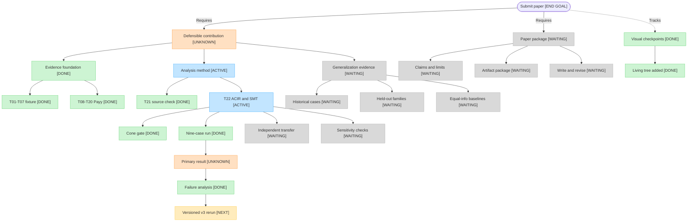

# BindCheck project checkpoints

This is the living visual index from the current research state to a paper
submission. It is a navigation aid, not an evidence source. The
[research contract](research-contract.md), [README](../README.md), and linked
task reports remain authoritative.

Status labels mean:

- `[DONE]` — the bounded task is complete at its stated evidence level;
- `[ACTIVE]` — work is underway;
- `[NEXT]` — the immediate gate;
- `[WAITING]` — depends on earlier work; and
- `[UNKNOWN]` — the research verdict is not established.

## Immediate path

1. Done: the running-flag false positive and both `UNKNOWN` classes are explained in [T22 Section 3.2](../reports/T22.md).
2. Freeze the T22-v3 encoding (repairs R1–R6) and its solver mode before inspecting any output, then rerun the same nine cases under a new run ID.
3. Run the independent transfer case only after the primary controls are acceptable, without tuning on its result.
4. Complete sensitivity checks and equal-information baselines.
5. Decide whether the evidence supports a defensible contribution and, if so, assemble the submission package.

The end goal does not imply that submission is currently justified. The
research contract's two principal properties remain unchanged, and T22 has no
completed verdict yet.

## Checkpoint log

| Date | Checkpoint | Status | Evidence and meaning |
| --- | --- | --- | --- |
| 2026-10-20 | T22-v2 single-case feasibility gate | `[DONE]` | [T22](../reports/T22.md): the known vulnerable Payy case produced a counterexample in 4.1 seconds after exact specialization reduced the probe from 587 opcodes and 523 witnesses to 0 opcodes and 1 witness. This is not the nine-case result. |
| 2026-10-20 | Living project checkpoint tree | `[DONE]` | This page and the corresponding `AGENTS.md` update establish the visual checkpoint routine. No research verdict changed. |
| 2026-10-20 | T22-v2 frozen nine-case primary run | `[DONE]` | [T22](../reports/T22.md): 2/9 outcomes matched, 6 were `UNKNOWN`, and the running-flag negative control returned a likely spurious `VIOLATION`. The evaluation task completed, but the T22 result remains `[UNKNOWN]`. |
| 2026-10-20 | T22-v2 failure diagnosis | `[DONE]` | [T22 Section 3.2](../reports/T22.md); raw evidence in ignored `results/raw/T22/32_v2_diagnosis/`. The running-flag `VIOLATION` is a confirmed analyzer false positive: the specialization drops the implied goal constraint, and original-ACIR subset certificates are UNSAT for all eight slots. Timeouts trace to the cvc5 `gb` mode, missing re-componentization and slot scheduling; the general queries remain unresolved. The `agg_utxo` contradiction is genuine but was handled as unsupported. No verdict changed; the primary result stays `[UNKNOWN]`. |
| 2026-10-20 | T22-v2 diagnosis correction and reproduction addendum | `[DONE]` | [T22 Section 3.2](../reports/T22.md), post-review corrections. Correction to the previous row: the `agg_utxo` contradiction rules out only the all-streams-inactive premise; it does not show that an empty prefix is impossible. The R3 wording was narrowed to match. An exact-command addendum (`11_commands_addendum.txt`) and three reproduction scripts were added; the original raw records are unchanged. No verdict or tree node changed; the v3 rerun remains `[NEXT]`. |

## Update rule

For every bounded task that changes project state, update the relevant node and
append one row above. Link to the report or evidence that supports the status.
Never remove an old row; corrections should be new rows that identify what
changed. Pure discussion or status checks do not create project checkpoints.
